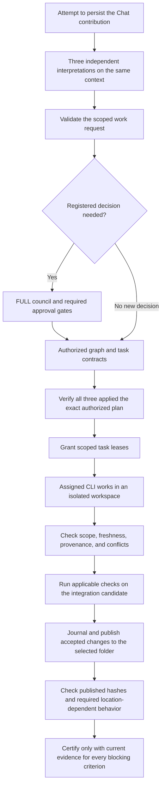

# Mayasaba

**One controller-owned project reality, three separate agent sessions.**

Mayasaba is a native Windows desktop control plane for **Hermes Agent CLI**, **Kilo Code CLI**, and **Claude Code CLI**. You open a local folder and describe your work in Chat. The specified system coordinates the required agents, confines their work to authorized workspaces, and publishes accepted results into that same folder only after the applicable checks pass.

**English only:** Mayasaba's interface, accessibility text, agent-authored workflow content and replies, and generated deliverables use English. There is no localization or language selector. Authorized non-English source material may be read, but Mayasaba does not reproduce its raw text in generated presentation or deliverables.

A non-English agent reply is never shown, including during streaming or in **Show details**. The affected turn shows an English blocker and controlled recovery; Mayasaba neither substitutes a translation nor presents the other agents as a complete reply.

The agents provide intelligence. Mayasaba owns **state, authority, safety, orchestration, verification, and proof**.

> **Project status: specification and architecture stage.** This repository contains the specification documents and a standalone Chat layout preview. The HTML preview demonstrates placement with sample data; it is not the native application. Application source code, machine-readable contracts, build targets, tests, and an MSI installer are not present. The behavior below describes the product specification, not a released or verified application.

## Contents

- [What Mayasaba is for](#what-mayasaba-is-for)
- [Read the project documents](#read-the-project-documents)
- [The intended Chat experience](#the-intended-chat-experience)
- [Which agents do what](#which-agents-do-what)
- [From a request to verified files](#from-a-request-to-verified-files)
- [How the FULL council works](#how-the-full-council-works)
- [Architecture and ownership](#architecture-and-ownership)
- [Safety, privacy, and recovery](#safety-privacy-and-recovery)
- [What counts as complete](#what-counts-as-complete)
- [Technology and development requirements](#technology-and-development-requirements)
- [Proposed source layout](#proposed-source-layout)
- [Required proof and next milestones](#required-proof-and-next-milestones)
- [Contributing](#contributing)
- [License](#license)

## What Mayasaba is for

Mayasaba is designed for software work and other authorized local-file tasks: implementing features, fixing bugs, refactoring, preparing documents and research reports, and cleaning up data. Each task uses the lifecycle stages and acceptance checks that fit its result. A report needs checks for its content and sources; it does not need a software build gate.

The controller keeps five things distinct throughout the work:

| Concern | Source of the answer |
| --- | --- |
| What the user requested | Immutable Chat contributions and their source links |
| What is permitted | Scoped user authorization, policy, approved requirements, binding decisions, and valid task leases |
| What is planned | Controller-owned decisions, task dependencies, and scheduling |
| What an agent claims | Separately attributed proposals, responses, and reported results |
| What has been established | Current observations and evidence from checks appropriate to the requested property |

A verified fact does not grant permission. A permitted action does not make a technical claim true. Three agents agreeing, a successful build, or an agent saying “done” cannot replace verification of the requested result.

Mayasaba itself runs locally, with no hosted execution service or separate application account. **Local control does not mean every CLI runs offline:** each CLI retains its user-configured model provider, authentication, runtime, and native tools, and may contact its provider or authorized research services. Mayasaba adds no model, model picker, cloud IDE, agent marketplace, or embedded browser interface.

## Read the project documents

The repository is organized around the specification. Start with this README for orientation, then read the documents relevant to the work.

| Document | Read it for |
| --- | --- |
| [Complete system description](./docs/Mayasaba%20%E2%80%94%20Complete%20System%20Description%20%28for%20AI%20agents%29.md) | The authoritative product definition: lifecycle, ownership, council rules, agent controls, contracts, and verification |
| [Architecture](./docs/ARCHITECTURE.md) | Service boundaries, communication, execution, storage, integration, and required proof |
| [UI and UX](./docs/UI-UX.md) | The native Chat experience, accessibility, attachments, details sheets, and desktop acceptance scenarios |
| [Three-screen interface preview](./docs/CHAT-INTERFACE-PREVIEW.html) | A standalone sample of welcome, Open Folder, and Chat; Send moves the one composer from the center to the bottom; no message is sent or saved |
| [User-visible screen diagrams](./docs/USER-VISIBLE-SCREENS.md) | One Markdown reference for the full Welcome → Open Folder → Chat journey and the important Chat states through delivery and recovery |
| [Agent instructions](./AGENTS.md) | Repository working rules, scope, development workflow, validation, and prohibited shortcuts |
| [README](./README.md) | The project overview and entry point you are reading |
| [Implementation-readiness audit](./docs/IMPLEMENTATION-READINESS-AUDIT.md) | The open documentation decisions and contract gaps tracked against the current documents |

**Repository guidance precedence:** the user's current explicit instruction, then the complete system description, then `AGENTS.md`, then the derived architecture/UI guides, then existing code, tests, schemas, and comments. This README summarizes the specification; it does not replace it. Record and resolve conflicts explicitly.

## The intended Chat experience

**Chat is the only persistent workspace and top-level route.** The Control Room uses native WinUI 3 controls, XAML, and C++/WinRT.

1. **Open the app.** A project root is required before Chat opens, and CLI readiness never gates it. On a first run with no bound project, the dismissible **first-run onboarding** sequence runs until a folder is bound: **screen 1** explains what Mayasaba is and reminds you that the three CLIs are installed, authenticated and updated by you — Mayasaba never installs, updates or reconfigures one, in the selected folder or anywhere else — **screen 2** opens the project folder, and Chat opens as soon as a folder is bound. **Next** advances from welcome to open folder, **Back** returns to welcome, binding opens Chat immediately without a second Next action, and **Skip** or Escape skip only the explanation to the mandatory folder step — there is no route to Chat without a project root. Once bound, every later launch opens directly at Chat, with each CLI's observed readiness shown in the compact header indicator as soon as it is known.
2. **Open a folder.** The first binding happens on onboarding screen 2 through the native Windows directory picker. Chat (screen 3) shows the active project in its header and has no folder control, visible or hidden. Folder selection is separate from **Attach files**. It creates no working agent session, repository scan, Git repository, CLI installation, or task approval, and consumes no model-provider usage. Project switching remains required, but its user entry point outside Chat still needs a design decision.
3. **Keep chatting.** Drafting is available on the open-folder screen and is never a submission before a root is bound. An unsent draft is restored locally under its originating project after restart, never automatically submitted. For an open bound project, each Send follows `SubmitUserContribution`, retains one submission identity and attempts to persist exactly one immutable `UserContribution`, regardless of CLI readiness. Selected attachments must finish bounded byte verification; none is silently omitted. The sole exception is a closed project: it stays readable, but a new submission requires explicit `Reopen Project` authorization. If persistence fails or is uncertain, the message is never shown as saved or answered: the draft is preserved, the precise reason is displayed, and recovery uses the same idempotency identity so no duplicate is created. First and later messages use the same composer.
   In an empty bound project's Chat, that composer is centered. Once the first user message is confirmed saved, the same composer moves to the bottom and later messages build a chronological conversation above it. A restored conversation opens with the composer at the bottom; a failed first Send retains the centered draft and does not pretend the message was saved.
4. **See what needs attention.** Concise controller cards show material progress, questions, decisions, blockers, changed files, validation, and delivery. **Show details** expands a card or opens a temporary sheet; closing it restores Chat focus and reading position.
5. **Stay in control.** After opening the folder, Mayasaba refreshes detection of Hermes Agent CLI, Kilo Code CLI and Claude Code CLI and shows each observed readiness in Chat. Screen 3 has visible **Start**, **Pause**, and **Stop**. Start initializes all three project sessions and shows each actual startup outcome; Stop acts immediately and prevents a silent restart until Start is selected again. Detection alone starts no working session. A blocked operation leaves unrelated Chat available. A saved message is not shown as answered, authorized, or executed without the corresponding observed outcome.

**Everything starts in the same Chat.** There is no separate project brief, goal document, or stored intent summary. Current scope is derived from approved requirements and binding decisions, linked back to the original messages and approvals. Proposed changes remain pending until authorized, and an exploratory project needs no approved build goal to keep chatting or request authorized file inspection.

The compact Chat header permanently carries a small status indicator with exactly one entry per required CLI — Hermes Agent CLI, Kilo Code CLI, Claude Code CLI — showing the CLI name, its current observed readiness (`CHECKING`, `READY`, `MISSING`, `UNSUPPORTED`, `PROBE_FAILED`) and a colored dot. It is a truthful read-only projection: never fabricated, averaged, hidden, percentage-bearing or color-only (name + status text + accessible name), and never a gate on Chat, Open Folder, Send after binding, drafts, history, recovery or project switching. Missing, unsupported or probe-failed CLIs additionally receive inline problem cards with the exact cause, operation impact, **Locate executable** and **Recheck**; a healthy CLI generates no problem card and no setup banner. Council, tasks, requirements, files, evidence, delivery, and diagnostics appear through contextual Chat details rather than standalone pages or persistent navigation.

Attachments have separate preparation, persistence, and context-inclusion states. A file appearing in Chat does not imply every agent read it. The UI follows the current Windows light/dark app setting, updates when it changes, and lets high contrast override both palettes. It must preserve drafts, keyboard navigation, screen-reader semantics, DPI scaling, reduced motion, and the user's reading position during streaming and theme changes.

## Which agents do what

The three supported CLIs are **Hermes Agent CLI**, **Kilo Code CLI**, and **Claude Code CLI**. Each has its own adapter and session. The user installs, authenticates, configures, and updates them externally. Mayasaba must preserve their existing model/provider selections, credentials, and update settings.

| Operation | Required participation |
| --- | --- |
| Opening Chat, binding a folder, restoring history, or persisting a message | No working agent session required |
| Every reply-eligible Chat message, including greetings and semantic interpretation | All three independently respond; one rotating CLI writes the combined reply and both peers review it. A control-only contribution follows the immediate-control exception and creates no turn. |
| A registered FULL council decision point | All three agents, including all six directed peer critiques |
| Whole-repository exploration | All three agents independently inspecting the authorized read-only scope |
| Three-agent research | All three agents using their own admitted native search and fetch/extract tools |
| An individual implementation or repair task | The agent assigned through that task's current scoped lease |

Mayasaba's **Start** control explicitly initializes all three project-scoped CLI sessions. Before Start, Send can still save a contribution, but its agent-dependent reply waits. After Start, the controller supervises necessary headless processes for authorized work; an explicit Stop holds those sessions until a later Start. The user does not manage three terminal windows. Compatibility comes from **bounded behavioral, capability, and enforcement probes**, never release-number comparisons or a version allow-list. Missing capabilities block the affected operation with a recorded reason. An all-three workflow cannot quietly become a two-agent workflow.

All three CLIs independently propose source-linked `InterpretationCandidate` records when a Chat turn needs semantic interpretation. The Work-request authority service checks each candidate against the actual contribution and current authority. Confidence, inferred intent, or classifier output cannot approve a material action.

**One reply-eligible Chat message, three contributors, one reply.** Even “Hi” goes to all three CLIs against the same authorized context. After their independent responses, Mayasaba assigns a rotating CLI writer to draft one combined answer, cycling **Hermes → Kilo Code → Claude Code** by project-local turn ordinal — so the first reply-eligible turn in a project is written by Hermes, even if a control-only contribution preceded it. Both other CLIs review the exact final text. The controller validates participation, references, policy and freshness, then displays one consolidated reply with **Show details** for attribution and disagreements. The CLIs do the language work; Mayasaba adds no AI model or provider-settings page. Peer review does not certify factual claims or authorize actions.

A missing CLI or review leaves the persisted turn waiting, and a turn that cannot complete within its declared finite time and byte bounds reaches a recorded blocked status with a precise reason and a controlled, resumable recovery path — never a reduced-participant answer and never an indefinite spin. Explicit Pause/Stop controls act immediately without waiting for discussion or contribution persistence. A control-only Chat message still attempts to persist one contribution, creates no turn and consumes no writer ordinal; failed or uncertain persistence cannot notify a CLI. A greeting starts no repository scan, research or file changes. Consolidation runs inside recorded finite time and byte bounds — provider token, cost and usage budgets remain yours, since you own each CLI's model, provider and account — with at most one draft revision by default; it is not a reduced council mode. See the [complete Chat workflow](./docs/Mayasaba%20%E2%80%94%20Complete%20System%20Description%20%28for%20AI%20agents%29.md#three-agent-chat-and-one-consolidated-reply).

## From a request to verified files

For **“Build a native Windows task manager app”**, the required sequence is:

1. Send the request and the same authorized context to all three CLIs.
2. Collect each agent's independent proposed requirements, questions and plan. Clarify material ambiguity, such as a to-do app versus a process-monitoring utility, in Chat.
3. Route their proposals, all six directed peer critiques, rebuttals and revisions through Mayasaba.
4. Complete the registered FULL councils for material product, architecture and plan choices; bring necessary questions or approvals back to the user. Existing services record approved requirements, binding decisions and the authorized task graph.
5. Synchronize that exact plan/context to all three sessions and verify application-level results. A delivery ACK is insufficient.
6. Grant scoped leases, assign individual tasks, coordinate isolated background work, verify it and integrate accepted results into the selected folder.

All three share the reviewed plan; each implements its assigned tasks. They communicate through Mayasaba, and the user stays in one Chat. The [canonical six-step contract](./docs/Mayasaba%20%E2%80%94%20Complete%20System%20Description%20%28for%20AI%20agents%29.md#engineering-request-six-step-contract) defines ownership, synchronization and recovery. A new app cannot skip its material FULL decisions using the “No new decision” branch. Mayasaba's own UI stack does not silently dictate the generated app's technology.

Conversational finalization is separate from work authorization: planning need not wait for an extra finalized Chat answer. One reviewed primary reply can summarize the plan, while linked question, progress and delivery cards continue throughout the work. Missing required council contributions or plan-application results block dependent work; a missing conversational review alone blocks its reply. Changed plans and replaced sessions require current synchronization before affected work resumes.

The specified file-change path is:



Arrows represent the eligible success path. Missing authority, failed checks, stale context, conflicts, or unknown outcomes stop the affected transition and enter the appropriate clarification, repair, or recovery path. An unknown physical outcome is never blindly retried, rolled back or certified: it is reconciled within bounds and, when no safe path exists, ends blocked with its outcome explicitly unresolved and a precise reason while unrelated authorized work continues.

Each `TaskContract` binds the work to its originating request, project, epoch, snapshot, approved scope, dependencies, allowed reads/writes, tools, time and resource bounds, expected artifacts, and acceptance criteria. Tasks retain their identity across retries; each execution is a separate attempt with a fenced lease and an attributed evidence bundle.

Agents work in isolated Git worktrees for compatible existing repositories, or controlled staged copies for other folders. The controller validates an integration candidate before publishing through a durable journal. Final checks bind the result to the actual published files. Opening an empty or non-Git folder never silently initializes Git.

The software lifecycle covers discovery, independent proposals, critique and revision, user clarification where needed, design and architecture, task planning, implementation, integration, build/test/E2E checks, cross-agent review, bounded repair, final validation, and packaging. The [architecture guide](./docs/ARCHITECTURE.md#project-lifecycle) lists the exact phases. `PAUSED`, `STOPPED`, `BLOCKED`, and `RECOVERING` are operational conditions rather than additional phases. **Project closure is a separate, explicit durable action** — recorded by Project service only after safe quiescence, never implied by switching folders, inactivity, application exit, or lifecycle `COMPLETE` — and the optional retention clock for a closed project starts no earlier than both that closure commit and your explicit opt-in. Reopening restores the same project identity and truthfully discloses any history already lawfully retired.

New requirements remain ordinary Chat contributions. A material scope change follows the pending-change, FULL-council, and relevant approval gates before the owning services commit new requirements and a successor project epoch. Affected work is invalidated or replanned; historical records and unaffected work remain intact.

## How the FULL council works

**FULL is the only council mode.** A registered decision point is a scoped question that needs a recorded choice. Ordinary conversation and routine task assignment do not automatically open a council.

For each decision point, the controller requires:

1. A synchronized current context and participation from all three agents.
2. Independent initial proposals before any agent sees a peer's proposal, followed by a frozen proposal set.
3. **Six actual directed cross-critiques:** each agent critiques both peers and never itself.
4. Rebuttals and optional revisions with immutable predecessor links.
5. Evidence grading, common evaluation criteria, and preservation of material disagreements.
6. A pre-proposal, content-independent rotating chair/duty assignment, **both** non-chair agents' reviews of the exact synthesis revision, and a controller coverage check. The binding index is `i = (d + r - 1) mod 3`, using a durable zero-based **project-local** decision-point ordinal `d`, one-based round `r`, and Hermes → Kilo Code → Claude Code order; chair/proposer is `i`, skeptic `(i + 1) mod 3`, verifier `(i + 2) mod 3`.
7. Controller and Decision-service gates before a resolution becomes a binding decision.

Each project starts its own `d` sequence at 0; another project's council points cannot affect its role rotation. The Council Engine allocates ordinals atomically within the project, and restart, replay or reopening preserves an existing point's ordinal.

The default **five-round cap applies to the whole decision point**. User answers and context changes do not reset it. Later rounds on the same baseline require explicit reaffirmation or revision; a material context change requires fresh independent proposals.

`converged` requires two consecutive comparable completed FULL rounds with identical normalized surviving positions and all positive gates satisfied. An evidence-backed, fully reviewed synthesis may resolve the point earlier as `synthesized`. Other reported outcomes are `cap reached`, `escalated` for a user choice, and `sealed with an open question` for missing facts or clarification. `CONTINUE` is an internal transition and grants no approval.

Missing mandatory council participation keeps a round incomplete, even when a time or round limit expires. The authoritative D-03 table fixes the outcome order: authorized Pause/Stop, invalid authority/safety, missing participation, completed-round missing user fact, user choice, insufficient evidence, eligible synthesis, eligible two-round convergence, completed unresolved cap, then eligible `CONTINUE` or block. No timeout or silence grants approval.

An absent agent or critique cannot count as participation. Silence, a transport acknowledgement, a majority, and stable agreement cannot substitute for authority or factual evidence. The Council Engine owns deliberation; **the Decision service owns binding decisions and locks**.

## Architecture and ownership

Mayasaba has **thirteen functional layers**. Lower layers must not depend on higher ones, and every authoritative record has one canonical owner.

| # | Layer | Responsibility |
| --- | --- | --- |
| 1 | Control Room UI | Render Chat and immutable projections through typed commands and queries |
| 2 | Controller Application Services, including the Orchestrator | Own domain records; coordinate phase transitions, scheduling, barriers, and gates |
| 3 | MCF-v2 Communication Fabric | Persist and route typed traffic; acknowledge, retry, deduplicate, dead-letter, and replay |
| 4 | Agent Gateway / Adapters | Discover and probe each CLI; manage sessions and translate native traffic |
| 5 | Council Engine | Own decision points, provisional positions, critiques, rounds, and syntheses |
| 6 | Context Synchronizer | Build immutable snapshots, context versions, and digests; reject stale context |
| 7 | Task/DAG Engine | Own task graphs, attempts, leases, and fencing versions |
| 8 | Workspace Manager | Own repository manifests, authorized views, isolated staging, integration, and publication journals |
| 9 | Local Execution Kernel | Launch, supervise, cancel, and observe controller-issued processes |
| 10 | Validation / Repair Engine | Evaluate criteria, diagnose failures, and manage bounded repair |
| 11 | Evidence Engine | Preserve artifacts, hashes, source citations, and provenance |
| 12 | Policy Engine | Authorize material actions and record denial reasons |
| 13 | SQLite Storage | Execute SQL and persist owner-authorized transactions through a serialized write path |

Within layer 2, **Project service** owns project identity, folder binding, and the project epoch; **Requirement service** owns requirements and approvals; **Message/Contribution service** owns immutable user contributions and the linked conversational response/review records; **Work-request authority service** owns request routing and authorization; and **Decision service** owns binding decisions. The **Orchestrator** coordinates these owners without mutating their records. SQLite persists their transactions and cannot originate authority.

The UI has a separate typed application command/query boundary. It cannot issue SQL, launch processes, talk directly to agents, schedule their work, or certify results. CLI-native formats stay inside the adapters. MCF-v2 carries agent traffic and bus-routed asynchronous events; its at-least-once delivery requires durable inbox/outbox records and project-plus-operation idempotency. An ACK means receipt and persistence only.

There are **exactly twelve authoritative state machines**:

| # | State machine | # | State machine |
| --- | --- | --- | --- |
| 1 | Project lifecycle | 7 | Council round |
| 2 | Agent session | 8 | Synchronization barrier |
| 3 | Message delivery | 9 | Handoff |
| 4 | Context | 10 | Execution |
| 5 | Task | 11 | Validation |
| 6 | Lease | 12 | Repair |

Readiness, request routing, exploration, research, and decision validity are projections or workflows over these machines. They introduce no additional state owner or authoritative state machine.

Handoff #9 means replacing a project-scoped CLI session under an Orchestrator-owned scheduling hold. The source must be fenced and its attributable effects resolved, and the distinct successor must prove current context/plan application before dependent work resumes. It does not move an old lease or replace the Agent Session or Synchronization Barrier machines. The [authoritative transition table](./docs/Mayasaba%20%E2%80%94%20Complete%20System%20Description%20%28for%20AI%20agents%29.md#handoff-machine-9-replacement-of-a-project-scoped-cli-session) states the failure and recovery path.

## Safety, privacy, and recovery

- **Scoped filesystem access.** The selected Windows folder is the canonical project root and final destination. Validate path identity, permissions, aliases, junctions, reparse points, and changes between checking a path and using it. Access to a folder or attachment never implies access to its neighbors.
- **Enforcement before effects.** A lease, a working directory, a permission file, or a prompt is not a sandbox. Admit an execution profile only when material effects are mediated before execution or independently confined by a tested effective boundary, including stale-write rejection and revocation.
- **Supervised process trees.** The Execution Kernel creates controlled children suspended, assigns them to controller-owned Job Objects, then resumes them. Job Objects provide lifecycle control and cleanup; they do not alone enforce filesystem or network restrictions. Launching a parent CLI does not prove its internal tools were kernel-mediated.
- **Protected CLI configuration.** Necessary reads of existing runtime settings or authentication outside the project are narrowly verified exceptions. They cannot expose credentials to task tools, prompts, logs, ordinary state, or evidence, or alter the user's model/provider selection.
- **Bounded research and honest coverage.** Authorized research uses the CLIs' admitted native read-only web tools. Repository exploration separately tracks inventory, actual content inspection, analysis, exclusions, and stale or unreadable files. Neither repeated claims nor a list of filenames proves full coverage.
- **Recoverable publication.** Durable journals, guarded file mutations, and post-publication checks protect integration into the selected folder. Multi-file publication is not automatically atomic. Recovery must preserve newer user edits and report unresolved conflicts.
- **Durable, verifiable state.** SQLite is the sole authoritative state store. Managed attachment/evidence bytes outside it require database-linked identity, provenance, and digest checks. Missing or mismatched bytes are integrity failures. Historical records are superseded explicitly.
- **Bounded but never silent.** Authoritative history is preserved by default; automatic expiration requires an explicit per-project opt-in and always discloses exactly what was removed. Reclaimable operational data — logs, diagnostics, temporary staging, caches, unreferenced blobs — is collected on declared, crash-safe schedules, never on age alone. Storage pressure reclaims disposable data first, then fails closed with a precise storage blocker in Chat. A failed persist is never shown as saved.

Repository files, attachments, and web content are untrusted input. They cannot become controller instructions. Mayasaba must deny unrelated external effects such as messaging, account changes, website publishing, purchases, arbitrary network commands, and agent-invoked plugin installation. Private chain of thought and credentials never appear in Chat.

## What counts as complete

Every task or deliverable requires an `AcceptanceEvidenceMatrix`. Each criterion names the expected property, its source requirement, the applicable environment and artifact hashes, a check or review procedure, evidence, and whether it blocks completion. Two individually valid criteria that cannot both be satisfied are detected before execution and on material change as an `AcceptanceConflictAssessment`; the conflict blocks completion certification of only the affected work until the owning requirement and decision services resolve it through the existing authority gates. No agent or validator may resolve it by weakening, re-scoping, or self-declaring either criterion satisfied.

| Result | Meaning |
| --- | --- |
| `PASS` | An adequate check established the expected property against the current artifacts, with preserved evidence |
| `FAIL` | A valid check observed that the expectation was not met |
| `INCONCLUSIVE` | Evidence or the check's coverage was insufficient to determine the result |
| `BLOCKED` | The check could not run with the required authority, dependencies, or safety |
| `NOT_APPLICABLE` | A verified task-specific justification establishes that the criterion does not apply |

**All applicable blocking criteria must be `PASS`, or validly `NOT_APPLICABLE`.** An aggregate score cannot hide a blocking failure, uncertainty, or unavailable check.

Before accepting a pass, the controller checks whether the oracle actually measures the criterion. Compilation, process launch, runtime behavior, accessibility, and final certification remain separate results. An agent-authored test needs its own relevance and assertion review. Evidence links to exact artifacts, workspace, environment, check identity/version, time, and provenance.

Failures are classified before repair. Each repair needs a falsifiable hypothesis, bounded scope, a rerun of the affected check, and relevant regressions. Repeating an identical failed strategy without new evidence is not progress.

## Technology and development requirements

These are specification choices and candidates, not a claim that the dependencies are installed or an implementation has been built.

| Area | Required foundation or candidate |
| --- | --- |
| Language and core | C++20; deterministic core independent of WinUI |
| Native interface | WinUI 3, XAML, C++/WinRT, Windows App SDK |
| Platform and ownership | Win32, Windows Runtime, RAII, standard C++ ownership types, Microsoft WIL |
| Build | MSVC, Windows SDK, MSBuild for WinUI; CMake and CTest for the core |
| Core tests | GoogleTest/GoogleMock candidate; pin and validate before use |
| Contract decoding | `nlohmann/json` and `pboettch/json-schema-validator` candidates; declare and test the schema dialect |
| Persistence | Embedded SQLite C API with one serialized writer; durability settings require local proof |
| Integrity | Windows CNG SHA-256 and an explicitly tested canonical byte profile |
| Processes | Controlled `CreateProcessW`, redirected streams, Job Objects, asynchronous I/O where supported |
| Workspaces | Git worktrees for compatible repositories or controller-owned staging; effective confinement must be proven |
| Desktop checks | Windows UI Automation, accessibility, responsiveness, and fault-injection checks |
| Distribution | Mandatory WiX-authored MSI; proposed unpackaged, self-contained Windows App SDK payload requires a packaging prototype |
| Initial support matrix | Windows 11 version 25H2 (build 26200), native x64 Home/Pro/Education/Enterprise outside S mode; release proof required |

Build and validate the product **locally on Windows**. There is no hosted CI or cloud runner. A Linux-only result cannot satisfy a Windows acceptance gate. Keep blocking I/O and agent activity off the UI thread; use bounded queues, cancellation, explicit boundary errors, and reproducible recovery.

There are **no runnable build or installation instructions yet** because this checkout has no application or build definitions. The initial Windows release and architecture target is selected above; exact dependency revisions, licenses, hashes and toolchain versions, plus actual install/CLI/containment proof on that target, remain required before relying on it. Other Windows releases and architectures require an explicit support-matrix amendment and their own proof. A candidate in the specification is not authorization to download or install it.

The intended build setup uses pinned NuGet packages for Windows App SDK, C++/WinRT, and WIL, plus an offline-restorable native dependency manifest recording revisions, licenses, and hashes. A pinned vcpkg baseline or pinned vendored sources are possible delivery approaches. Record the MSVC runtime configuration with the toolchain. The installer toolchain is WiX v4 or later, with the exact revision to be pinned and verified. Local verification also covers static analysis, supported AddressSanitizer targets, parser fuzzing, and process/storage/publication fault injection.

## Proposed source layout

Only the documents, license, and Git ignore file exist today. The following implementation layout is a boundary proposal from the architecture guide, not a set of existing build targets:

```text
/
  app/                 # WinUI entry point, XAML, view models, UI composition
  core/
    application/       # Layer 2 services and typed command/query contracts
    protocol/          # MCF-v2 envelopes, registries, codecs
    council/           # FULL council domain logic
    context/           # snapshots, manifest-derived indexes, invalidation
    tasks/             # DAG, attempts, leases, scheduling
    workspace/         # roots, manifests, views, integration, publication journal
    execution/         # Win32 process supervision
    validation/        # acceptance matrices, diagnostics, repair
    evidence/          # provenance and artifact evidence
    policy/            # authorization and denials
    storage/           # SQLite implementation and migrations
  adapters/
    hermes/  kilo/  claude/
  contracts/           # versioned schemas, registries, canonical test vectors
  tests/
    unit/  integration/  contract/  fault/  ui/
  installer/           # WiX MSI sources and packaging verification
  docs/                # existing specification, architecture, and UI/UX guides
```

Final directory names may change, but the selected structure must make forbidden dependencies testable. Creating empty directories alone does not implement these boundaries.

## Required proof and next milestones

The [implementation-readiness ambiguity audit](./docs/IMPLEMENTATION-READINESS-AUDIT.md) records the decisions and exact contract definitions still missing from these documents. The repository remains in the documentation stage; an AI implementation agent must not choose unresolved behavior on its own. Local Windows proof of CLI behavior, containment, UI, and deployment is a later, separate acceptance gate.

Before implementation relies on the design, three bounded prototypes must produce local Windows evidence:

| Prototype | Required demonstration |
| --- | --- |
| Responsive Control Room | Native Chat remains responsive under sustained CLI/event streaming |
| Owned process tree | Controlled launch, stream handling, cancellation, and crash cleanup work across the child process tree |
| Enforceable workspace access | Each admitted CLI execution profile rejects unauthorized access and stale writes through verified mediation or compatible OS containment |

**These proof gates are not yet evidenced in this repository.** A successful build or an opened window would not satisfy them.

The specification also requires an end-to-end slice: persist one Chat request, authorize scoped work, observe a real change by an assigned CLI in isolation, validate it, journal publication into the original folder, and show current criterion-linked evidence. An injected failure must demonstrate honest repair or recovery. Any registered decision encountered on that path still requires the FULL council.

Release work additionally needs contract and parser checks, persistence and publication recovery, per-CLI containment evidence, desktop accessibility, and MSI install/launch/repair/upgrade/uninstall verification on a declared support matrix. These are required milestones without a promised delivery date.

## Contributing

Read the [complete system description](./docs/Mayasaba%20%E2%80%94%20Complete%20System%20Description%20%28for%20AI%20agents%29.md) and [AGENTS.md](./AGENTS.md) before changing the repository. Read [UI-UX.md](./docs/UI-UX.md) for user-facing work and [ARCHITECTURE.md](./docs/ARCHITECTURE.md) for implementation boundaries.

1. Identify the requirement, owning service/layer, affected paths and contracts, acceptance criteria, and validation method before editing.
2. Inspect the current repository and Windows toolchain. Keep implementation in authorized isolated worktrees or staged copies, and prefer a small working vertical slice over placeholder scaffolding.
3. Preserve the native stack, thirteen layers, twelve authoritative state machines, exactly three CLIs, and single-owner boundaries. Material replacements or weaker safety boundaries require an explicit architectural change.
4. Review the diff, run the relevant checks, and record exact outcomes and limitations in an acceptance matrix or implementation-stage equivalent. Never mark an unexecuted check as passed.
5. Report changed files, verified behavior, unavailable checks, remaining proof obligations, and the next coherent milestone. Commit, push, or publish only when the user explicitly requests it.

## License

Licensed under the [MIT License](./LICENSE). Copyright (c) 2026 Pavan.
