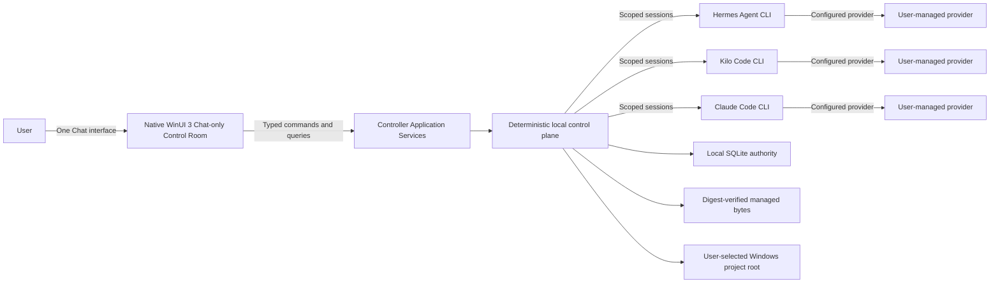
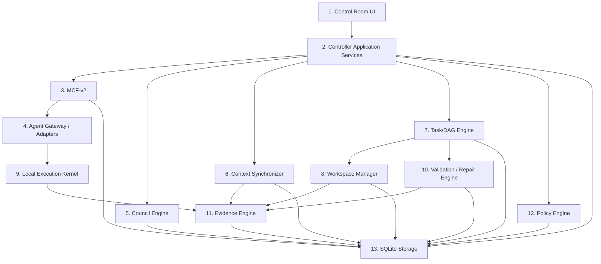
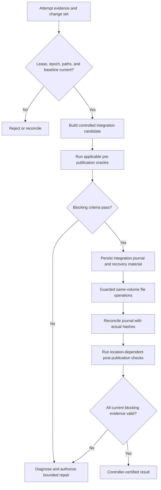

# Mayasaba Architecture

## Document status

This document is an implementation-facing architectural reference derived from [Mayasaba — Complete System Description (for AI agents).md](./Mayasaba%20%E2%80%94%20Complete%20System%20Description%20%28for%20AI%20agents%29.md). The complete system description remains authoritative. If the two conflict, follow the complete system description and correct this document through an explicit architectural change.

The architecture combines fixed decisions, candidate implementation details that must be pinned before build, and enforcement claims that require local Windows proof. A candidate or `PROOF REQUIRED` item is not a validated capability.

## 1. Architectural intent

Mayasaba is a local, deterministic Windows control plane for three independent coding agents. It converts a user's Chat contribution into authorized, scoped, evidence-backed work and publishes accepted results into the same Windows folder the user opened.

The system deliberately separates:

- what the user authorized;
- what the controller decided and scheduled;
- what an agent proposed or reported;
- what the local machine actually did; and
- what current evidence proves.

Agents provide reasoning and implementation proposals. They do not own project truth, permissions, state transitions, or completion.

The same control plane may execute software engineering, document, research, data, and refactoring work. Lifecycle stages and validation oracles are task-applicable: non-software work is not forced through meaningless build or runtime gates.

English is the sole Mayasaba product language. The UI and installer-owned text, accessibility output, agent-authored workflow content and replies, and published deliverables use English; no locale-dependent alternate presentation or localization system is admitted. The authorized source/evidence path may retain and read non-English material, but the presentation boundary must not reproduce its raw text in Mayasaba-generated output. English-only output is an acceptance condition before display or publication, without introducing a new model, owner, route or state machine. Exact verification and failure contracts remain part of the implementation-readiness work.

The agent-stream presentation boundary withholds unverified text. A non-English reply from any required CLI cannot reach provisional Chat, Show details, notifications, accessibility output or history; the existing turn outcome reports an English blocker and controlled recovery without a translated substitute or reduced-participant reply. Diagnostic/evidence retention never makes raw traffic user-facing.

The WinUI presentation layer follows the current Windows light/dark app setting at launch and reacts while open. High contrast overrides both standard palettes. The theme is UI presentation state, not a controller state transition; switching it cannot discard a draft, change the selected project, reset the timeline, move focus unexpectedly or affect authorization. The native shell, cards and details surfaces must remain readable in either mode.

### System context



The provider connections belong to the external CLIs. Mayasaba does not choose models, manage provider credentials, or run its own inference service.

## 2. Architectural invariants

The following are system invariants rather than implementation preferences:

1. **Windows only and fully native.** C++20 implements the controller and UI code; WinUI 3, XAML, and C++/WinRT implement the Control Room.
2. **One project reality.** The controller owns one durable, source-linked view of project identity, approved requirements, binding decisions, tasks, evidence, and state. Current scope is derived from approved requirements and binding decisions with source contribution/approval links, without a separate stored summary.
3. **Three isolated agents.** Hermes, Kilo Code, and Claude Code retain distinct sessions, configurations, providers, tools, and reasoning.
4. **Exactly thirteen functional layers.** New implementation components must fit a declared layer without creating another authority plane.
5. **Exactly twelve authoritative state machines.** Other workflows are projections over them.
6. **One owner per durable record.** Coordination never implies co-ownership.
7. **Typed boundaries.** UI commands/queries, domain commands, MCF-v2 events, storage operations, and adapter protocols are distinct.
8. **SQLite is the only authoritative state store.** Managed artifact bytes outside SQLite are accepted only through database-linked identity, provenance, and digest verification.
9. **The selected folder is the canonical project root.** Agent workspaces are isolated views derived from that root; accepted results return to it through controlled publication.
10. **Authority and factual evidence are independent.** Neither can substitute for the other.
11. **Unknown fails closed.** Unobserved, stale, or inconclusive state cannot satisfy a positive gate.
12. **Completion is controller-certified.** Agent statements, ACKs, exit code zero, compilation, and process launch are not completion.
13. **Chat is the only persistent user-facing route.** Council, requirements, decisions, tasks, files/evidence, validation/repair, delivery and diagnostics are background projections surfaced only as contextual timeline cards, expanded inline details or temporary dismissible sheets over Chat.

## 3. Functional layers

Dependencies flow through declared interfaces. Lower layers do not depend on higher layers, and CLI-native protocols never escape their adapter.

| # | Layer | Responsibility | Must not do |
| --- | --- | --- | --- |
| 1 | Control Room UI | Render one persistent Chat timeline, contextual projection cards and temporary details sheets; collect folder, attachment, control and decision input through Chat | Add standalone project pages/navigation, write SQL, launch processes, talk directly to agents, schedule work, or certify results |
| 2 | Controller Application Services | Own domain commands and records; coordinate phases, barriers, and gates | Let the Orchestrator overwrite another service's state |
| 3 | MCF-v2 Communication Fabric | Route, persist, acknowledge, retry, deduplicate, dead-letter, and replay typed traffic | Treat delivery as authorization or task success |
| 4 | Agent Gateway / Adapters | Discover, probe, launch, stream, interrupt, and translate one CLI each | Leak native wire formats or alter model/provider settings |
| 5 | Council Engine | Run FULL deliberation, critique assignment, rounds, and synthesis checks | Persist binding decisions or use majority voting |
| 6 | Context Synchronizer | Build immutable context snapshots, versions, digests, and stale detection from Workspace Manager-owned manifests | Invent inspection coverage or authority |
| 7 | Task/DAG Engine | Own tasks, dependencies, attempts, leases, fencing, scheduling, and recovery | Treat a lease as an operating-system sandbox |
| 8 | Workspace Manager | Own repository manifests; enforce project boundaries; create isolated views; stage, reconcile, and publish changes | Let agents concurrently write the selected root |
| 9 | Local Execution Kernel | Launch and observe controller-issued processes and commands | Claim hidden CLI-internal actions were mediated without proof |
| 10 | Validation / Repair Engine | Evaluate criteria, run oracles, diagnose failures, and bound repairs | Accept self-certification or rewrite source for environment failures |
| 11 | Evidence Engine | Preserve observations, artifacts, hashes, citations, and provenance | Convert narrative, paths, or repeated claims into proof |
| 12 | Policy Engine | Authorize material actions and record denials | Infer authority from an agent, ACK, or factual observation |
| 13 | SQLite Storage | Serialize SQL, migrations, transactions, integrity, and backup | Originate domain authority or imply filesystem publication succeeded |

### Layer dependency shape



The diagram shows logical use, not permission for arbitrary cross-layer calls. Concrete interfaces must preserve ownership and dependency direction.

## 4. Canonical record ownership

Layer 2 contains several application services, but they do not co-own records.

| Record or controlled effect | Canonical owner |
| --- | --- |
| Project identity, folder binding, project epoch, `ProjectClosure` record | Project service |
| Requirements, amendments, requirement approvals | Requirement service |
| `UserContribution`, message/question/attachment links, Chat turn/response/draft/review/consolidated-reply records | Message/Contribution service |
| `WorkRequest`, routing, authorization, pending change proposal, `ResearchAssignment` authorization | Work-request authority service |
| Binding decision, lock, disposition, supersession | Decision service |
| Phase scheduling, barriers, cross-service coordination, decision triggers | Orchestrator |
| Council points, positions, critiques, rounds, syntheses | Council Engine |
| Envelopes, inbox/outbox, ACK, retry, replay | MCF-v2 Fabric |
| CLI session identity, adapter health, translated traffic | Agent Gateway |
| Snapshot, context version, digest | Context Synchronizer |
| Task graph, attempt, lease, fencing version | Task/DAG Engine |
| Repository manifest, workspace view, staging, integration, publication journal | Workspace Manager |
| Controller-issued process launch and observed result | Local Execution Kernel |
| Validation result, failure diagnostic, repair disposition | Validation/Repair Engine |
| Evidence, artifact/source hash, citation provenance | Evidence Engine |
| Material-action authorization and denial | Policy Engine |
| SQL connection, migration, serialization, persisted bytes | SQLite Storage |

SQLite persists an owner's transaction; it does not become the semantic owner. The Orchestrator coordinates owner commands; it does not write another owner's record. The Council Engine deliberates; only the Decision service can persist a binding decision after all gates pass.

## 5. Authoritative state model

Mayasaba uses twelve independent state machines:

1. project lifecycle;
2. agent session;
3. message delivery;
4. context;
5. task;
6. lease;
7. council round;
8. synchronization barrier;
9. handoff;
10. execution;
11. validation; and
12. repair.

Each transition has a registered command and event. Compare-and-swap guards protect transitions; any "equivalent" transactional guard must satisfy the declared selection contract for state-transition guards (atomic expected-version check and mutation, single-winner behavior, crash consistency, stale-write rejection). The Orchestrator reads these machines and derives overall project state; it does not flatten them into one mutable status field.

Adapter readiness values (`CHECKING`, `READY`, `MISSING`, `UNSUPPORTED`, and `PROBE_FAILED`) are projections. Request routing, repository exploration, research assignments, and decision-validity assessments are workflows or projections. None is a new authoritative state machine.

**Handoff (#9) is session replacement.** The Orchestrator durably holds dependent scheduling while a project-scoped CLI source session is fenced and its attributable effects are shown ceased or effectively revoked. Agent Gateway then identifies a distinct, probed successor for that same CLI and project; Context Synchronizer verifies current context/plan application and any affected all-three barrier; the Orchestrator releases the hold only after rechecking current authority and Task/DAG lease status. Handoff does not own session health, leases, snapshots, the project epoch, or a second synchronization barrier. Failure, uncertainty or an expired bound leaves the hold and recovery obligations recorded. The authoritative [transition table](./Mayasaba%20%E2%80%94%20Complete%20System%20Description%20%28for%20AI%20agents%29.md#handoff-machine-9-replacement-of-a-project-scoped-cli-session) controls implementation.

### Project lifecycle

The canonical software lifecycle is:

```text
PROJECT_CREATED -> DISCOVERY -> INDEPENDENT_ANALYSIS -> PROPOSALS
-> CROSS_CRITIQUE -> REBUTTAL_AND_REVISION -> DISAGREEMENT_RESOLUTION
-> USER_INTERVIEW -> PRODUCT_AND_UX_DESIGN -> TECH_STACK_DEBATE
-> ARCHITECTURE_REVIEW -> ARCHITECTURE_LOCKED -> TASK_PLANNING
-> IMPLEMENTATION -> INTEGRATION -> BUILD -> TEST -> E2E
-> CROSS_AGENT_REVIEW -> REPAIR (when required) -> FINAL_VALIDATION
-> PACKAGE -> COMPLETE
```

`PAUSED`, `STOPPED`, `BLOCKED`, and `RECOVERING` are orthogonal operational conditions, not lifecycle phases. User interruption has highest operational priority. Project service alone commits an authorized epoch change; the Orchestrator invalidates affected work and schedules the return to the appropriate phase.

### Project closure and retention eligibility

Closure is a durable Project-service `ProjectClosure` record, not a lifecycle phase and not a new state machine. It is created only by an explicit authorized user action after race-free quiescence — no active leases, running processes, pending publication journal, unresolved `UNKNOWN` outcome or in-flight council round — with pending questions and approvals preserved and listed rather than blocking. Switching folders, inactivity, application exit and lifecycle `COMPLETE` never imply closure. Project service durably records a closure-admission intent under the same Close Project operation identity before quiescence checking; it fences admission, links the eventual closure or refusal, and reconciles any uncertain commit before reopening admission. Orchestrator checks this Project-owned barrier before scheduling new work; leases stay Task/DAG-owned, so no second lease-fencing authority exists. The exact typed intent and transaction contract remain open P0-08 work. The retention clock starts at the later of the durable closure commit and the explicit retention-policy opt-in commit, never retroactively, and destructive retirement rechecks current closure and policy eligibility under the existing cleanup fencing. Records and bytes required by pending questions/approvals remain protected. Binding a known folder restores its open/closed identity; only explicit authorized Reopen Project supersedes closure, suspends pending expiration and prevents further eligible cleanup. Reopening discloses lawful retirement rather than claiming recovery. A closed project stays inspectable while new submissions require explicit reopen authorization.

## 6. Application command boundary

The WinUI layer calls typed C++ commands and queries on application services and receives immutable projections. It never uses MCF-v2 as a UI transport.

Important command flows include:

- open or switch the authorized project folder;
- submit a `UserContribution`;
- attach or remove a pending file;
- answer a linked question or decision request;
- request Start of the three project-scoped CLI sessions, pause, stop, retry, reassignment, or reopening;
- query Chat, project, council, task, artifact, evidence, validation, and readiness projections for rendering inside Chat cards, the compact header CLI status indicator or temporary detail sheets.

The UI owns unsent drafts, pending attachment selections, card expansion, temporary-sheet state, focus/scroll restoration, and presentation state only. Domain owners validate and persist all authoritative effects. Current scope is a read-only application query over approved requirements and binding decisions, retaining their versions, project epoch, and originating contribution/approval links. It has no separate durable record, version sequence, editor, approval flow, or service owner. No approved build requirements are needed for conversation or separately authorized exploration; a derived view cannot authorize work.

Composer placement is UI presentation state: an empty bound project's one composer is centered in the conversation area; after the first confirmed persisted user contribution it docks below the chronological timeline, and a project restored with retained conversation starts docked. A failed or uncertain first persist leaves the unsaved draft centered with an exact recovery path. CLI problem cards alone do not dock it. Chat identifies the project in its header and has no folder control, visible or hidden. **File → Switch Project** belongs to the native application menu outside Chat, invokes the native folder picker, and delegates binding to Project service under the existing isolation/pause/recovery guards. The transition preserves attachments, focus and reading position, respects reduced motion, and does not create another input path, route or authoritative state machine.

### Chat-only projection model

Chat is the application's sole persistent route. Layer 1 does not expose Council, Requirements, Decisions, Tasks, Files, Validation, Delivery, Settings or Agents as standalone pages, tabs or navigation destinations. Their domain records remain fully authoritative in their owning services but are hidden from ordinary presentation until relevant.

Application services derive compact, immutable `ChatCardProjection`-style results for meaningful state changes: a decision requiring input, a task milestone or blocker, an exploration report, changed files, a validation result, a repair/recovery event, a deliverable, or a CLI problem. The exact contract name may differ, but it must remain a projection rather than a new authoritative owner or state machine.

Each card has a stable source record, concise summary, truthful status and allowed actions. **Show details** either expands the card in the timeline or opens a temporary modal/sheet over Chat for dense trees, matrices, logs, per-file coverage or diagnostics. The sheet is not another route; dismissal restores the same timeline scroll position and keyboard/accessibility focus. A user may also request the same information conversationally, such as "show current tasks," producing a current source-linked card without changing authority.

Routine controller traffic stays hidden. Cards are emitted for user-relevant changes rather than every event, preventing background mechanics from flooding the conversation. This presentation filtering never deletes, merges or weakens the underlying durable records and cannot fabricate completion.

## 7. Startup, folder binding, and Chat flow

With no bound project, the UI shows the first-run onboarding sequence — screen 1 welcome (what Mayasaba is, plus the reminder that the user installs, authenticates and updates the three CLIs themselves, with the truthful status indicator) and screen 2 open folder — and remains on it until a project root is bound. **Next** advances from welcome to open folder, **Back** returns to welcome, binding a folder opens Chat immediately without a second Next action, and **Skip** or **Escape** skip only the explanation to the mandatory open-folder screen: there is no route to Chat without a bound project root. CLI readiness never gates any screen or Chat itself; the single precondition for Chat is the bound root. Onboarding is UI presentation state only — it creates no record, state machine, owner or route. Mayasaba installs nothing into the selected folder or anywhere else; folder binding never installs, updates or configures a CLI.

```mermaid
sequenceDiagram
    participant User
    participant UI as Control Room UI
    participant App as Controller Application Services
    participant Agents as Adapter probes
    participant Workspace as Workspace Manager
    participant Policy as Policy Engine
    participant Project as Project service

    UI->>UI: Show onboarding screen 1 (welcome) when no project is bound
    App->>Agents: Start bounded non-mutating readiness probes
    UI->>App: Query readiness projection
    App-->>UI: Current readiness projection without blocking onboarding
    Note over UI: Skip/Escape advance to the mandatory open-folder screen
    User->>UI: Choose Windows folder
    UI->>App: Open folder command
    App->>Workspace: Validate canonical root and workspace boundary
    Workspace-->>App: Validated candidate or rejection
    App->>Policy: Authorize selected access
    Policy-->>App: Scoped authorization or denial
    Note over App,Project: Bind only after validation and authorization pass
    App->>Project: Bind or restore project identity
    Project-->>App: Project projection or exact rejection
    App-->>UI: Folder command result
    Note over UI: Chat opens with a bound root; CLI readiness never gates it
    Note over Project,Agents: Folder binding does not launch working sessions
    App->>Agents: Refresh bounded detection of all three CLIs
    Agents-->>App: Three observed readiness results
    App-->>UI: Show each CLI readiness in the Chat header
    User->>UI: Start three CLI sessions
    UI->>App: Typed Start command for bound project
    Note over App,Agents: Controller-owned launch through adapters and Local Execution Kernel
    App-->>UI: Per-CLI session starting/ready-or-idle/failure card
    User->>UI: Send message
    UI->>App: SubmitUserContribution
    Note over App: Message/Contribution service attempts to persist the immutable contribution; the result may be storage failure
    App-->>UI: Contribution persistence result (saved, or precise storage failure)
    Note over App: If Start has not succeeded, saved turn waits; no CLI dispatch
    Note over App: After Start, Orchestrator schedules three independent Chat responses via MCF-v2
    Note over App: Work-request authority validates independent interpretations and scoped routing
    Note over App: Eligible work proceeds through FULL/plan synchronization/lease gates
    Note over App: Reply drafting and both peer reviews are separate from work admission
    App-->>UI: One consolidated reply or truthful waiting/blocked status
    App-->>UI: Separate authorized-work and control-result projections
```

The application-services participant represents the typed boundary and coordination within layer 2, not a new service owner. Project service is shown separately to make its exclusive folder-binding authority explicit; root validation and access authorization remain with Workspace Manager and Policy Engine.

Opening a folder never scans files, initializes Git, installs or configures a CLI, launches model-backed sessions, or approves work. It does refresh bounded, non-mutating detection of all three named CLIs and shows their separate observed readiness in Chat. The visible Start control is a separate typed application command; Controller Application Services coordinate all three project-scoped session initialization attempts through Agent Gateway/adapters and the Local Execution Kernel, then project each actual outcome into a source-linked Chat card. Start itself grants no scan, research, council, task, write, or reply authority. Its permission is scoped to the current application run and project; restart restores Chat without automatically starting sessions, and recovery first reconciles any prior effects. Repeated Start during an in-flight or healthy attempt returns its current projection without duplicate launches. After a known partial failure, a later Start revalidates and retries only failed/missing sessions; an unknown old outcome blocks affected launch pending reconciliation. Stop immediately invokes existing cancellation/fencing and prevents an on-demand restart until a later Start; it does not change the readiness projection. Mayasaba never installs the CLIs — they are machine-level tools the user installs, authenticates and updates outside Mayasaba. Every enabled Send after folder binding uses the same command and attempts to persist one immutable contribution; a failed or uncertain persist is never represented as recorded. If dependent agents are unavailable or explicitly stopped, a successfully persisted contribution truthfully waits or blocks, and no CLI status gates Chat, folder selection, drafts, history or recovery.

### Semantic interpretation

Every **confirmed persisted** conversational turn is dispatched independently to all three currently authorized project-scoped CLIs **after explicit Start**. Before Start, the saved turn waits with a precise visible reason; a failed or uncertain contribution persist grants no dispatch, interpretation or derived work authority. When semantic interpretation is needed, each CLI supplies a bounded, read-only `InterpretationCandidate` before peer disclosure. The candidate contains source-text spans, operation proposals, constraints, referenced records, affected scope, missing details, and suggested acceptance criteria.

The candidates are advisory. Work-request authority verifies each against the exact contribution, approved records, policy, and allowed vocabulary. Unsupported assumptions stay assumptions. Multi-intent turns are split into source-linked operations. Negation and sequencing such as "analyze first; implement only after approval" must be preserved.

### Three-agent reply coordination

The [authoritative Chat workflow](./Mayasaba%20%E2%80%94%20Complete%20System%20Description%20%28for%20AI%20agents%29.md#three-agent-chat-and-one-consolidated-reply) applies even to greetings; control-only contributions are the immediate-control exception. Message/Contribution service records the contribution — a failed or uncertain persist is never represented as recorded and grants no conversational dispatch or CLI notification — and owns the `ChatTurn`, `AgentChatResponse`, `ChatReplyDraft`, `ChatReplyReview` and `ConsolidatedChatReply` records. For reply-eligible turns, Orchestrator schedules three independent initial responses through Gateway/MCF-v2 on the same permitted context. It selects a writer by persisted project-local turn ordinal modulo three in Hermes -> Kilo Code -> Claude Code order (ordinal zero selects Hermes, so a project's first reply-eligible turn is written by Hermes; this counter is independent of the council chair rotation, which uses the separate project-local decision-point creation ordinal `d` and round number `r`). Both other agents review the exact final draft; one revised draft is allowed by default inside finite recorded time and byte bounds. Both complete peer reviews reach the writer through MCF-v2 before any revision, and a revision requires a recorded unresolved blocking objection. An independently authorized control acts immediately; a control-only Chat message attempts contribution persistence but creates no turn or ordinal, so it never advances rotation. Schema/version, the project-local turn ordinal, source IDs, final draft digests, both reviewer identities, context/epoch, operation identity and predecessor links are required by the registered contracts.

The controller validates structural participation, authorization, freshness and evidence references; the selected CLI performs natural-language consolidation. There is no controller-owned model or new service. Reply reviews do not prove prose semantics, authorize work, or replace FULL-council critiques. Message/Contribution service commits at most one finalized primary reply per project/turn, with explicit supersession for corrections. The UI renders a consolidated reply and optional contribution details. Missing responses/reviews, exhausted time or byte bounds or stale context block finalization; `waiting` is intermediate and the terminal liveness outcome is a recorded `BLOCKED` status with a precise reason and a controlled recovery path, never an indefinite spin. Provider token, cost and usage budgets are the user's concern and are never metered or capped by Mayasaba; durable records support bounded replay without duplicate replies. Progress is derived from existing delivery/session/context/task/validation machines, not a new authoritative conversation state machine.

Chat and contribution persistence remain available when a participant is missing. Immediate authorized Pause/Stop controls are executed by their owner before any discussion; notifications to project sessions never restart stopped sessions solely for a reply. Conversational processing grants no source scan, web tool or write permission. Registered planning decisions use the full council; the authorized plan must then be synchronized to all three project sessions through the existing barrier before dependent tasks start. Individually leased implementation continues within its valid authority and dependencies; all-three understanding does not grant shared writes.

### Engineering request coordination

Follow the [canonical six-step contract](./Mayasaba%20%E2%80%94%20Complete%20System%20Description%20%28for%20AI%20agents%29.md#engineering-request-six-step-contract) for a new native Windows app: shared request/context to all three; independent requirements/questions/plans; FULL peer exchange; authorized reviewed plan; all-three context application; then individual leased execution, verification and publication. New-app material product, architecture and task-plan decisions cannot bypass FULL. Intake responses count as council proposals only when their point, frozen baseline, contract and pre-disclosure independence already satisfy the council rules; otherwise obtain fresh proposals.

| Gate | Owner and required record | Reject or wait when |
| --- | --- | --- |
| Request intake | Message/Contribution attempts to record one input (a failed or uncertain persist is never shown as recorded); Work-request authority validates three source-linked interpretations | Scope or material intent is unresolved; reply completion is not this gate |
| Deliberation | Council Engine records three proposals, six critiques, rebuttals/revisions and reviewed synthesis where used | A required contribution, evidence or choice is missing |
| Authorized plan | Requirement service owns approvals; Decision service owns binding choices; Task/DAG owns the graph revision and contracts; Policy checks effects | A summary or council outcome is offered as permission |
| Shared baseline | Context Synchronizer owns the snapshot and application results; Orchestrator owns the all-three barrier | Any required session returns only an ACK, stale digest, missing reference or different baseline |
| Execution | Task/DAG grants current leases after the barrier; Workspace Manager supplies isolated views | Session/context, dependencies, paths or authority are stale or unproven |
| Delivery | Validation/Evidence establish criteria; Workspace Manager journals guarded publication and reconciliation | Required current staged/published evidence is missing |

An application result identifies project, session, epoch, graph revision, task-contract versions and snapshot digest and reports missing/rejected references. Keep the task contract's planning/source snapshot distinct from the distributed execution snapshot that references the finalized graph/contracts; bind the latter separately on execution envelopes and leases so hashes cannot become circular. It establishes observable application of the plan, not cognitive understanding. Register the versioned payloads/events under existing Context and synchronization machinery; do not introduce another plan owner or state machine. Replaced sessions reapply the current baseline. Material plan changes follow existing authorization and epoch rules, invalidate/reconcile affected work, and require a successor all-three barrier before affected leases resume.

Reply finalization may proceed alongside authorized planning and summarize its current outcome; it is not a scheduling prerequisite. A missing reply review cannot block otherwise eligible work, but required interpretations, council contributions and plan-application results remain mandatory. Linked question/plan/progress/delivery cards are independent projections of their owners; the single-primary-reply rule does not suppress them. A later answer is a new contribution linked to the existing work. Keep historical source links; material baseline changes require fresh independent responses and current draft/reviews before finalization, without resetting the turn budget.

## 8. MCF-v2 communication fabric

MCF-v2 carries agent/controller traffic and bus-routed cross-service asynchronous events. It does not replace synchronous typed domain calls or the UI command/query boundary.

Every envelope includes protocol/schema version, message/event identity, project/session identity, sender/recipients, channel/type/phase, correlation, sequence, epoch, priority, timestamp, acknowledgement/response/blocking flags, payload, security data, and an operation ID for material actions.

Priority order is:

1. emergency control;
2. synchronization;
3. task control;
4. failure recovery;
5. council;
6. progress and heartbeat; and
7. bulk.

Delivery is at least once. Safety therefore depends on transactional inbox/outbox persistence, schema validation, explicit ordering-gap detection, bounded queues, deduplication, and project-plus-operation idempotency. ACK means only that a message was received and persisted. Replay creates a new message and requires fresh authority for material effects.

Per-project event chains use SHA-256 over contract-defined canonical bytes to detect corruption, deletion, or reordering. The chain is not a keyed signature and cannot prevent a deliberate full recomputation.

## 9. Agent Gateway and adapter model

Each CLI has one dedicated adapter. The adapter owns executable discovery, bounded behavioral probes, process/session lifecycle, native transport decoding, normalized MCF-v2 events, interruption, and diagnostics.

| CLI | Baseline transport | Required isolation behavior |
| --- | --- | --- |
| Hermes Agent CLI | Streamed native JSON over standard I/O | Suppress outside-workspace rule/memory/skill injection; forbid approval bypass, upgrades, outbound messaging, credential export, and service control |
| Kilo Code CLI | Native JSON events; local ACP only when verified | Absolute working directory; private controller-owned session; default-deny permissions; no cloud/public sessions, plugin/import surfaces, or codebase indexing |
| Claude Code CLI | Headless print mode (`-p`); native JSON events | Establish the installed CLI's supported JSON mode through a bounded behavioral probe; reject `--dangerously-skip-permissions`, background listeners, plugin installation and credential export. Never rewrite or treat raw Claude settings or an interactive `/permissions` display as authorization proof; prove task permissions and containment through a controlled-session behavioral/fault check tied to the launched process. |

Compatibility is behavioral. Adapters do not request or compare release numbers. A path or executable name alone cannot prove support.

The user owns each CLI's model, provider, authentication, credentials, updates, and native research backend. Adapter launch arguments, environment, and project configuration must not select or rewrite them. Required runtime configuration access outside the project root is a separate, least-privilege allowance and must never become task-visible source access.

## 10. Council architecture

FULL is the only deliberation mode. All three agents participate in every registered decision point.

### Decision-point lifecycle

A decision point is a durable scoped question with a trigger, affected records, required outcome, acceptance checks, project epoch, and context digest. Valid creation triggers are:

1. a registered lifecycle decision gate;
2. a material execution or validation event exposing a new choice;
3. an explicitly authorized reopening request; or
4. a material scope-change proposal originating from a persisted Chat contribution.

Raw messages and agent suggestions cannot open or close decision points directly. Stable trigger keys deduplicate equivalent events within an epoch.

A decision-reopening request can open a successor FULL point without changing the approved epoch. The earlier decision remains in force only within its still-valid scope; independently unsafe affected work is quarantined. Project service commits a successor epoch only after the material successor has passed its authorization gates. A refused or abandoned request does not advance the epoch.

### FULL round

1. Confirm all three adapters and freeze one synchronized context.
2. Assign chair and rotating duties before proposals by the binding content-independent rule: zero-based, durably and atomically allocated **project-local** decision-point ordinal `d` starting at 0 in each project; one-based round `r`; `i = (d + r - 1) mod 3` in Hermes → Kilo Code → Claude Code order. Chair/proposer is `i`, skeptic `(i + 1) mod 3`, verifier `(i + 2) mod 3`. Points in another project cannot advance `d`; concurrent creation within one project has one ordinal winner, and restart/replay/reopening preserves the existing ordinal and assignments.
3. Collect three independent proposals before disclosure.
4. Freeze the proposal set and assign six directed peer critiques.
5. Collect rebuttals and immutable revisions.
6. Grade evidence, preserve conflicts, and require both non-chair agents to review the exact chair-synthesis revision plus controller coverage checks. Either missing/stale review prevents a positive synthesis result.
7. Seal the round using one allowed outcome or an internal `CONTINUE` reason.

Externally reported outcomes are `converged`, `synthesized`, `cap reached`, `escalated`, or `sealed with an open question`. `CONTINUE` is internal. A first stable round cannot prove convergence by itself; absent an accepted synthesis, a second comparable FULL round is required. The default five-round budget covers the entire decision point and does not reset after user input or context changes.

A missing mandatory proposal, critique, rebuttal or synthesis review leaves the round incomplete, even if a bound expires. It cannot become a completed `cap reached` round. Apply the authoritative D-03 table in priority order: immediate authorized Pause/Stop; invalid authority/safety; missing participation; completed-round missing user fact; user choice; insufficient evidence; eligible synthesis; eligible fixpoint convergence; completed unresolved cap; eligible registered `CONTINUE`, otherwise block. A material missing fact precedes a choice packet; pending user approval never becomes approval by timeout. The prose outcome list above has no independent precedence.

User choice/trade-off and missing factual information use distinct typed answer contracts. Silence and timeout pause; they never authorize.

## 11. Context and repository exploration

Workspace Manager owns the permitted `RepositoryManifest`. Context Synchronizer uses that manifest to create versioned, immutable, digest-linked snapshots. Repository relationships and indexes are advisory and carry source file IDs, hashes, extraction method, epoch, and uncertainty.

Whole-repository exploration is a separately authorized all-three read-only workflow:

1. validate the canonical root and explicit exclusions;
2. create a bounded `RepositoryManifest` with identity, type, size, digest, and access outcome;
3. expose frozen or change-detecting source references;
4. send identical independent assignments to all three CLIs;
5. collect attributed, source-linked findings;
6. independently validate citations, ranges, hashes, and coverage;
7. open a FULL council only if a real registered decision trigger emerges; and
8. produce a controller-owned report with honest gaps.

Coverage states are `INVENTORIED`, `CONTENT_INSPECTED`, `ANALYZED`, `EXCLUDED`, `UNREADABLE`, `UNSUPPORTED`, `TOO_LARGE`, and `STALE`. A filename listing is not content inspection. Agent assertion is not analysis evidence. Full coverage may be claimed only when every readable in-scope file has matching current inspection evidence and all gaps are reported.

Normal tasks use incremental invalidation and the smallest sufficient context. Changed hashes invalidate affected files, demonstrable reverse dependencies, and acceptance checks. Incomplete dependency knowledge requires conservative wider retrieval or explicit `PARTIAL`/`STALE` status.

## 12. Tasks, attempts, leases, and scheduling

A task is the stable unit of acceptance. An attempt is one execution of that task. A lease assigns an attempt, and its active version is the only fencing token for lease-derived material effects.

Every actionable `TaskContract` includes:

- task, project, work-request, contribution, epoch, graph revision, and snapshot identity;
- linked requirement and decision records;
- objective and expected artifacts;
- dependencies and assigned CLI;
- allowed read paths, allowed write paths, and forbidden paths;
- approved commands/tools and resource budgets;
- expected change types; and
- criterion IDs, oracle types, and blocking designations.

The scheduler respects dependencies and compares read/write sets. Overlapping, unknown, generated, aliased, or reparse-mediated writes are serialized or blocked until safe. Disjoint tasks may run concurrently in separate writable views. Discovered changes outside the contract are rejected rather than retroactively approved.

Each attempt produces an immutable evidence bundle containing lease/session identity, baseline and result hashes, observed changes, process/tool outcomes, diagnostics, proposed criterion evidence, and omissions.

Before a dependent implementation lease is granted, verify the all-three plan-application barrier for the authorized graph revision and contracts. A task attempt cannot substitute another session's result or treat a delivery ACK as context application. Recheck current session/context and authority at execution; serialize conversation/council and task prompts where concurrent use of one CLI session would mix independent inputs or corrupt its baseline.

## 13. Execution and containment

The Local Execution Kernel uses controlled Win32 process creation, restricted inheritance, redirected streams, and controller-owned Job Objects. Controlled processes are created suspended, assigned to their job, and then resumed. Cancellation records request, deadline, escalation, and observed process-tree termination separately.

Job Objects do not restrict filesystem or network access. For each CLI and execution profile, Mayasaba must either:

- mediate a material side effect before it occurs; or
- independently prove an effective Windows isolation and revocation profile across the real process/service tree.

The containment prototype must exercise forbidden writes, unapproved outside-root reads, reparse escapes, parent instruction injection, unmanaged tools, shared service attachment, lease revocation, and unapproved network/service effects. Required narrow runtime authentication/configuration reads must continue to work without becoming task-visible.

If neither mediation nor confinement is proven, the operation is denied: `UNSUPPORTED` when the CLI profile can never admit the required property, `BLOCKED` when the property is achievable but current conditions prevent it. Prompt instructions, worktrees, permission maps, event logs, and post-hoc hashes do not retroactively authorize an uncontrolled action.

## 14. Workspaces, integration, and publication

The user's selected folder remains the canonical root and final destination. Read-only work uses an enforced snapshot/view. Implementation uses a task-scoped Git worktree for eligible repositories or a controller-owned staged copy for other projects.

### Publication flow



Windows does not make a multi-file publication atomic. The journal records before/after identities and digests, authorization, recovery material, expected outputs, and the per-file plan. Immediately revalidate user-owned files before each guarded mutation. After failure or restart, compare the journal with actual hashes; never blindly roll back over newer user edits.

SQLite transaction success and filesystem publication success are separate facts.

### Unknown outcomes and safe recovery

Not every `UNKNOWN` means the same thing. For each unknown physical outcome — an uncertain SQLite commit, an interrupted CLI process, an interrupted multi-file publication, a user file changed during publication, missing or corrupted managed bytes, or an uncertain MCF delivery — the controller identifies the affected operation and authority boundary, preserves durable intent and evidence, performs bounded independent reconciliation, and permits only a demonstrably safe next action, following the [authoritative recovery mapping](./Mayasaba%20%E2%80%94%20Complete%20System%20Description%20%28for%20AI%20agents%29.md). An uncertain material side effect is never blindly retried, rolled back, repeated or certified; when no safe path exists the operation becomes `BLOCKED` with its outcome explicitly unresolved and a precise reason. `UNKNOWN` is an evidence status and `BLOCKED` an operational disposition — an operation can be blocked because its outcome is unknown — so no thirteenth state machine exists. Contextual recovery actions are offered only when their owning service can demonstrate permission, and a generic Retry never appears for an unresolved material side effect.

## 15. Persistence architecture

SQLite is embedded in Mayasaba-owned local application storage. The storage layer owns connections, prepared statements, migrations, transaction boundaries, backups, and integrity checks. Writes are serialized through one owner-mediated path.

Durable domain changes commit with their events and outbound records. Event history is append-only. Startup recovery reconciles persisted intent with observed process, artifact, and filesystem outcomes; uncertain effects remain `UNKNOWN` until checked.

WAL is a candidate for eligible local filesystems, not a universal assumption. Before release, prove actual journal mode, `synchronous` behavior, busy handling, checkpoint policy, bounded readers, clean shutdown, crash recovery, backup/restore, migration, and integrity checks. Use SQLite's online backup API or an equivalent consistent snapshot rather than copying a live database file alone.

Managed attachment and evidence bytes live outside SQLite only for size and access-management reasons. SQLite remains authoritative for identity and provenance. Every use rechecks existence, hash, permissions, and project association.

### Retention and bounded storage

Retention serves two separately guaranteed promises: **audit integrity** for every retained record, and **storage boundedness** so local application storage never grows without a declared policy or safe stopping behavior. Authoritative records — active requirements, decisions, approvals, contributions, open task/council/lease/recovery records, and evidence substantiating current acceptance claims — are retained while the project exists and are retired only under an explicit per-project user retention policy, with preservation as the default. Initial approved defaults are 30 days for completed logs/diagnostics, 7 days after verified publication/recovery for staging, a 7-day safety grace plus a verified unreferenced scan for blobs, three retained verified backups, cache eviction when stale or under pressure, and an optional 365-day closed-project history period only after per-project opt-in. Backup verification covers the managed bytes the database references. The storage ceiling/reserve, cleanup and backup cadence, and draft/attachment policies are still open decisions, not implementation-agent defaults.

Retirement is a storage-layer execution under owning-service authorization with Policy validation: eligibility is computed from authoritative SQLite references, exclusion lists cover active leases, unresolved operations, pending publication journals, protected evidence, recovery dependencies and records/bytes required to resume pending questions or approvals; a transactional cleanup plan is recorded, references are rechecked immediately before deletion, only controller-managed bytes are deleted, outcomes are recorded and interrupted cleanup is reconciled on restart. Eligibility and deletion are transactionally fenced so a blob cannot become newly referenced after eligibility is finalized, and no blob is deleted on age alone. Under opt-in finite retention, immutable log segments, verified retention checkpoints, retained hash-chain boundary anchors and a durable deletion manifest keep the boundary of intentional removal explicit; an abbreviated chain is never presented as complete and expired evidence is never treated as independently verifiable. Closed-project retention starts no earlier than the later of the durable closure commit and the retention-policy opt-in commit — never retroactively — and before any destructive retirement, eligibility is rechecked against the current closure record and policy version: reopening prevents further eligible cleanup and completed lawful deletion cannot be undone.

A declared storage-safety ceiling governs local application storage only — never provider token usage. Pressure reclaims disposable data first; protected overflow fails closed with a precise storage blocker and recovery/cleanup controls surfaced in Chat, never corrupting SQLite, never deleting the user's project files, and never representing a contribution as persisted when it was not. A failed or uncertain commit preserves the draft and reconciles through the operation's idempotency identity before retry.

## 16. Evidence, validation, and repair

Every task and deliverable has an `AcceptanceEvidenceMatrix`. Each criterion identifies the requirement, observable expectation, oracle class, environment, blocking status, expected artifact/hash scope, check procedure, result, evidence, freshness, and disposition.

Valid criterion outcomes are:

- `PASS`: the correct current observation was established and preserved;
- `FAIL`: a valid oracle observed the expectation was not met;
- `INCONCLUSIVE`: evidence or oracle adequacy was insufficient;
- `BLOCKED`: the check could not run safely or with required authority/dependencies; and
- `NOT_APPLICABLE`: verified task-specific justification shows the criterion does not apply.

Completion is a matrix gate. All blocking criteria must be `PASS` or validly `NOT_APPLICABLE`, with no blocking `FAIL`, `INCONCLUSIVE`, `BLOCKED` or unresolved material conflict.

Before execution leases are granted — and whenever approved requirements or criteria materially change — the controller also checks for conflicting acceptance obligations: criteria whose satisfaction conditions are jointly unsatisfiable within the same scope, epoch and evidence rules, proven from the approved obligations, mutually exclusive required artifact states, or recorded oracle results. Difficulty, effort and agent assertion never establish a conflict, and a genuine scope distinction is an ambiguity for clarification rather than a contradiction. The Validation/Repair Engine records an evidence-linked `AcceptanceConflictAssessment` (a derived projection, not a new lock or state machine). An unresolved conflict is a matrix-level blocking condition that prevents completion certification, blocks only the affected work and its dependents, and is resolved only by the owning Requirement and Decision services through the existing authority, FULL-council and user-choice gates, with affected-work invalidation and matrix re-materialization. No agent or validator may silently weaken, discard, reinterpret or mark either criterion satisfied, and the five per-criterion verdicts remain closed.

An `OracleAdequacyReview` must establish that an oracle measures the named requirement. A compile check cannot prove runtime behavior; process launch cannot prove functional correctness; an agent-authored passing test cannot prove its own relevance. Use positive, negative, boundary, regression, and controlled fault-injection cases when safe and applicable.

Failure diagnosis precedes repair. Diagnostic classes distinguish code/test defects, integration conflict, stale context, toolchain/dependency failure, CLI/provider failure, policy/scope denial, external environment failure, and unknown causes. A repair attempt carries a falsifiable hypothesis, narrow scope, expected discriminating check, and regression plan. Repeated identical failure without objective improvement stops that strategy.

## 17. Research architecture

User-authorized research uses all three CLIs independently. Each uses its own configured native search and fetch/extract tools. Mayasaba does not add a search provider or arbitrary HTTP fallback.

Adapters probe the actual assignment-scoped tool behavior. Authorized profiles permit only native read-only search and page fetch/extraction plus the necessary scoped local reads. They do not permit shell HTTP, servers, uploads, forms, posting, account changes, external messaging, credential export, or plugin installation.

Findings distinguish search snippets from fetched pages and include query, URL, observed date, native result identity, excerpt/range, limitations, and digest where available. Evidence validation deduplicates repeated sources and preserves contradictory results. Missing tools or agents produce partial or blocked coverage, never fabricated three-agent completion.

## 18. Technology baseline

| Area | Baseline | Status |
| --- | --- | --- |
| Language | C++20 | Fixed |
| UI | WinUI 3, XAML, C++/WinRT | Fixed |
| Platform APIs | Win32 and Windows Runtime | Fixed |
| Resource ownership | RAII, standard ownership, Microsoft WIL | Fixed approach |
| Core build/test | CMake, CTest, GoogleTest/GoogleMock candidate | Pin before build |
| UI build | MSBuild, Windows SDK, Windows App SDK | Fixed; pin toolchain |
| JSON | `nlohmann/json` candidate | Pin and validate |
| JSON Schema | `pboettch/json-schema-validator` draft-07 candidate | Pin and prove dialect coverage |
| Hashing | Windows CNG SHA-256 | Fixed primitive; canonical byte profile must be tested |
| Persistence | Embedded SQLite C API, single writer | Fixed; durability policy requires proof |
| Process control | `CreateProcessW`, redirected streams, Job Objects, overlapped I/O/IOCP where supported | Fixed primitives; per-CLI behavior requires proof |
| Workspace isolation | Git worktrees or controlled staging | Fixed model; confinement requires proof |
| Packaging | WiX-authored MSI | Fixed |
| Runtime layout | Unpackaged, self-contained Windows App SDK payload candidate | Packaging prototype required |
| Initial supported target | Windows 11 version 25H2, build 26200, native x64 Home/Pro/Education/Enterprise outside S mode | Selected; release proof required |
| UI verification | Windows UI Automation | Pin and prove discriminatory tests |

Third-party revisions, source hashes, licenses, schema dialect, and an offline-restorable dependency manifest must be fixed before implementation relies on them. Listing a candidate does not authorize a download or installation.

## 19. Suggested codebase boundaries

The source specification fixes responsibilities but not final folder names. A practical initial layout may be:

```text
/
  app/                 # WinUI entry point, XAML, view models, UI composition
  core/
    application/       # Layer 2 services and typed command/query contracts
    protocol/          # MCF-v2 envelopes, registries, codecs
    council/           # FULL council domain logic
    context/           # snapshots, manifest-derived indexes, invalidation
    tasks/             # DAG, attempts, leases, scheduling
    workspace/         # roots, manifests, views, integration, publication journal
    execution/         # Win32 process supervision
    validation/        # acceptance matrices, diagnostics, repair
    evidence/          # provenance and artifact evidence
    policy/            # authorization and denials
    storage/           # SQLite implementation and migrations
  adapters/
    hermes/
    kilo/
    claude/
  contracts/           # versioned schemas, registries, canonical test vectors
  tests/
    unit/
    integration/
    contract/
    fault/
    ui/
  installer/           # WiX MSI sources and packaging verification
  docs/
```

Treat this as a boundary proposal, not permission to create placeholder directories or bypass a better solution structure. Whatever physical layout is selected must make forbidden dependencies testable.

## 20. Architectural proof gates

Before production implementation relies on the design, local Windows evidence is required for:

1. responsive WinUI rendering during sustained CLI/event streaming;
2. controlled launch, redirected I/O, cancellation, crash cleanup, and process-tree ownership; and
3. enforceable project/workspace access, parent-rule isolation, and stale-write rejection for every admitted CLI profile.

Additional release gates cover:

- contract/schema drift and hostile parser inputs;
- bounded queue backpressure and SQLite inbox/outbox atomicity;
- council replay, participation, six critiques, and convergence guards;
- canonical serialization vectors;
- SQLite journal, backup, restore, migration, and crash recovery;
- publication interruption and concurrent user edits;
- oracle discrimination and repair stopping rules;
- UI accessibility and responsiveness;
- MSI install, launch, repair, upgrade, uninstall, signing, and supported Windows/architecture matrix.

## 21. Architectural governance

Classify every material architecture change as `additive`, `refinement`, `replacement`, or `deprecation`. Record:

- previous behavior;
- new behavior;
- reason and supporting evidence;
- compatibility impact;
- migration path;
- affected records, contracts, and tests; and
- whether a locked decision must be reopened.

The [scope representation refinement](./Mayasaba%20%E2%80%94%20Complete%20System%20Description%20%28for%20AI%20agents%29.md#scope-representation-refinement-2026-10-11) removes the separately versioned project-direction summary. Approved requirements and binding decisions remain the sources for current scope; Project service retains identity, folder binding, and epoch authority. Ownership and continuous-Chat checks must reject a separate summary record or approval checkpoint and verify source links, pending-change exclusion, and stale-view invalidation. No application-data migration is required at this documentation-only stage.

Historical requirements, decisions, dissent, and evidence remain append-only. A successor links to its predecessor. A conflict between sources is recorded and traced rather than silently edited away.

The [three-agent conversational participation refinement](./Mayasaba%20%E2%80%94%20Complete%20System%20Description%20%28for%20AI%20agents%29.md#three-agent-conversational-participation-refinement-2026-10-12) replaces single-CLI conversation with three independent responses, rotating drafting, both peer reviews and one reply. Its contract, readiness, immediate-control, replay and plan-synchronization checks are required; it introduces no extra authority owner or model.

The [control-only turn exception refinement](./Mayasaba%20%E2%80%94%20Complete%20System%20Description%20%28for%20AI%20agents%29.md#control-only-turn-exception-refinement-2026-10-12) records why an immediate control submitted through Chat attempts contribution persistence without creating a reply turn or consuming the writer ordinal. Failed or uncertain persistence does not permit CLI notification. For mixed intent, the valid control executes under its stable identity while non-control text remains behind the normal contribution-persistence, turn and authority gates; recovery cannot duplicate the control. The exact deterministic control-recognition predicate remains open.

The [retention and bounded-storage refinement](./Mayasaba%20%E2%80%94%20Complete%20System%20Description%20%28for%20AI%20agents%29.md#retention-and-bounded-storage-refinement-2026-10-12) adds the missing data lifecycle without weakening audit integrity: authoritative history is preserved by default with expiration only under an explicit per-project opt-in, reclaimable operational data is collected on declared crash-safe schedules, blob eligibility and deletion are transactionally fenced, internal cleanup never touches user project files, and storage pressure fails closed with a precise blocker. It also amends the Send-persistence statement so a failed or uncertain commit is never represented as saved. Retention, cleanup, storage-safety and persistence-failure checks are required; the thirteen layers, twelve state machines and single-owner authority are unchanged.

The architecture is successful only when authority, observed execution, and current evidence remain distinguishable from input through final certification.
