# Mayasaba — Complete End-to-End Description

Mayasaba is a fully native, Windows-only desktop control plane built in C++20, with a WinUI 3 interface and a deterministic local core. A user points it at a folder on their own PC and states a request. Three coding agents deliberate and carry the work out in isolated workspaces, and Mayasaba declares the result done only after it has verified the work itself, with evidence. The agents supply the intelligence; Mayasaba supplies state, authority, safety and proof.

**Implementation-readiness status: OPEN.** This document is the authoritative product and architecture description, but its [ambiguity audit](./IMPLEMENTATION-READINESS-AUDIT.md) identifies unresolved commands, schemas, transition tables, alternatives and failure decisions. AI coding agents must not choose those rules independently or treat this title as a claim that the documentation is ready for a full end-to-end build. Complete the documentation contracts and resolve the audit first; later Windows behavior still needs its own local proof.

## Contents

1. [What Mayasaba is](#1-what-mayasaba-is)
2. [Project lifecycle](#2-project-lifecycle)
3. [Frontend and UI/UX](#3-frontend-and-uiux)
4. [Architecture and authoritative state](#4-architecture-and-authoritative-state)
5. [Council deliberation and user decisions](#5-council-deliberation-and-user-decisions)
6. [MCF-v2 communication fabric](#6-mcf-v2-communication-fabric)
7. [Agent integration and controls](#7-agent-integration-and-controls)
8. [Technology stack](#8-technology-stack)
9. [Contracts, verification and governance](#9-contracts-verification-and-governance)
10. [Technical references](#10-technical-references)

## 1. What Mayasaba is

Mayasaba is a native C++20 application and the deterministic control plane between a user and three coding agents. **A bound project root is required before Chat opens; Chat is never gated on CLI readiness.** A first-run user with no bound project is shown the dismissible onboarding sequence — a welcome screen, then an open-folder screen — until a folder is bound; binding an **existing Windows directory, either empty or already containing files**, as the authorized project root opens Chat, and later project switching retains Project-service safeguards; its user entry point outside Chat remains to be selected. The user describes the task through the single Chat composer. The agents reason and write inside separately authorized task workspaces; Mayasaba coordinates, verifies and integrates accepted changes into the selected project folder.

**The three agents.** Hermes Agent CLI, Kilo Code CLI and Claude Code CLI, and no others. Mayasaba does not replace them or add a model of its own. **The user configures the model, model-provider account and authentication separately inside each CLI; Mayasaba always uses that CLI's existing selection and never chooses, changes or overrides a model or provider.** Each CLI retains its own native model configuration, tools, login, session and reasoning. At every registered **FULL council decision**, all three submit separately attributed proposals and six directed cross-critiques; authorized **whole-repository exploration and three-CLI research assignments** also require their three independent reports. Every reply-eligible submitted Chat message, including a greeting, is assigned to all three project-scoped CLIs for independent responses and one reviewed consolidated reply; the control-only exception below creates no conversational turn. Interpretation also uses all three; implementation/repair tasks still use their individually leased agents. Immediate controller controls follow the priority exception below and never wait for agent discussion. Mayasaba validates all factual claims against observed evidence rather than treating agent agreement as proof.

**Supported work.** Software engineering from requirements to a packaged application and other local-file work: documents, research reports, data cleanup and refactors. On a user-authorized research assignment, Hermes Agent, Kilo Code and Claude Code use their **own configured web-search and web-fetch/extract tools**, independently retrieving and citing sources; Mayasaba supervises and verifies evidence rather than hosting its own fetch system. Whole-repository exploration separately inventories and inspects the authorized local folder with all three CLIs, records content coverage and verifies findings.

**Hard boundaries**

- Windows only. All controlled execution happens on the user's own PC: no hosted machine, workspace or remote executor and **no separate Mayasaba application account or login**. Each externally installed CLI retains its own user-managed model-provider account/authentication and may contact its own provider.
- The selected folder and task-specific allowed paths form the **project-data access boundary**. Separately, a CLI may require minimal access to its existing **user-managed runtime settings, provider authentication and supporting files outside the project root**; this is a distinct narrowly verified runtime allowance, never project-source access, permission to index neighboring directories, permission to expose credentials in context, or permission for arbitrary agent tools to read those locations. A typed path is only a candidate until Mayasaba confirms it exists, is local and is allowed. It never scans the whole PC.
- No unrelated outside side effects: Mayasaba does not send emails/messages, publish content, submit forms, purchase items, change accounts or control unrelated applications. Explicit user-authorized **read-only search/fetch using each CLI's configured native web tools** is allowed for research; this never grants arbitrary network commands or website-changing operations.
- It installs from an MSI package. **SQLite exclusively holds authoritative application state, records, metadata and provenance references.** Durable attachment/evidence and workspace artifact bytes may reside in access-controlled Mayasaba-managed local files, verified against SQLite-stored digests; those files never constitute an independent source of state or authority.

**What it refuses to be.** Not an AI model or inference provider, a cloud IDE, a chat wrapper, an agent marketplace, or a system where an agent has the final word. An agent saying "done" never completes a task.

**Core principle: one project reality, three separate agent sessions.** Mayasaba holds the facts: requirements, decisions, task ownership, context versions, workspace scope, evidence and validation state. The agents never share a hidden brain, and nothing an agent claims becomes true until Mayasaba confirms it.

## 2. Project lifecycle

A software project passes through these stages. Other local-file tasks run only the stages that apply to their acceptance criteria, so a report never needs a build step. A document, research or data task is validated by the checks its own acceptance criteria require — structure, source and citation validity, record counts, invariants or integrity — never by a software gate that does not apply to it.

1. **Bind a folder, then keep chatting.** A bound project root is required before Chat opens. A first-run user without one is shown the dismissible onboarding sequence — welcome screen, then open-folder screen — until a folder is bound; binding an authorized local Windows directory creates or restores a persistent project identity and opens Chat. Later project switching remains required, with its user entry point outside Chat still to be selected. A closed project is the sole exception: it stays inspectable, but every work submission requires an explicit, authorized **Reopen Project** action before Send applies to it, independent of CLI readiness. Every enabled Send, after an authorized folder is bound, uses the same `SubmitUserContribution` command and attempts to persist an immutable `UserContribution`—whether the user asks a question, explores existing code, describes an idea, requests new work, changes requirements, attaches files or answers Mayasaba; a failed or uncertain persist is never represented as saved. The Requirement service owns approved requirements and their amendments; the Decision service owns binding decisions. Typed application queries derive current scope from those records and their links to immutable Chat contributions and approvals. There is no separately persisted or versioned project-intent record, project brief, one-time goal-completion checkpoint or separate scope document. Project service owns project identity, canonical folder binding, the project epoch and the durable `ProjectClosure` record. The owning services route each contribution to its specific allowed workflow. Explicit read-only exploration may start before any build goal has been established; material implementation requests and changes follow their own requirement, FULL-council, policy and approval checks. When a specific operation lacks necessary detail, Mayasaba asks about that operation in the same Chat rather than freezing all conversation. The project may grow, change direction and be re-planned repeatedly. All agents use authorized isolated working areas; Mayasaba validates and integrates accepted changes into the selected root. Chat never widens filesystem authority.
2. **Discovery.** For an authorized engineering request needing investigation, the Work-request authority service issues a scoped, idempotent `WorkRequestAuthorized` event after required checks; the Orchestrator separately enters or revisits `DISCOVERY` as appropriate. The controller establishes objective workspace facts, requirements, source context and toolchain constraints for this request. Exploration and ordinary conversation can proceed through their own authorized paths without forcing the whole project into a new software-build lifecycle. Further discovery and planning can recur when user requirements change; no complete project description is required up front.
3. **Independent council analysis and proposals (`INDEPENDENT_ANALYSIS` → `PROPOSALS`).** At every registered FULL council decision point, all three agents receive the same synchronized project snapshot, reason independently before seeing the others' proposals, and each submits a position. All three are mandatory for that council; an unavailable agent pauses or blocks the round rather than reducing membership. Ordinary Chat and separately assigned implementation tasks do not automatically open a FULL council, and the independently specified whole-repository exploration and research workflows retain their own three-CLI requirements.
4. **Cross-critique, rebuttal and revision.** Mayasaba assigns each agent which proposals to review. Reviewers critique with evidence, authors answer and revise.
5. **Disagreement resolution and user interview.** Material disagreements stay visible. They are settled by evidence, by revision, or by the user. Agents' questions are collected, merged and checked against the workspace first; the user is asked only what is still unresolved, in one batch.
6. **Design and architecture.** Product and UX design, a technology-choice debate and an architecture review end in a **locked architecture**: recorded decisions with rationale, evidence and alternatives.
7. **Task planning.** The work becomes a graph of tasks. Each task has an objective, allowed paths, dependencies, required outputs, acceptance criteria and a validation method.
8. **Implementation.** After the authorized graph/contracts are applied by all three project sessions and the Orchestrator verifies the synchronization barrier, Task/DAG Engine grants dependent implementation leases. Agents work on individually assigned tasks in isolated workspaces; see the [six-step contract](#engineering-request-six-step-contract).
9. **Integration, build, test and end-to-end checks.** Mayasaba merges accepted work in a workspace it controls, then builds, tests and exercises the running application. Agents also review each other's work. These are separate results, not one: building successfully, launching a process successfully and behaving correctly at runtime are three different things, and only the last of them is runtime correctness. A process starting up proves nothing about whether the application works.
10. **Repair.** Failures are diagnosed and turned into bounded repair tasks, followed by targeted and regression tests.
11. **Final validation, packaging and certification.** The project is complete only when Mayasaba certifies it from evidence.

### Coding and file changes — from Chat request to the opened Windows folder

The following flow shows how **Mayasaba turns agent output into verified project files**. The three agents take part in every registered FULL-council decision; implementation tasks are assigned individually to whichever agent or agents hold valid task leases. An agent's text reply is not a file change or proof of completion.

```mermaid
flowchart TD
    U["User opens Windows project folder and requests code work in Chat"] --> Persist{"Attempt to persist one UserContribution"}
    Persist -- "Persisted" --> Inputs["Three independent interpretations on the same authorized context"]
    Persist -- "Persist failed or uncertain" --> Storage["Precise storage blocker; draft preserved; controlled recovery via idempotency reconciliation before any new Send"]
    Storage -. "Controlled retry only after reconciliation" .-> Persist
    Inputs --> V["Validate scoped WorkRequest; reply finalization is not a work gate"]
    V --> Q{"Missing necessary information or authorization?"}
    Q -- "Yes" --> Ask["Ask or obtain scoped approval in the same Chat"]
    Ask --> V
    Q -- "No" --> D{"Registered FULL council decision required?"}
    D -- "Yes" --> C["FULL council via MCF-v2: Hermes, Kilo Code and Claude Code independently propose and critique"]
    C --> A{"Controller-authorized decision and approvals?"}
    A -- "No" --> Hold["Wait, escalate or reject; no coding authorization"]
    A -- "Yes" --> P["Task/DAG Engine: authorized graph and task contracts, paths and acceptance checks"]
    D -- "No new decision point" --> P
    P --> PlanSync["Synchronize approved plan to all three project sessions; verify barrier"]
    PlanSync --> Assign["Grant current scoped leases and assign each task to its selected CLI"]
    subgraph W["Separate, controlled working areas derived from the selected project"]
        H["Hermes CLI: write permitted task files"]
        K["Kilo Code CLI: write permitted task files"]
        O["Claude Code CLI: write permitted task files"]
    end
    Assign -. "If assigned" .-> H
    Assign -. "If assigned" .-> K
    Assign -. "If assigned" .-> O
    H --> Changes["Adapters and MCF-v2 deliver change sets plus evidence to Mayasaba"]
    K --> Changes
    O --> Changes
    Changes --> Verify["Controller verifies lease, allowed paths, baseline hashes and change provenance"]
    Verify --> Candidate{"Changes authorized and conflict-free?"}
    Candidate -- "No" --> Repair["Record exact failure and authorize bounded repair or replan"]
    Repair --> P
    Candidate -- "Yes" --> Stage["Stage integration candidate and run applicable build, test and acceptance oracles"]
    Stage --> Accepted{"Blocking checks and evidence requirements pass?"}
    Accepted -- "No" --> Repair
    Accepted -- "Yes" --> Integrate["Controller journals and publishes accepted changes to the original Windows folder"]
    Integrate --> Post["Recheck final hashes and any applicable post-publish or runtime checks"]
    Post --> Passed{"All required acceptance evidence valid?"}
    Passed -- "No" --> Recover["Stop certification; reconcile or restore with journal and recorded diagnostics"]
    Recover --> Repair
    Passed -- "Yes" --> Done["Report verified files, checks and evidence through Chat cards"]
```

**Folder boundary.** The destination is the **same Windows folder opened in Mayasaba**, never a CLI-selected alternative. Agents work against task-scoped worktrees or staged copies, not concurrently against the user's original writable root. The Workspace Manager and Execution Kernel enforce file access; the controller alone accepts and publishes changes to that root.

**Response versus implementation.** Agent proposals and chat answers travel through adapters and MCF-v2; coding requires an authorized task, a current lease, observed file changes and criterion-linked evidence. Mayasaba rejects stale/unpermitted/conflicting writes, creates a staged integration candidate, runs applicable blocking acceptance checks, and only then uses a recoverable controller-owned publication operation for the original folder. Subsequent checks that must run against the published location are tracked separately; their failure prevents certification and triggers recorded reconciliation/recovery, never a false success. Build, test and runtime outcomes remain distinct evidence records. An agent saying "done" or a process exiting successfully never certifies completion. The user sees changed files, validation results and recovery through contextual cards in the **same Chat timeline**, not separate project pages or CLI terminals.
### Continuous Chat and per-request authorization

**There is no single global project goal-completion checkpoint.** The user may keep describing, exploring, refining, correcting or changing the project through one Chat for its entire life. Folder selection establishes the workspace and project identity; it does not start a special intake conversation. The same composer and `SubmitUserContribution` contract apply from the first message onward. Neither a message count, an agent's confidence nor a one-off user summary unlocks all future work.

**Every enabled Send attempts to persist; individual operations are separately assessed.** The contribution service attempts to record a `UserContribution` with project/root identity, attachments, message and question links; a failed or uncertain persist is never represented as recorded. The interpreting component can propose typed routing labels `CONVERSATION`, `READ_ONLY_EXPLORATION`, `WORK_REQUEST`, `CHANGE_PROPOSAL`, `QUESTION_RESPONSE` and `CONTROL_ACTION`. These are advisory classifications of one message, not UI modes, authoritative approvals or additional state machines. The responsible controller service verifies what the user actually requested; one message may contain several independently tracked work items.

**Operation-specific controls:**

1. **Conversation:** questions, brainstorming and clarifications receive normal Chat responses without being converted into tasks, locked requirements or project-wide decisions.
2. **Read-only exploration:** a clear instruction to inspect the selected project uses the existing independent three-CLI repository-exploration workflow once current root, scope, privacy and enforced read-only checks pass. If any check fails, record the exact blocker and do not claim exploration began or completed. No separate first-project goal or redundant whole-project confirmation is demanded.
3. **Engineering and deliverable work:** a concrete user request becomes a source-linked `WorkRequest` with operation, authorized affected scope, known inputs, expected result/acceptance checks as applicable, current project context and the relevant user authority. The owner checks only the facts necessary for this operation, asking a targeted clarification for missing or conflicting details. `WorkRequestAuthorized` is an idempotent controller event bound to this request and current authority, not a permanent project unlock. Design and architecture decisions still pass through the mandatory FULL three-agent council; execution needs valid leases and policy/evidence gates.
4. **Ongoing changes:** an instruction to add a feature, correct a bug, remove a component or change direction is recorded even during implementation, validation or delivery. If it materially conflicts with current approved scope, the owning service opens a pending change proposal, uses the existing FULL-council decision trigger and required user approval, then the Requirement and Decision services commit the applicable approved requirement amendments and binding decisions through their own commands. Project service alone commits a successor epoch when the material change is authorized; the Orchestrator then invalidates/reconciles affected work and resynchronizes required agents. Unrelated authorized work and Chat need not stop.
5. **Responses and controls:** question answers, decisions and pause/stop/retry instructions use Chat or inline controls with explicit links to the owning question/operation. Approval is required only at the relevant authorization gate and must name its effect; silence, an unrelated "yes", an agent suggestion or routine Chat never authorizes a protected change.

**Continuous durable truth comes from Chat-linked records.** The user describes, clarifies and changes the project only through Chat and its linked inline controls. Current scope is a read-only query over approved requirements and binding decisions, with links to the immutable contributions and approvals that established them; it is not another stored summary, editable brief, approval target or authority owner. The query identifies the source record versions and current project epoch so stale results cannot authorize work. An exploratory project may have no approved build requirements, and conversation or explicitly authorized read-only exploration does not require them. New authorized scope is recorded through the existing requirement/decision amendment and supersession paths, with Project service alone committing an authorized epoch change. Pending proposals and inferred preferences remain outside approved scope. Each operation still needs its own validated request and applicable policy/lease gates; the transcript, a derived scope view or agent interpretation cannot grant blanket authority.

**Routing is deterministic and recoverable.** Each typed actionable request is uniquely identified by project, source contribution, operation and affected scope, and its controller-derived status is `RECORDED`, `NEEDS_CLARIFICATION`, `PENDING_AUTHORIZATION`, `AUTHORIZED`, `REJECTED` or `COMPLETED`. These are request projections, not another authoritative lifecycle state machine. Commands and events are schema-checked, persisted and deduplicated; retries cannot repeat side effects, and changed project context invalidates stale authorization. A blocked request does not prevent normal Chat or unrelated authorized work. The existing twelve state machines continue to govern project, council, execution and recovery.

### Agent-assisted semantic interpretation — advisory input, deterministic authority

**How Mayasaba understands free-form Chat without its own model.** The Message/Contribution service attempts to persist the exact user text and authorized attachment references before any agent processing; an independently authorized immediate control remains the priority exception. Every **successfully persisted, reply-eligible** Chat message receives three independent, bounded responses from **Hermes Agent CLI, Kilo Code CLI and Claude Code CLI** against the same permitted context, using each CLI's existing model/provider. A control-only contribution follows the immediate-control exception and creates no `ChatTurn`. Where semantic interpretation is needed, all three submit source-linked candidates before peer responses are disclosed. Sending a message authorizes only its bounded conversational processing and permitted context delivery, not repository exploration, web research, file changes or execution of suggested work. Privacy, provider-context and effective read-only policy still apply. The three-agent Chat workflow below produces one reply without adding a fourth model or making ordinary conversation a council decision.

**Typed `InterpretationCandidate`.** Each of the three proposing CLIs returns its own schema-validated object with `project_id`, `user_contribution_id`, `context_digest`, `agent_session_id`, `candidate_id`, source-text spans (and attachment references), one or more independent requested operations, proposed existing routing labels, explicit constraints and prohibitions, referenced project/requirement/task/question IDs where resolvable, request conditions and dependencies, potentially affected files/scope, missing details and suggested acceptance criteria. Each field describing user intent must point to a supporting text span or an existing authorized record; unsupported inferred preferences and new obligations are marked `ASSUMED` and may not be silently promoted to user instructions. The adapter strips untrusted tool instructions and rejects invented source spans or schema drift.

**Controller verification and ambiguity handling.** The Work-request authority service checks all three candidates independently against the immutable message, known project records, locked requirements, policy and the allowed operation vocabulary; it splits multi-intent messages into separately identified requests and preserves negation and sequencing (for example, 'analyze first; implement only after approval'). A typed classifier result, confidence score or agent-generated explanation cannot grant permission, sign a user approval, expand the selected Windows root or prove the entire meaning of natural language. For consequential uncertainty, contradictory instructions or unsupported authorization, the service asks a targeted linked Chat question and blocks only affected work. Simple questions receive one three-agent consolidated reply without creating implementation tasks. Interpretation retry/recovery is bounded, source-linked and idempotent; malicious text in project files or web results never becomes a user instruction.
### Three-agent Chat and one consolidated reply

**Every Chat turn involves all three CLIs.** After root binding, each Send attempts to persist one immutable `UserContribution`; a confirmed persisted, reply-eligible contribution creates a source-linked turn operation, while an independently authorized immediate control executes without waiting for that persistence and a control-only contribution creates no turn. A failed or uncertain persist is never represented as a saved contribution and grants no derived conversational dispatch or agent notification. For each turn, the Orchestrator sends the same message and authorized context snapshot to Hermes, Kilo Code and Claude Code through their adapters and MCF-v2. This includes greetings, questions, requirements, corrections and linked question answers. Initial responses remain isolated until all three current-context responses are validated. Three responses must not become three competing primary answers in the timeline.

**Who writes the answer.** Mayasaba has no model, semantic inference engine or model/provider settings page. For each turn, the Orchestrator deterministically selects a reply writer from Hermes -> Kilo Code -> Claude Code using the persisted project-local turn ordinal modulo three (ordinal zero selects Hermes). Message/Contribution service allocates that ordinal once when recording the turn; Orchestrator records its writer assignment through the owning service. Retries of that turn keep the same selection. After the three independent responses arrive, that CLI drafts one concise reply using all three contributions. Both other CLIs review the exact draft digest for faithfulness to the user's message, coverage, unsupported claims, omissions and preserved disagreement. The controller checks typed references, participation, source/context freshness, policy and review completeness; it does not claim to understand prose or prove its factual correctness merely from agreement.

**Bounded consolidation, full review visibility and deterministic termination.** One draft and at most one revised draft are permitted per turn by default, inside explicit finite time and byte bounds recorded before dispatch. A revision is triggered only by an unresolved blocking objection recorded by either reviewer with a precise reason. **Before any revision, Mayasaba routes both peer reviews to the writer in full** — dispositions, concerns, the blocking objections, suggestions and evidence references, each linked to the exact draft digest reviewed — through MCF-v2; no peer feedback is hidden from its intended recipient. Both peers must review the exact final revision; prior reviews cannot approve changed text. `waiting` is an intermediate condition, not a terminal one: a turn that cannot complete within its declared bounds must reach a recorded **`BLOCKED`** outcome preserving the precise reason, evidence and a controlled recovery path, and it remains resumable through the normal recovery controls. It is never left spinning, and the controller never invents consensus or a reply from fewer participants. A faithful reply may state uncertainty or disagreement rather than pretend every agent agrees. The consolidated response is advisory unless it cites an independently authorized controller decision or verified result. No free-form synthesis directly authorizes work or changes records. **Provider token, cost or usage budgets are not Mayasaba's to set, meter or cap; that belongs to the user, who owns each CLI's model, provider and account. The declared bounds exist to guarantee termination, not to ration spend.**

**One primary reply, inspectable provenance.** Message/Contribution service records a single finalized `ConsolidatedChatReply` for a turn using project/turn idempotency, linking the three initial responses, writer, exact final draft, both reviews, contribution and context. The UI displays that reply once, with an unobtrusive three-agent attribution and **Show details** for individual contributions, writer/reviewer identity, disagreements and evidence. Raw independent drafts remain in details; operational status cards may appear separately. A failed or cancelled turn may have no finalized reply. A corrected finalized answer is explicitly superseded, never silently overwritten. An ACK, partial stream or retry cannot create a duplicate reply.

**Missing agents, changes and recovery.** Chat, Open Folder, Send after binding, drafts and history remain available with zero, one or two usable CLIs. A successfully persisted turn identifies its missing response/review or unavailable capability, and a turn whose persist failed or cannot be confirmed follows the storage-failure rule — never shown as saved; it cannot claim a completed three-agent answer. Reuse a recorded response only if its project, contribution, scope, permissions, epoch and snapshot still match. Context changes invalidate affected drafts and reviews; restart reconciles durable records and resumes only missing authorized steps. A later message is a distinct turn and cannot be silently substituted into an earlier response set. All three see only authorized data for the same project, never another project's session, secrets or unapproved attachment content. There is no one- or two-agent conversational fallback.

**Immediate controls take priority.** Explicit Pause/Stop controls and deterministically recognized authorized control commands act through the owning controller service immediately; they never wait for three responses, synthesis, a missing CLI or confirmation of a Chat contribution's persistence. The controller attempts to durably record and separately displays the observed control result; a failed or uncertain record commit is reported truthfully, never claimed as persisted. A control-only message submitted through Chat attempts to persist one contribution but creates no turn operation and consumes no turn ordinal, so it never advances the writer rotation. Only after confirmed contribution persistence and current authorization may all three project sessions receive its permitted notification when available; a failed or uncertain persist sends no message to a CLI, and the controller does not restart stopped sessions merely to discuss a stop. Ambiguous natural-language controls require scoped clarification rather than guessing a destructive effect. Agent replies cannot reverse a control or impersonate approval.

**Greeting versus an engineering request.** For “Hi”, the three CLIs respond independently, the selected writer drafts a greeting, and the two peers review it; the user receives one concise greeting. No source scan, research, file edit or FULL council is authorized by that greeting. For “Build a native Windows task manager app”, all three first interpret the request and offer their independent responses. Work-request authority then validates the scoped request and the Orchestrator opens the applicable registered FULL council points. Those rounds require fresh/current-context proposals, all six directed critiques, rebuttals, any reviewed synthesis and the existing approval/evidence gates. Conversational responses and two reply reviews cannot substitute for those six critiques or bind a plan. Once the owning services approve the plan, Context Synchronizer distributes the same versioned plan/snapshot to all three project sessions; the Orchestrator verifies the synchronization barrier before dependent implementation starts. Transport receipt alone is not plan adoption. Task/DAG Engine then leases individual tasks; agents work in separate authorized workspaces, and the controller coordinates integration, validation and publication. All three know the plan without all three writing every task.

**Contracts and existing ownership.** Add versioned registry definitions for `ChatTurn`, `AgentChatResponse`, `ChatReplyDraft`, `ChatReplyReview` and `ConsolidatedChatReply`. Each carries project/turn/contribution identity, the project-local turn ordinal that fixes the writer rotation, schema version, epoch/context digest, author/session identity where applicable, immutable source references, operation/idempotency identity and timestamps. Drafts reference all three response IDs and their writer assignment; reviews reference exact draft ID/digest and reviewer, concerns and disposition; the final reply references both reviews and the final draft. Revisions preserve predecessor links. Interpretation payloads retain the existing `InterpretationCandidate` contract. Message/Contribution service owns these conversational records; Orchestrator owns dispatch and the declared termination bounds; Gateway owns sessions; MCF-v2 owns delivery; Context Synchronizer owns snapshots and context-application results; Orchestrator owns synchronization barriers; Work-request authority owns request authorization; Evidence/Validation and Policy retain their existing duties. `ChatTurn` is an operation record with derived progress, not a thirteenth state machine, second orchestrator, council mode or new authority service. All peer exchange is routed through Mayasaba, never direct CLI-to-CLI communication.

### Engineering request: six-step contract

For **“Build a native Windows task manager app”**, the following is the required end-to-end workflow. A new app has material product, architecture and task-plan choices, so it must enter the registered FULL decision gates; it cannot take the diagram's “No new decision point” branch to bypass them. That branch is only for work already covered by current approved requirements, binding decisions and a valid plan.

1. **Deliver the request to all three.** Attempt to persist one `UserContribution`; only after successful persistence, deliver its exact text and the same authorized context snapshot to Hermes Agent CLI, Kilo Code CLI and Claude Code CLI. Record project, contribution, epoch, snapshot digest and the three session identities. A greeting follows conversational processing; this engineering request also enters operation-specific interpretation and authorization. No repository-wide scan, research, dependency installation or write is implied by merely sending a message.
2. **Collect independent requirements, questions and proposed plans.** Each CLI identifies source-linked requested requirements, constraints, unresolved questions, assumptions, candidate steps and acceptance checks before seeing either peer's response. Work-request authority validates the requested scope; necessary authorized discovery supplies facts. For example, “task manager” could mean a personal to-do app or a process-monitoring utility: do not silently choose one or infer process-termination authority. Ask only unresolved material questions in Chat. Mayasaba's own C++20/WinUI stack does not automatically choose the generated app's stack; that choice follows the user's constraints and the registered technology/architecture gates.
3. **Route real peer discussion through Mayasaba.** At each applicable FULL point, all three receive the same frozen question/context and independently propose requirements or design/plan alternatives. Freeze all three proposals, route each to both peers, collect all six directed critiques, deliver critiques back to their authors, and record rebuttals and optional immutable revisions. Subsequent exchanges, chair synthesis and both non-chair reviews of its exact revision stay on adapters/MCF-v2 under Council Engine records and Orchestrator scheduling. There is no direct peer channel or hidden controller model.
4. **Resolve and authorize the reviewed plan.** Preserve disagreement, apply evidence and round-budget gates, and bring necessary facts, choices or approvals back to the user through linked Chat cards. FULL review covers material product/design/architecture/task-plan decisions and the acceptance plan. Requirement service commits approved requirements; Decision service commits eligible binding decisions; Work-request authority owns the scoped request authorization; Policy Engine checks permitted effects. Task/DAG Engine records the resulting graph revision and `TaskContract` references. “Authorized plan” means this linked set of records, not an independent brief, a free-form summary, a Council-owned approval or a second plan-authority service. Existing sufficient user authorization is reused; no redundant blanket approval screen is added.
5. **Synchronize that exact plan to all three.** Context Synchronizer produces a snapshot identifying the authorized graph revision, task-contract versions, requirement/decision versions, dependencies, acceptance checks, project epoch and digest. Orchestrator opens the existing synchronization barrier for all three project sessions. Task contracts retain their planning/source snapshot references; the distributed execution snapshot references the already finalized graph/contracts and is identified separately on the execution envelope and lease, avoiding a cyclic digest in which a contract hashes a snapshot containing itself. Each must return a versioned application-level context-application result naming that exact baseline and any missing/rejected reference. The controller checks identities, digests, reference availability and current authority before closing the barrier. A transport ACK, a prose “understood”, or another session's result cannot satisfy it. “All three understand the plan” means this observable synchronization contract; it is not a claim to inspect model cognition.
6. **Assign, coordinate, verify and integrate.** Only after the barrier passes may dependent implementation leases be granted and work begin. Task/DAG Engine assigns each scoped task to one CLI per active attempt. Nonconflicting tasks may run concurrently in separate authorized workspaces; dependencies and conflicting integrations remain ordered. Agents submit questions, blockers, proposed changes and results through Mayasaba; material new choices return to FULL council. The controller checks leases, paths, conflicts and evidence, validates the integration candidate, journals publication into the selected folder, runs required post-publication checks and reports current criterion-linked results in Chat. All three share the plan; they need not each implement every task or receive a task when there is no eligible work for them.

**Conversation and work are linked, separately gated operations.** The three independent interpretations feed request routing without waiting for a finalized conversational reply. Reply drafting/review may run alongside authorized planning; a missing reply review blocks that reply, not independently eligible work. Missing required interpretations, council contributions or plan-application results still block their dependent work. The selected writer may summarize the reviewed plan instead of forcing an extra greeting-style answer before council. A turn has at most one finalized primary conversational reply; linked question, plan, progress and delivery cards can appear throughout the resulting work. Subsequent user answers are new contributions linked to the same request/decision point. A reply may reference newer authorized outcomes only after all three response contributions, its draft and both reviews are current for that context. Material baseline changes require fresh independent responses before disclosure; preserve superseded inputs as attributed history and retain the recorded turn budget rather than silently resetting it.

**Independence cannot be recovered after disclosure.** Intake candidates are advisory, not automatically council proposals. They may satisfy a FULL proposal collection only if the registered decision point and exact frozen question/context already existed, the council proposal contract and evidence requirements were met, and none of the three had seen peer material before submitting. Otherwise collect new independent proposals against the council baseline before disclosure. Conversational reply reviews never count as any of the six directed critiques.

**Plan changes and recovery.** Persist graph/snapshot identity and each session's application result under existing Task/DAG, Context and Orchestrator ownership; register their versioned commands/events without adding a state machine. A replaced session must reapply the current baseline before dependent work. Serialize conversation/council and execution prompts when concurrent use of one CLI session would disclose peer inputs prematurely or corrupt its task baseline; asynchronous coordination does not imply simultaneous prompts in a shared session. Missing agents block a new all-three barrier; an already synchronized, unaffected, validly leased task can continue only while its own authority and dependencies remain current. A material user change follows pending-change, FULL and approval rules; Project service commits the authorized epoch change, affected queued work and leases are invalidated/reconciled, and the successor plan passes a new all-three barrier before affected implementation resumes. Preserve unaffected authorized work and all historical plans, contributions and evidence. No silent reapproval, same-plan replay side effects or stale-plan execution is permitted.

### Repository exploration and verification — read-only three-agent workflow

**Natural Chat trigger.** When the user asks Mayasaba to "read all files and folders", "explore this project" or "analyze the whole repository", it records an ordinary `UserContribution`. The owning service validates a separately scoped read-only request against the already authorized folder, privacy restrictions and effective read-only agent permissions; Mayasaba can start inventory and all-three independent inspection even if the user has never described a build goal. Unsafe or unclear portions receive targeted clarification or explicit exclusions; existing approved requirements and locks remain unchanged. Output is an evidence-linked coverage-accounted report, not a new Chat mode or automatic architecture decision.

**End-to-end controller procedure:**

1. **Set the permitted boundary.** The Workspace Manager and Policy Engine authorize the selected canonical root and identify explicit permitted and excluded paths. Enumeration handles Windows junctions, symlinks, reparse points, inaccessible directories, cycles, hidden files, Git administrative data, generated/vendor trees and archives under declared rules and budgets. A request to read *everything* never permits a scan outside that root or a bypass of credential/secret protections. Every exclusion is recorded with a reason.
2. **Create a trustworthy inventory.** Mayasaba enumerates the permitted tree through controlled read-only operations and persists a versioned `RepositoryManifest` keyed by project/root, scan ID, context/epoch and snapshot digest. Each entry records its normalized relative path, kind (file/directory/link), size, digest when safely readable, and any access/exclusion error. Listing a filename is `INVENTORIED`, not proof its content was read. Traversal and hashing are bounded and cancellation-aware; file mutation or identity change between scan and inspection marks evidence `STALE` pending revalidation.
3. **Prepare synchronized source access.** The Context Synchronizer builds a consistent frozen or change-detecting baseline from the manifest and exposes versioned, bounded file/chunk references with content hashes and byte/line ranges where applicable. Content sent to a model is filtered for secrets and unauthorized data; repository text and instructions embedded in files are treated as untrusted source material, not controller commands. Large, binary, archive or unsupported content is inspected only by safe applicable readers; it is never silently assumed to fit into an agent context window.
4. **Dispatch to all three CLIs independently.** The Orchestrator delivers three separate, read-only `ExplorationAssignment` messages over MCF-v2 to **Hermes Agent CLI**, **Kilo Code CLI** and **Claude Code CLI**. They get the same question, authorized manifest, snapshot version and evidence-access policy; each returns its own initial analysis before seeing the other agents' findings. Controller-enforced read-only execution allows only permitted source reading/searching: it forbids edits/deletions, installations, executing repository scripts/builds, uncontrolled network/service commands and access outside the selected scope. If read-only enforcement cannot be proved for an agent, block its assignment rather than rely on prompt instructions.
5. **Collect attributed findings.** Each agent returns source-linked `ExplorationFinding` records covering relevant project layout, entry points, modules, dependencies, data paths, tests, build structure, risks, missing information and file-level observations. Every claim links to manifest entries and source/chunk evidence, or is explicitly an inference or unknown. The controller records actual per-entry coverage as `INVENTORIED`, `CONTENT_INSPECTED`, `ANALYZED`, `EXCLUDED`, `UNREADABLE`, `UNSUPPORTED`, `TOO_LARGE` or `STALE`; the latter statuses have concrete reasons. `CONTENT_INSPECTED` requires observed read evidence; `ANALYZED` additionally requires traceable source-based analysis, never just an agent declaration.
6. **Independently validate.** The Evidence and Validation services compare all three reports against the controller manifest, recheck source references and current hashes, validate claimed line/range locations and run only explicitly authorized read-only/static checks when useful. Findings become `VERIFIED` only with controller-observed facts; otherwise mark them `CITED`, `INFERRED` or `UNVERIFIED` with the reason. Repeated agent claims or citations to the same observation do not produce extra evidence; agreement is not verification. Conflicting factual claims are resolved by re-inspection where possible and unresolved differences are preserved. On changed files, re-snapshot and boundedly retry or report the stale scope.
7. **Apply existing council decision rules only when needed.** Exploring or comparing read-only reports does not itself create a council decision point. If the exploration exposes a real architecture choice, requirement conflict or other registered decision trigger, the Orchestrator opens/links a decision point and runs the existing **FULL** three-agent council. The exploration phase itself still requires independent participation from all three CLIs; an offline or failing agent yields waiting/blocked with recoverable partial evidence, **never a claimed completed three-agent inspection from two agents**.
8. **Report honestly in the same Chat.** Mayasaba presents one controller-owned `ExplorationReport`: repository tree and architectural explanation, each agent's attributed findings, verified facts, disagreements, confidence limitations, excluded paths and recommended next checks. It displays separately the count of inventoried in-scope files, files with actual content inspection evidence, deeply analyzed files, unreadable/excluded/oversized/unsupported files and files invalidated by changes. Counts are computed from distinct manifest IDs and validated evidence, not agent totals. Claim **full content coverage** only if every readable in-scope file has matching inspection evidence, the inventory is current, and no unreported gap exists; otherwise label the result `PARTIAL` or `BLOCKED` and specify the exact gaps. Full content coverage is not a guarantee of perfect understanding. The exploration never changes project files; exporting a report to disk requires separately authorized output.

**Typed ownership and recovery.** `RepositoryManifest`, `ExplorationAssignment`, `ExplorationFinding`, `FileCoverage` and `ExplorationReport` have versioned machine-readable contracts and immutable provenance links to the originating contribution, project, agent sessions, context, entry digests and evidence. The existing Workspace Manager, Orchestrator, Context Synchronizer, MCF-v2 and Evidence/Validation services own their respective records and transitions; exploration is a coordinated workflow, **not a thirteenth authoritative state machine**. Idempotent assignments, bounded retries, interruption and restart recovery preserve partial results without ever fabricating completion.
### Incremental project analysis and context precision

**Versioned, evidence-linked project understanding.** The Workspace Manager maintains the authoritative permitted `RepositoryManifest`; the Context Synchronizer derives disposable, version-tagged dependency and symbol/entry-point references from observed file contents, build/project metadata and evidence supplied by the three CLIs. These references can capture imports/includes, build/test relationships, call sites, generated-file provenance and uncertainty, but are **advisory indexes**, not another source of project truth. Every relation names source file IDs, content digests, extraction method, context epoch and a validity/unknown marker. Missing or language-specific dependency data never silently means 'no dependencies.' No project-wide continuous background scan, external index upload or agent launch begins merely because a folder was opened.

**Change-based invalidation and bounded retrieval.** For a normal scoped task, compare current file identity/digests with the last authorized snapshot, invalidate modified files plus demonstrably affected reverse dependencies and acceptance checks, then deliver the smallest *sufficient* permitted source context to the assigned CLI. Use conservative wider retrieval, rescan or user-visible `PARTIAL`/`STALE` status where dependency knowledge is incomplete, and do not reuse cached context when project root, access policy, epoch, source hash or user consent changed. Cache keys include canonical project identity, authorized scope and snapshot/context digests; caches are local, redacted and bounded by memory/disk/age budgets. **Whole-repository exploration** still proves current per-file coverage using all three CLIs; **every FULL council round** still receives its required synchronized frozen context. Incremental retrieval cannot reduce mandatory membership or fabricate prior inspection.
The canonical phase sequence beneath these stages — the software-engineering lifecycle — is:

~~~text
PROJECT_CREATED → DISCOVERY → INDEPENDENT_ANALYSIS → PROPOSALS
→ CROSS_CRITIQUE → REBUTTAL_AND_REVISION → DISAGREEMENT_RESOLUTION
→ USER_INTERVIEW → PRODUCT_AND_UX_DESIGN → TECH_STACK_DEBATE
→ ARCHITECTURE_REVIEW → ARCHITECTURE_LOCKED → TASK_PLANNING
→ IMPLEMENTATION → INTEGRATION → BUILD → TEST → E2E
→ CROSS_AGENT_REVIEW → REPAIR (when needed) → FINAL_VALIDATION → PACKAGE → COMPLETE
~~~

`REPAIR` is entered only when required. `COMPLETE` is controller-owned and evidence-backed. Global conditions include `PAUSED`, `STOPPED`, `BLOCKED` and `RECOVERING`; these are orthogonal conditions on the lifecycle, not phases. User interruption has the highest operational priority. **A mid-project requirement proposed in chat enters the pending-change and FULL-council flow; it does not immediately alter the approved plan.** On an authorized material change to a requirement, a locked decision, the architecture or a contract, the Orchestrator schedules a return to the applicable earlier planning/design phase, **Project service alone persists the approved new epoch**, and affected plans are invalidated: work still queued under the old plan is recomputed rather than allowed to execute as though nothing changed. The Control Room makes every relevant message, conclusion, action, artifact and piece of evidence available through Chat timeline cards and their on-demand details, never through an agent's private chain of thought.

**Project closure is an explicit durable record, not a lifecycle phase.** A project is closed only by an explicit, authorized user action recorded durably by Project service after race-free verification of safe quiescence. Switching folders, exiting Mayasaba, inactivity and lifecycle `COMPLETE` never imply closure. Closure never cancels work silently, bypasses unresolved physical recovery, deletes the user's project files or certifies unfinished work. `ProjectClosure` is a durable Project-service record carrying user-action provenance, its committed timestamp, a quiescence-verification reference and supersession links. It is not the same record type as the derived `DecisionValidityAssessment` and `AcceptanceConflictAssessment` projections, though it follows the same provenance and supersession principles, and it introduces no lifecycle phase, orthogonal condition or authoritative state machine.

**Quiescence.** Closure requires no active execution leases, no running controller-issued processes, no attributable effect-capable CLI-owned activity — subprocesses, tool runtimes, spawned helpers or private/local and shared services — that has not reached verified cessation or effective revocation/fencing, no pending or unresolved publication journal, no `UNKNOWN` physical outcome or open recovery obligation, and no in-flight FULL council round — a paused or stopped round may qualify only after its outstanding work is safely fenced or reconciled and the incomplete round remains durably recorded. Effect-capable activity is attributed whenever the CLI, a subprocess it created, or a service it started can perform a side effect, regardless of which process the kernel observed directly. Pending user questions and approvals do not independently block closure: they are preserved, shown in the closure summary and restored on reopening, unless tied to an unresolved physical operation. While any physical obligation remains, closure is refused with the exact blocking operations listed and only the contextual recovery actions offered; an explicit Stop is available but does not clear an `UNKNOWN` obligation. The user is never locked out — an unclosed project simply never starts the expiry clock.

**Race-free admission barrier.** Verifying quiescence is insufficient if new work can start between verification and committing the closure. The existing Project service and Orchestrator boundaries must prevent new project-scoped work admission while closure is finalized, revalidate quiescence, and either commit safely or refuse closure. The Project service owns a durable closure-admission intent associated with the requested `ProjectClosure`, not a second closure authority or state machine. It carries the project and current epoch, the authorized Close Project action and stable operation identity, the requested closure identity, the admission-fence generation, its disposition, and durable links to verification/refusal or committed closure. Before quiescence checking, the Project service transactionally records the intent and closes project-scoped admission for that generation. The Orchestrator consults that Project-owned admission result before scheduling new work; Task/DAG still owns lease fencing. Repeated Close Project commands with the same operation identity reconcile to that intent and cannot create a second closure. A refusal records its reason and retires the fence only after Project service has established that reopening admission cannot overlap a committed closure; a new authorized request uses a successor intent. A successful closure atomically links the committed `ProjectClosure` to the intent and keeps admission closed. If the controller fails after admission fencing but before closure commit, restart first reconciles the durable intent and re-establishes the same fence before admitting work; a committed closure is honored, while an uncommitted intent is revalidated and either completed or refused idempotently. An unknown commit result remains fenced until reconciled. The versioned record/command/error schema and atomic transaction boundary remain P0-08 work; this paragraph does not certify them as complete.

**Closure is a controller-owned user action.** The **Close Project** control uses the existing typed UI/application command boundary with durable user-action provenance. A closure requested through Chat follows the ordinary persisted-contribution rules; the control itself requires no three-agent reply and no FULL council.

**Retention clock.** Optional historical retention begins no earlier than **both** the durable closure commit and the explicit retention-policy opt-in commit — the effective start is the later of the two, never retroactive. Expiration always rechecks current eligibility: the project is still closed, the policy version is still opted-in, and the crash-safe cleanup exclusions still clear.

**Restoring versus reopening.** Binding a previously known canonical folder restores the same project identity and its current open or closed condition; restoration alone never changes closure. Only an explicitly authorized **Reopen Project** action on a closed project adds an immutable superseding event to `ProjectClosure`, suspends pending expiration eligibility, and prevents further closure-based cleanup. It cannot undo lawful deletion already completed: Mayasaba preserves enough project identity and retirement-manifest metadata to recognize and truthfully restore the same identity, and discloses exactly what was lawfully retired rather than claiming the evidence was recovered. A closed project remains inspectable — its retained Chat history, requirements, decisions and evidence stay readable, and CLI readiness is irrelevant to reading — but new work submissions require explicit **Reopen Project** authorization; a closed project never silently resumes work.

**Project switching with active work.** Switching the Chat view to another bound project may leave the old project's already authorized work running only when project-scoped session identity, workspace and effect boundaries are currently proven to remain isolated after the switch. The controller never retargets a live CLI or rebinds a task, lease, publication journal or draft. If isolation or continued safe supervision cannot be proven, the switch follows controlled pause and reconciliation of the affected old-project activity before changing the active view; an unresolved physical outcome remains visible and blocks only effects that depend on it. Failure to reach a safe pause leaves the switch pending with a precise blocker and recovery action, never a silent cancellation or an unsafe retarget. Switching never closes or reopens either project.

**Unsent local drafts.** The Message/Contribution service and Chat UI restore unsent text under its originating project after application restart; a pre-binding draft remains unbound until the user chooses a root. A restored draft is never submitted, dispatched, interpreted or shown as `UserContribution` history merely because it was recovered. Switching projects cannot transfer or send another project's draft. Selected-attachment recovery is not assumed: the exact Windows-profile protection, draft-byte and attachment-copy handling, explicit Discard semantics, closed-project behavior and expiration policy remain open product parameters in the implementation-readiness audit; no agent may choose them as a silent default or mark an unverified restored attachment ready.

## 3. Frontend and UI/UX

The frontend is the native WinUI 3 Control Room. **Chat is the only persistent user-facing workspace and the only top-level route, and it is never gated on CLI readiness.** A bound project root is required before Chat opens: the only permitted prelude is the first-run onboarding sequence below — a dismissible presentation state of that same route, shown to a user with no bound project until one is bound. It is never a separate page, wizard, navigation destination or mode. The same Chat and composer remain the entry point for project direction, conversation, requests, clarifications, answers and attachments throughout the project. Chat has no folder control, visible or hidden, including in its overflow menu. Project switching remains required, but its user entry point outside Chat is unresolved. Council, requirements, decisions, tasks, files, evidence, validation, delivery and agent diagnostics remain background controller concerns; when the user needs them, the controller surfaces a concise contextual card in the Chat timeline with an explicit **Show details** action that expands inline or opens a temporary overlay without navigating away from Chat. There is no permanent project-navigation rail, tab bar, dashboard or separate project page. Neither the UI nor agent discovery may silently grant execution authority.

**English-only product language.** English is the sole language of Mayasaba-owned UI and UX: onboarding, Chat chrome, controls, status text, controller cards, questions, approvals, errors, recovery guidance, help, notifications, accessible names and announcements, and installer-owned text. English is also required for agent-authored material accepted into Mayasaba's workflow (including replies, proposals, critiques, plans, questions and narrative evidence) and every Mayasaba-generated or Mayasaba-published deliverable, including documents, reports and user-facing application text produced for a project. Do not ship a language picker, localization setting, translated Mayasaba string resources, multilingual UI, or a non-English output fallback. System locale must not change Mayasaba-owned language. The three external CLIs, Windows-owned system surfaces, and pre-existing user files are not Mayasaba-owned text; they never authorize non-English Mayasaba output. Non-English source material may be read under its existing scope and privacy rules, but its raw text must not be echoed in Mayasaba-generated UI or output. Preserve original bytes and provenance where the existing evidence contract requires them; use English descriptions and source locators for user-facing presentation. A required output that cannot be verified as English is blocked rather than published or marked complete. This language rule creates no new service owner, model, approval route, or state machine.

**Agent-reply display gate.** No non-English AI-agent reply may appear anywhere in Mayasaba, including provisional streaming, the primary Chat reply, individual contributions or reviews under **Show details**, notifications, screen-reader output or recovery history. Hold unverified stream text from display until it meets the English-only presentation rule; an unsafe or unverifiable stream remains hidden. If a required agent response is non-English, record the language failure through the existing turn/agent outcome and show an English-only blocker and controlled recovery path. Do not finalize or display a translated substitute, silently omit that agent, or treat the other two agents as a complete turn. Protected raw traffic may be retained only as authorized diagnostic/evidence bytes, never as user-facing text. The precise check and error contract remains an open implementation-readiness item; this prohibition is binding now.

### Chat with a bound project and operation-scoped agent readiness

**MSI installation and launch.** The MSI installs Mayasaba's native application and own assets, not external CLIs. On every launch, show a bound project's Chat and its available local history immediately, independently of CLI readiness; a user with no bound project is shown the first-run onboarding sequence until a root is bound, and Chat opens as soon as one is. Detect existing Hermes Agent CLI, Kilo Code CLI and Claude Code CLI through bounded, non-mutating background checks that do not freeze the UI. **No blocking Agent Setup screen, CLI onboarding wizard or global readiness gate** precedes Chat or project creation: the first-run onboarding sequence defined below is dismissible, skippable and never gated on CLI readiness. Opening/restoring a folder is a local Workspace/Project service action and does not launch working agent sessions, consume model-provider usage, scan source files automatically or approve any task. The user manually installs or repairs any missing CLI outside Mayasaba and then triggers **Recheck** in the UI; Mayasaba rediscovers and behaviorally verifies it without installing, upgrading, changing credentials or altering model/provider settings. Successful checks remove that CLI's warning. User installation, authentication, updates and configured models remain external.

~~~text
MSI installs Mayasaba
         |
         v
First run: welcome -> open-folder screen (mandatory)
Returning user: bound project's Chat + history
         |
         +----------------------------+
         |                            |
         v                            v
Bind or restore the authorized  Check existing Hermes /
Windows folder -> Chat opens     Kilo / Claude Code CLIs
         |                            |
         v                            v
Send -> attempt to persist      Show ONLY missing or
typed UserContribution         unusable CLI warnings
         |                            |
    +----+-----+                User fixes CLI, selects
    |          |                 Recheck in Mayasaba
 saved      failed                      |
    |            |                      |
    |            v                      |
    |      precise storage              |
    |      blocker; draft kept;         |
    |      controlled recovery via      |
    |      idempotency reconciliation   |
    |      before any new Send;         |
    |      no dispatch until persisted  |
    |      [terminates: no work path]   |
    |                                   |
    +----------------+------------------+
                     |
                     v
         Agent-dependent operation?
                       |
              Check only required
           agent(s), task policy and
              current authorization
                       |
               +-------+-------+
               |               |
            Not ready         Ready
               |               |
         Record waiting      Execute only
         /blocked cause      authorized work
~~~

**Adapter-controlled readiness.** Each adapter discovers the user's existing CLI through validated explicit paths or effective PATH and performs bounded non-mutating tests of native communication, safe process control and currently observable essential capabilities. It does **not request, compare, gate on or require a CLI release/version number** or run a release-number command. Full sessions and task-specific provider/web/tool/write-permission checks occur only when that operation is requested. The controller internally distinguishes `CHECKING`, `READY`, `MISSING`, `UNSUPPORTED` and `PROBE_FAILED` with an exact observed reason; user-facing setup problem cards are limited to the specific missing or unusable CLIs, while the compact Chat-header status indicator persistently reports each CLI's current observed readiness by name, status text and colored dot. A missing or incompatible installed CLI limits its dependent operations, **never Chat, project selection, access to existing history or local recovery controls**.

**Persistent compact CLI status indicator.** The compact Chat header permanently carries one small, quiet status indicator in its top-right region with exactly one entry per required CLI — **Hermes Agent CLI**, **Kilo Code CLI** and **Claude Code CLI**. Each entry names the CLI, shows its current observed readiness as short status text, and carries a status dot: `CHECKING` neutral/amber, `READY` green, and `MISSING`, `UNSUPPORTED` or `PROBE_FAILED` red. The indicator is a truthful projection of the existing adapter readiness records: it never fabricates, averages, hides or upgrades a state, shows no fabricated percentage, countdown or progress bar, and never renders an entry green without the corresponding observed readiness evidence. It is **compact presentation only — never authority and never a gate**: Chat, Open Folder, Send after folder binding, drafts, history, recovery and project switching remain fully available whatever it shows, and it adds no condition to any operation. Color is never the only carrier of meaning: each entry also provides a CLI name plus status text and a UI Automation–visible accessible name, and it stays legible under high contrast, DPI scaling and reduced-motion settings. Selecting or expanding a CLI entry opens the existing on-demand technical-details overlay (read-only, with scoped **Locate executable** and **Recheck** actions). The header overflow offers project closure/reopening and access to those diagnostics; it contains no folder action. The indicator is never a navigation destination, standalone Agents/Settings page, dashboard, setup wizard, version manager, automatic CLI installer/updater, model selector, credential collector or a compulsory approval prompt.

**Exception-only CLI problem cards.** Separately from that indicator, a CLI that needs user action still receives a prominent inline Chat setup card: `MISSING` if no executable is found, `UNSUPPORTED` if required behavior cannot be safely supported, or `PROBE_FAILED` if its observed readiness check fails. Each affected card names the exact CLI, observed reason and a relevant user action, including **Locate executable** or **Recheck**, and disappears once that specific problem is verified resolved. **Healthy `READY` CLIs generate no problem card; when every CLI is ready, no setup banner interrupts Chat.** An installed but unsupported or probe-failed CLI must never be mislabelled `MISSING`. A provider-login/task-tool failure that occurs later is shown in the affected operation's Chat card rather than disguised as an installation failure. No setup wizard, version manager, automatic CLI installer/update, model selector or credential collection is introduced.

**Gate operations, not the interface.** `ALL_AGENTS_READY` is at most a current aggregate health projection, **not a condition for launching Chat, opening a folder, enabling Send after folder binding or reading authorized local state**. The registered FULL council, complete whole-repository exploration and three-agent native research each demand current participation from **all three** CLIs and all relevant safety/approval gates. Every conversational reply and semantic interpretation requires all three CLIs and the reviewed consolidation workflow. An already authorized individually leased implementation/verification task may use its selected capable CLI when its own authority, synchronized plan and dependencies permit, even if an unrelated CLI later becomes unavailable. Mayasaba automatically launches/resumes and supervises the **required user-installed CLI processes** in the background for authorized tasks: **all three** for each Chat response/interpretation, FULL council or three-agent exploration/research assignment, and the specifically leased agent for individual work. The user never needs to open three separate terminals or manually start CLI sessions. Missing agents do not produce reduced councils, fabricated independent coverage or false results.

**Unavailable agents and durable Chat.** Once the user selects an authorized root, Send remains enabled regardless of readiness and attempts to persist each submitted message as one immutable `UserContribution`; the sole exception is a closed project, where every submission additionally requires explicit reopen authorization. If persistence fails, the message is never displayed as saved, interpreted, answered, approved, running or completed, and the precise storage failure is shown with a recovery path. If an agent is needed but unavailable, the controller records a source-linked pending/waiting or blocked explanation under its existing request/task projections; **a saved message must not be displayed as interpreted, answered, approved, running or completed without observed corresponding work**. After an agent recovers, the controller re-evaluates the message, project epoch, specific operation, prior authorization, consent and permissions before any side effect. Queuing a message never silently authorizes or executes a task. Missing CLIs, authentication failure and session crashes do not hide Chat, lose drafts or history, deny folder switching, or block otherwise eligible unrelated work. The same recovery controls appear from first launch through later failures.

### What the user sees

**First-run onboarding sequence and mandatory project root.** A bound project root is required before Chat opens; Chat is never gated on CLI readiness, but it is not shown without an authorized root. A user with no bound project therefore sees the first-run onboarding sequence until a root is bound: **screen 1 welcome**, then **screen 2 open folder**. Binding a folder in the native picker opens **Chat** immediately. The sequence is shown on every launch until a project root is bound and is never re-shown afterwards. Screen 1 explains what Mayasaba is and reminds the user that the three coding CLIs — Hermes Agent CLI, Kilo Code CLI and Claude Code CLI — are machine-level tools installed, authenticated and updated by the user outside Mayasaba; **Mayasaba installs nothing into the selected folder or anywhere else**, and folder binding never installs, updates or configures a CLI. Screen 1 carries the truthful three-CLI status indicator, collects no credentials, configures no model and never blocks on a missing CLI. Screen 2 shows native **Open Folder** and explains that folder selection only creates or restores project identity: it launches no working agent session, scans no repository, initializes no Git repository, approves no task and consumes no model-provider usage. **Next** advances from welcome to open folder; **Back** returns to welcome; binding a folder opens Chat immediately, so screen 2 has no separate Next-to-Chat action; **Skip** and Escape skip the explanation and advance to the open-folder screen, which is the mandatory step — **there is no route to Chat without a bound project root**. The sequence never disables folder selection, never gates on CLI readiness, and adds no condition to any operation other than the required root binding. Onboarding progress is UI presentation state only — it introduces no authoritative record, state machine, owner or route, and no goal-intake, brief or scope record.

**Before a folder is bound.** The user remains on the onboarding sequence, at minimum the open-folder screen, until a root is bound; Chat does not open without one. Once an authorized root is bound, Chat shows the welcome view while any CLI checks are running or failing, with no folder control in Chat. The editable draft composer is available on the open-folder screen, a typed draft is preserved when Chat opens, and a draft before binding is not a submission; Send activates only for a bound root. An unregistered folder creates the persistent project shell; an existing registered folder restores its conversation, approved requirements, binding decisions and work. **Every message from the first onward follows the same Chat Send and `UserContribution` path.** The user may explore, ask questions or describe and refine work over many messages; Mayasaba clarifies only what the specific requested operation needs. Opening a folder alone never launches a working agent session or starts project analysis. Authorized engineering requests can enter or revisit Discovery; read-only exploration follows its own bounded workflow. There is no goal-intake or project-submission screen, special button or different message format beyond the dismissible first-run introduction above.

**Inside a project.** A compact Chat header identifies the project, authorized workspace, lifecycle phase and operational condition, and carries the compact three-CLI status indicator at its top right. **Only missing or unusable CLIs receive prominent inline setup cards**, with agent-specific troubleshooting and Recheck; the card disappears once the specific problem is verified resolved. Active agent work remains transparently attributable through inline work-update cards even when all installations are ready: users can see running/starting/blocked/failed sessions, assignments, progress, results and evidence without leaving Chat. These execution records are not a redundant installation-health banner. Pause and Stop remain accessible in the Chat header while work runs.

**Composer placement follows the conversation.** In a bound project's empty Chat, before any confirmed persisted user contribution is visible, the single composer is centered in the available conversation area. After the first confirmed persisted user contribution, that same composer docks at the bottom and the chronological timeline occupies the space above it; later sends append to the timeline and keep the composer docked, with a Jump to latest action when the user is reading earlier messages. Restoring a project with retained conversation opens with the composer docked at the bottom. A failed or uncertain first Send does not create a visible saved message or trigger the layout transition: preserve its draft in the centered composer and show the precise error and recovery path. CLI readiness and problem cards do not control composer placement. This is one presentation transition within Chat, not a second composer, route, message mode, contribution path or authority state. The Chat header identifies the project; no folder control appears in either layout, including in its overflow menu. Docking preserves draft contents, selected attachments, keyboard focus and reading position; reduced-motion settings suppress unnecessary motion.

A minimal Chat shell contains no project-section navigation. The Chat header shows the bound project name and inspectable canonical path. Chat has no folder control, visible or hidden. Later project switching must retain the native picker and Project-service rules, but its user entry point outside Chat remains to be selected; **Attach files** stays a separate composer action. Selecting another root changes the active project through the Project service; it does not rebind existing tasks, merge projects, lose previous state or bypass controlled pause/recovery requirements. Chat occupies the application workspace at every window size. Structured details appear only by expanding the relevant timeline card or opening a temporary, dismissible details sheet over Chat; closing it restores the same scroll position and focus.

| Chat element | What the user sees and can do |
| --- | --- |
| Conversation timeline | Use one composer and **Send** for every message after opening a folder: ideas, details, questions, attachments, corrections and answers. See agent responses and controller outcomes in one chronological conversation. |
| Project identity (Chat header) | See the active project and inspectable canonical path; Chat has no folder control. **Attach files** is a separate composer action. |
| Work-update card | See a concise controller-owned summary when council, requirements, decisions, tasks, exploration, validation, repair or delivery changes materially. Routine background activity does not flood Chat. |
| Expanded inline details | Inspect the selected card's relevant proposals, six critiques, requirement links, task attempts, files, evidence, criterion results, repair history or delivery data without changing routes. |
| Temporary details sheet | Inspect dense trees, matrices, logs, per-file coverage or technical diagnostics on explicit request; dismissal returns to the same Chat position and focus. The sheet is not a standalone project page. |
| Agent problem card | See **only** missing, unsupported or probe-failed CLIs with the exact cause, operation impact, **Locate executable** and **Recheck**; a healthy CLI generates no card. Its current readiness remains visible in the compact header indicator. |
| Chat header controls | Inspect project identity, canonical path and lifecycle/condition; use Pause, Stop and the small overflow menu for project closure/reopening and on-demand diagnostics and Mayasaba-owned preferences. |

These cards and overlays are read-only projections over existing authoritative services and records. They do not introduce separate project, task or decision owners, and they never become permanent navigation destinations.

### Where the user actually types

The Control Room has **one Chat interface and one consistent composer from launch onward**, regardless of CLI readiness. Onboarding **Open Folder** chooses the initial Windows project root. Later project switching uses the same Project-service authorization, with its user entry point still to be specified. **Every sent user message uses the same `SubmitUserContribution` command and immutable `UserContribution` contract**, including the earliest messages; the Chat never switches to a different input mode.

| Chat/project state | User interaction | Controller-owned result |
| --- | --- | --- |
| **No folder selected (any CLI status)** | Draft a message and use **Open Folder**. | Send waits for the authorized project root only, not for CLI readiness. |
| **Conversation in an opened project** | Ask questions, brainstorm, attach context or continue describing features. | Every submitted Send attempts to persist `UserContribution`, and a failed persist is never shown as saved; all three independently contribute to one reviewed reply, which does not automatically commit requirements. |
| **Read-only exploration requested** | Ask Mayasaba to examine the selected folder. | The verified read-only scope can launch three-agent exploration without an initial goal milestone. |
| **Engineering work requested** | Request a feature, fix, app or deliverable. | The service validates a scoped `WorkRequest`, asks only necessary clarification and routes approved work through the appropriate planning/council/lease gates. |
| **Existing project restored** | Open its folder and inspect it even with missing CLIs. | Restore its identity and retained records without starting model work or changing a closed project's closure status; an explicit authorized **Reopen Project** action is required before new submissions to a closed project. |
| **Agent unavailable or recovering** | Continue reading project history, submit a message or choose Recheck on the inline agent-problem card or Chat diagnostics overlay. | Persist the message — a failed or uncertain persist follows the storage-failure rule instead — then show the affected operation waiting/blocked until current readiness, scope and approvals can be established. |
| **Material change proposed** | Change functionality or direction at any point in Chat. | FULL council and relevant user authorization precede changes to authoritative scope, epoch and plans. |
| **Question/approval pending** | Reply in Chat or use linked inline controls. | Only the response tied to the exact pending operation can authorize its proposed effect. |

**One input pipeline, continually evolving project.** Every enabled Send after project-folder binding attempts to persist a source-linked `UserContribution` with user, project, message, attachments, current context and pending-question reference where applicable; if persistence fails, the recoverable draft is preserved where possible, the precise storage failure is shown with a recovery path, and an uncertain commit outcome is reconciled through the existing idempotency identity before retrying, preventing duplicate contributions. When any required Chat participant is unavailable, persistence is not evidence of interpretation, a reply or authorization; any dependent request remains transparently waiting. Its suggested role is advisory; the owner checks the specific requested action and independently records its result. Current scope is derived on demand from approved requirements and binding decisions, retaining their source contribution and approval links. It has no separately persisted record, version sequence, input form or approval flow. The absence of approved build requirements does not prevent conversation or separately authorized exploration.

**Opening a folder and chatting are different actions, not different message types.** Folder selection creates or restores an authorized project identity, but never treats local files as instructions, launches agents, initializes Git or rewrites data. Chat messages never grant filesystem permissions or bypass council, requirement, evidence and approval rules. The UI displays the owning service's real outcome, never a classifier's guess.
**Ownership remains distinct even though the input experience is unified:**

| Concern | Owner |
| --- | --- |
| **All user text entry, pending file selections and unsent draft** | The single Chat UI/composer (temporary presentation state only) |
| **Authorized root selection and workspace access checks** | Workspace Manager validates canonical source/workspace boundaries; Policy Engine separately authorizes the selected access (neither owns project identity) |
| **Folder-to-project binding, project identity and epoch** | Project service; binding does not require an initial goal or approved build requirements |
| **Current scope shown in Chat** | Read-only application query over Requirement service-owned approved requirements and Decision service-owned binding decisions, retaining source contribution/approval links; no separate durable record or authority owner |
| **All user contributions and their interpretation** | Message/Contribution service alone persists `UserContribution` and the linked Chat turn, response, draft, review and consolidated-reply records; Work-request authority service evaluates routed work and requests typed action-owner commands without becoming a second contribution owner |
| **Approved requirements and amendments linked to user contributions** | Requirement service |
| **Analysis context snapshot** | Context Synchronizer |
| **Deliberation over the frozen context** | Council Engine |

The composer does not directly write requirements, decisions or project epochs. Every user message is advisory until an owning service authorizes its specific effect. Simple questions get ordinary responses; an explicit read-only request follows the bounded three-CLI exploration workflow; engineering work uses a source-linked `WorkRequestAuthorized` event for only that operation. Material changes to approved scope require the existing mandatory FULL council and user-approval gates, then re-plan and synchronize affected work. No globally confirmed goal or initial approval is required before ordinary conversation, read-only exploration or receiving clarifications.

**Folder and Chat submission states remain separate.** Folder selection shows opening, opened and rejected outcomes and stores the project identity. Every Chat Send uses the same **draft**, **sending**, **persisted** and **rejected** states; the resulting interpretation displays commentary, clarification needed, pending approval, approved or rejected. There is no special first-message completion state. Reopening a project restores prior conversation, approved requirements and binding decisions; the current scope view is derived from those records. Send is unavailable until an authorized folder is opened.

### Chat interface and file attachments

The Control Room provides a native, strictly Chat-only user experience. The conversation timeline presents user contributions, agent-attributed responses, controller outcomes and contextual work cards linked to tasks, decisions, artifacts and evidence. There is no project navigation rail, tab bar, dashboard or alternate project route. The active project, workspace, lifecycle phase and Pause/Stop controls remain visible in compact Chat chrome. Council deliberation and every other controller subsystem stay in the background; their user-relevant state is available only through inline card expansion, a temporary details sheet, or a direct Chat request such as "show the current tasks."

**Composer experience.** The single Chat composer provides multiline text, **Attach files**, drag-and-drop and one **Send** action for every submission, including a control-only contribution that creates no conversational turn. It is centered in an empty bound-project Chat and docks at the bottom after the first confirmed persisted contribution, remaining there for the continuing conversation and restored history. No folder control appears in Chat in either position; **Attach files** remains a separate composer action. Draft typing is allowed before folder selection but Send is disabled until a root is authorized. The first and later messages use the same `SubmitUserContribution` persistence path; reply-eligible submissions and control-only submissions then follow their stated distinct routing. Ordinary conversation, council questions and approval responses use the same composer with configurable keyboard behavior.

**Attachment experience**

- Users select one or more local files with the native Windows file picker or drop files onto the composer. Selecting files does not submit the draft.
- Each selected file appears as a removable attachment chip or card with its name, detected type, size and preparation status. Supported images have thumbnails; supported text and document formats have read-only previews only where the preview can satisfy the English-only presentation rule. Non-English or unverifiable source content remains readable to authorized processing but has a metadata-only card with an English preview-unavailable explanation; do not expose raw non-English text through thumbnail, preview, file name, or accessibility label. Files without a supported preview retain a metadata card and an explicit preview-unavailable label.
- Attachment preparation, ready, rejected and submitted states are visually distinct. Size, count, type and parsing limits are declared; a rejected file shows an actionable error beside that file. The draft and valid selections remain available after a failed submission.
- Submitted attachments appear with their originating `UserContribution` in Chat. Their expandable attachment card provides English-safe previews where allowed, provenance and context-inclusion status; there is no separate artifacts page.
- Long conversations are virtualized. Streaming updates preserve the user's reading position, and new activity can be reached through an explicit jump-to-latest action. Text, code blocks and structured controller results are rendered with native controls. Empty, loading, disconnected and error states explain the available next action.

**Attachment ownership and context.** The UI owns pending attachment selections only. Application services validate selected files, register them through the Workspace Manager and record artifact provenance through the Evidence Engine, with SQLite storing the authoritative metadata and associations. SQLite records accepted attachment IDs, digests, types, sizes and source/provenance associations; immutable attachment bytes are held in authorized Mayasaba-managed local storage. On use or recovery, verify blob existence, hash and permissions; an absent/corrupted blob cannot satisfy inclusion or evidence requirements. Later changes to the original file do not silently change a submitted attachment.

A selected file outside the project folder requires explicit authorization for that file and its managed copy; selecting it does not authorize its parent directory or a scan of surrounding files. Attachment processing does not execute the file or follow embedded instructions as authority. Any subprocess used for extraction passes through the execution kernel and its policy gates.

An attachment is supporting material, not an approved requirement, decision or verified factual claim. Authorized content is included through the Context Synchronizer's versioned snapshots with attachment references and provenance. Adding an attachment to ongoing chat records it with a `UserContribution`; the appropriate authority services decide whether project truth changes; **only Project service commits an authorized epoch transition** requested through typed owner commands. The interface shows preparation, persistence, context inclusion and agent synchronization separately, so a file displayed in chat is never automatically reported as read or applied by every agent. Agent context delivery follows the existing provider policy and workspace authorization.

**Desktop acceptance.** Local UI tests cover one Chat Send flow from first to latest message, project switching once its entry point is specified, initial read-only exploration with no prior build goal, normal questions, multi-turn evolving requirements, work-specific clarification, pending approval, scope revisions, draft retention, attachments, keyboard accessibility and streaming. Controller tests verify all requests retain source references, scoped authorization, deduplication and appropriate FULL-council/lease/evidence checks; stale requests never override approved decisions.

### Chat and interaction behavior

Chat is the **only persistent user-facing project surface from launch through delivery**, including during CLI failures. Agent status, controller work and recovery appear within the same timeline as contextual cards. Each submitted message shows author, timestamp, persistence/interpretation outcome and links to source `UserContribution`, approved requirements, decisions or other authoritative records. User messages, agent responses and controller results are visually distinguishable. Streaming text is provisional until its recorded outcome exists; an agent's completion claim is never shown as controller-certified success.

The composer provides multiline input, file attachment selection, draft attachment removal and a visible submit action. Attachments show preparation, rejection, persistence and context-inclusion status. Supported previews are read-only; an unsupported preview has a clear fallback card. Selecting an attachment does not send the draft.

A pending interview presents one batch of unresolved questions with the context needed to answer. A material disagreement shows the competing positions and affected requirements, with any recommendation labelled advisory. No response or timeout is shown as approval.

**Repository exploration display.** When a user asks to explore all files, Chat shows the requested root, scan/manifest status, three named agent assignments, source verification, and an exploration report card with separate inventory, read, analyzed, excluded and stale counts. Expanding that card or opening its temporary details sheet provides per-file coverage and citation drill-down without flooding the conversation with raw listings. Missing agents, unreadable files and incomplete analysis remain visibly partial or blocked, never presented as full verification. No separate Explore composer or page is introduced.

**Explainable design decisions.** A decision card appears in Chat only when a material choice, user answer or meaningful milestone requires attention. Its expansion shows the current alternatives under identical evaluation criteria, hard constraints versus user preferences, strongest supporting and contradicting evidence, rejected failure hypotheses, source-linked test outcomes, unresolved uncertainties, downstream impact and explicit approval/choice requirements. A settled decision card displays its authorized scope and rationale; a later validity concern shows the affected decisions and work without silently implying a lock was reversed. Stable agreement is labelled stability, not proof of objective optimality. Routine Chat does not display unsolicited council detail or introduce a decision mode.
**Criterion-by-criterion accountability.** Task and validation cards expose each approved acceptance criterion, its oracle, observed `PASS`/`FAIL`/`INCONCLUSIVE`/`BLOCKED`/`NOT_APPLICABLE` result and linked evidence, with separate staged versus published-artifact checks. Chat summarizes decisions, agent contributions, changed project paths, missing evidence, repair hypotheses and folder integration/recovery without exposing internal streams or false percentages. A report of success requires current completed evidence; users can expand the relevant card to inspect why the system did not certify a task.
The interface preserves the user's reading position during streaming, provides a jump-to-latest action, and keeps drafts after rejected submissions. Loading, empty, unavailable and error states identify what happened and which action is available. An acknowledgement, completed command and validated result are displayed as different outcomes.

### What happens in the background

Routine implementation mechanics are not displayed as raw text in the conversation. Their relevant status, effect and evidence are surfaced as compact controller-owned timeline cards; dense detail stays collapsed until the user explicitly expands it or requests it in Chat.

| Background responsibility | Work performed by the controller | User-facing result |
| --- | --- | --- |
| Orchestrator | Derive overall project state, schedule work, coordinate barriers and enforce phase gates. | Current phase and condition, next permitted work and the reason progress is waiting or blocked. |
| Project, Requirement, Message/Contribution, Work-request authority and Decision services | **Open Folder** is bound by the Project service; each enabled Send attempts to persist `UserContribution` through the Message/Contribution service, and a failed persist is never shown as saved. Work-request authority service separately routes and authorizes scoped actions and issues `WorkRequestAuthorized`; Requirement service owns approved requirements, Decision service owns binding decisions, and Project service alone commits authorized project-epoch changes. Current scope is queried from approved requirements and binding decisions without a separate summary record. The Orchestrator registers FULL council triggers and coordinates required user-approval gates for material changes. | One uninterrupted Chat timeline with per-request status, clarification, proposals, authorized work, updated decisions and verified outcomes. |
| Context Synchronizer | Assemble immutable snapshots, including repository-manifest digests and bounded, authorized file-content references for three-agent exploration; track versions and reject stale context. | Verified snapshot inclusion and synchronization status, with warnings when changed files invalidate exploration. |
| Council Engine | Assign reviewers, track positions, apply round budgets and enforce decision gates. | Council progress, critiques, unresolved disagreements and questions needing a user answer. |
| Task/DAG Engine | Evaluate dependencies, grant leases and track attempts and recovery. | Ready, active, waiting and blocked task states with ownership and causes. |
| Agent adapters and MCF-v2 | Quietly detect and behaviorally probe all three existing user-installed CLIs; expose **only missing/unusable installations** as inline problem cards with agent-specific Recheck/Locate. The Orchestrator automatically starts/resumes all three project-scoped CLI sessions for Chat response/interpretation, FULL council or three-CLI exploration/research, or the individually assigned CLI for leased implementation/verification work; the Execution Kernel supervises headless processes and MCF-v2 routes typed events and cancellation/recovery. Folder selection alone does not launch inference sessions. | The compact truthful CLI status indicator plus problem notices only for affected CLIs, no manual terminal launch, and attributable running/task outcomes in contextual cards. |
| Workspace Manager, Policy Engine and Execution Kernel | Validate the selected root, create policy-bounded, read-only repository manifests and source-access views, enforce agent task scopes, supervise processes and integrate only authorized validated changes when implementation is requested. | Authorized folder, inventory/coverage/exclusions, denied accesses, agent activity and any separately approved file changes. |
| Validation/Repair and Evidence Engines | Verify repository inventory, coverage, file hashes, source citations and read-only exploration claims, as well as applicable build/test, diagnostic and repair evidence. | Separate inventory/read/analysis evidence, validation results, unknowns, repairs and certification gates. |
| SQLite Storage | Persist transactional state, events and inbox/outbox records; support recovery. | A durable Chat timeline and reconstructable cards after restart, with visible recovery or integrity failures. |

The UI requests commands and queries through typed application interfaces. Application services produce authoritative projections and events; the UI renders those results. UI code does not write SQL, spawn processes, schedule agents or decide that a task succeeded.

### Internal files and information boundaries

The normal project experience exposes the user's authorized source files, submitted attachments, generated artifacts, relevant command output and evidence only through linked Chat cards and their on-demand details. Background storage includes the authoritative SQLite database and its supporting files, managed local attachment/evidence bytes linked to SQLite digest references, event/inbox/outbox records, snapshots, adapter buffers, temporary files and isolated worktree bookkeeping. Missing/mismatched managed bytes are reported as an integrity or availability failure, not inferred from persisted metadata. Users are not expected to edit these internal records to control the project. Where an internal failure affects the project, its error and effect must be visible in Chat.

Diagnostic detail may expose relevant technical records in a temporary read-only details sheet opened from Chat, subject to workspace authorization and redaction. Ordinary Chat is not flooded with raw protocol envelopes, queue operations, handle identifiers or database internals. Credentials, tokens and other secrets never enter ordinary messages, logs or evidence details. Agents' private chain of thought is never exposed. Evidence and record inspection do not grant broader filesystem access.

### Feedback, accessibility and acceptance

The interface displays progress from observed controller records. It does not invent completion percentages, **model-usage token counts**, capabilities or successful cancellation. **Authentication tokens** are secret credentials never displayed or logged; **usage-token counts** are operational metrics displayed only when reliably reported by a CLI. When an outcome is unknown, the interface says so and shows recovery status. After restart, it renders persisted state during reconciliation instead of assuming interrupted work completed.

All main flows support keyboard use, visible focus, screen-reader labels, high contrast, DPI scaling and reduced motion. The native Control Room follows the current Windows light/dark app setting on launch and while open; a Windows high-contrast theme overrides both standard palettes. The full Chat shell, onboarding, composer, cards, inline details, temporary sheets, status indicator and controls remain readable in dark mode with no light-only surface or dark-on-dark text. A theme change preserves the current project, draft, scroll position, focus and controller state. Large conversations and expanded task/evidence cards remain responsive during sustained event streaming. Success and failure are communicated with text as well as visual styling.

Local desktop acceptance covers the first-run Open Folder action, the onboarding sequence, continuous uniform `UserContribution` messages, no up-front goal checkpoint, scoped read-only exploration as the first actionable request, per-work authorization, clarifications that do not block unrelated activity, approved feature changes during execution, source-linked scope queries over approved requirements and binding decisions, absence of a separate project brief or summary record, idempotent requests and invalidated stale leases. Chat with a bound project, startup agent indicators and file attachments, council interviews, pause/stop, accessibility, recovery and evidence-backed certification remain covered.

## 4. Architecture and authoritative state

### Layer ownership

The WinUI 3 UI calls typed commands/queries on C++ controller application services and renders immutable projections. The system has **thirteen functional layers**; controller-domain authority services occupy the existing layer 2 alongside the Orchestrator, but each authoritative record has exactly one service owner. Layer 1 is the UI, not a service driven by a backend; layers 2–13 implement the controlled behaviors.

| # | Layer | What it owns |
| --- | --- | --- |
| 1 | Control Room UI | Shows state and collects user decisions. It calls only declared commands and queries; it never touches the database, a process or an agent. |
| 2 | Controller Application Services (including Orchestrator) | The Orchestrator owns phase transitions, scheduling, barriers and cross-subsystem gates; Project, Requirement, Message/Contribution, Work-request authority and Decision services separately own their declared domain records. Each authoritative record has one owner, and coordination cannot rewrite another service's state. |
| 3 | MCF-v2 Communication Fabric | The message bus: routing, acknowledgement, retry, de-duplication, dead letters and replay. |
| 4 | Agent Gateway / Adapters | One adapter per CLI: detection, probing, launch, streaming, interruption and translation of native output. |
| 5 | Council Engine | Structured deliberation among the agents. |
| 6 | Context Synchronizer | Immutable context snapshots, versions and digests, and stale-context rejection. |
| 7 | Task/DAG Engine | The task graph, leases, attempts, scheduling and recovery of work. |
| 8 | Workspace Manager | Folder boundaries, isolated worktrees, checkpoints and integration. |
| 9 | Local Execution Kernel | The only controller component that launches Mayasaba-issued commands and processes; CLI-internal tools/subprocesses must be actually mediated or independently confined, not assumed to route through this kernel. |
| 10 | Validation / Repair Engine | Build, test and end-to-end checks, diagnosis and bounded repair. |
| 11 | Evidence Engine | Artifacts, hashes, command records and the proof behind every claim. |
| 12 | Policy Engine | Authorization of every material action. |
| 13 | SQLite Storage | The only component that writes SQL and persists authoritative application records; owner-authorized managed artifact bytes are stored separately and verified against database references. |

**Authoritative record-to-owner mapping.** Layers are implementation/dependency boundaries; services inside a layer own specific durable records and commands. Distinct services may reside in layer 2 but never co-own a record. The Orchestrator coordinates transitions without directly editing another service's state, and layer 13 physically stores owner-authorized transactions without becoming an alternative authority.

| Record or controlled effect | Single canonical authority owner | Existing layer |
| --- | --- | --- |
| Project ID, canonical folder binding, project epoch, epoch-transition commit and `ProjectClosure` record | Project service | 2 — controller application services |
| Requirements, amendments and requirement approval record | Requirement service | 2 — controller application services |
| Immutable `UserContribution`, message/question/attachment links and Chat turn/response/draft/review/consolidated-reply records | Message/Contribution service | 2 — controller application services |
| `WorkRequest`, its routing/authorization record and pending change proposal | Work-request authority service | 2 — controller application services |
| Authoritative decision, lock, disposition and supersession | Decision service | 2 — controller application services |
| Cross-service orchestration, registered decision trigger and project phase scheduling (no project-epoch mutation) | Orchestrator | 2 — controller application services |
| Council points, provisional positions, critiques, rounds and syntheses | Council Engine | 5 — Council Engine |
| Protocol envelopes, delivery, inbox/outbox, retry and acknowledgement | MCF-v2 Fabric | 3 — MCF-v2 |
| CLI session identity, health and adapter-translated native traffic | Agent Gateway | 4 — Agent Gateway |
| Snapshot, context version and digest | Context Synchronizer | 6 — Context Synchronizer |
| Task DAG, attempts and active lease/fencing version | Task/DAG Engine | 7 — Task/DAG Engine |
| Approved workspace view, isolated staging and final integration | Workspace Manager | 8 — Workspace Manager |
| Controller-issued process/tool launch, cancellation and observed outcome (not presumed ownership of hidden CLI-internal calls) | Local Execution Kernel | 9 — Local Execution Kernel |
| Validation verdict, failures and bounded repair disposition | Validation/Repair Engine | 10 — Validation/Repair Engine |
| Evidence, content/source hashes, research source and citation provenance | Evidence Engine | 11 — Evidence Engine |
| Material-action authorization, agent-native web research permission and deny reasons | Policy Engine | 12 — Policy Engine |
| SQLite connections, migrations, serialization and persisted bytes | SQLite Storage | 13 — SQLite Storage |

**Authority transitions.** Workspace Manager and Policy Engine validate the chosen root; Project service alone binds project identity. Message/Contribution service alone records incoming Chat and does not approve work. Work-request authority service routes each scoped action through typed owner commands; Requirement service alone approves and commits requirements; **Project service alone commits the authorized successor project epoch** using its typed domain command. Current scope is derived from approved requirements and binding decisions, not committed as another domain record. The Orchestrator coordinates phase transitions, invalidation and scheduling but never directly writes the epoch or another owner's state. Council Engine owns *proposals and deliberation*, while **Decision service alone persists binding decisions and locks**, after verified council/evidence/policy/user-approval gates. The Orchestrator schedules but may not directly write these records. MCF receipts are delivery, not user contributions or decisions; SQLite persists transactions but cannot originate authority. This map adds no new functional layer or authoritative state machine.
### Dependency and interface boundaries

**Ownership rules.** Every layer has one canonical responsibility and no second copy of any authoritative domain record. Multiple named authority services reside within **layer 2 — Controller Application Services**; only the Orchestrator owns cross-subsystem scheduling, barriers and phase orchestration; **Project service alone commits project-epoch changes**, and the other services alone mutate their respective records through typed commands. Lower layers never depend on higher ones. The protocol layer depends on no agent or domain implementation; storage depends on no higher-level layer; agent adapters never depend on one another. Cross-boundary asynchronous events use MCF-v2, not ad-hoc agent channels or callbacks. The native UI uses the typed application command/query boundary rather than MCF-v2 as an agent transport, and UI view-model notifications carry projections only. A "mission", "worker" or "supervisor" is a view of these records, never a second orchestration owner.

### Authoritative state machines

**State is never one giant status field.** Twelve independent state machines are each authoritative for one concern:

1. Project lifecycle
2. Agent session
3. Message delivery
4. Context
5. Task
6. Lease
7. Council round
8. Synchronization barrier
9. Handoff
10. Execution
11. Validation
12. Repair

Each has an ordered main path and explicitly declared side branches, and every transition has a defined event and a registered command. The orchestrator reads them and derives the project's overall state.

**Exactly twelve authoritative state machines.** Other statuses and workflows—including adapter readiness, request routing, repository exploration, research assignments and decision-validity assessments—remain projections/operations of the existing machines, not additional authoritative state machines. The five readiness labels (`CHECKING`, `READY`, `MISSING`, `UNSUPPORTED`, `PROBE_FAILED`) reflect observed adapter state through typed application queries. The Orchestrator derives `ALL_AGENTS_READY` only as informative health, **never a Chat/folder/Send gate**. Agent Session machine #2 tracks actually started sessions; an unavailable CLI affects dependent tasks and FULL council through existing orchestration/recovery without hiding Chat or blocking unrelated valid work.

Three cross-cutting rules govern the state machines: a **cross-machine rule** for how machines interact, a **fail-closed rule** so that unverifiable state cannot satisfy a positive gate, and a **recovery rule**. The whole system separates what Mayasaba intends to happen, what an agent reports and what is physically observed on the machine. Where the physical outcome cannot yet be established, execution and attempt state may be recorded as **unknown** — which is neither a soft failure nor a success: it does not silently consume a retry, and nothing stable and resource-available is allowed to sit running forever unobserved.

#### Handoff machine (#9): replacement of a project-scoped CLI session

**Scope and owner.** Handoff governs one transfer of *dependent scheduling authority* from an existing project-scoped CLI session to a successor session for the same required CLI and project. The Orchestrator owns the durable handoff identity, state, transition intent and scheduling hold. Agent Gateway alone owns both session identities and health; Task/DAG alone fences and issues leases; Context Synchronizer alone owns snapshots and application evidence; the Local Execution Kernel and Policy Engine establish effect cessation or effective revocation. Handoff does not transfer a lease, retarget a live session, change a project epoch, approve a decision, or replace the all-three synchronization barrier. Initial session creation, task reassignment to a different CLI, and merely switching the visible project are not handoffs.

**Identity and admission.** A handoff is keyed by project ID, required CLI identity, source session ID and replacement-operation identity. `BeginSessionHandoff` is idempotent for that key. Its first durable effect is an Orchestrator hold on new dependent scheduling and a handoff intent linked to the current project epoch, graph revision and affected operations. Duplicate commands return the existing handoff; a different simultaneous replacement intent for the same project/CLI is rejected as a conflict. The hold survives restart. The source session is never renamed as the successor.

| Current state | Owner command and required observation | Next state and durable event |
| --- | --- | --- |
| Absent | `BeginSessionHandoff`; current project/CLI/source identity and replacement authority are verified; persist the hold and intent before any successor-dependent action. | `FENCING_SOURCE`; `HandoffStarted`. |
| `FENCING_SOURCE` | `ConfirmSourceFenced`; Task/DAG has fenced each affected active lease, Gateway has retired the source for new traffic, and attributable effect-capable child/tool/service activity has verified cessation or effective revocation. Any unresolved material `UNKNOWN` for an affected source action remains linked and prevents this command. | `AWAITING_SUCCESSOR`; `HandoffSourceFenced`. |
| `AWAITING_SUCCESSOR` | `AttachSuccessor`; Gateway supplies a distinct, correctly scoped, behaviorally probed session for the same CLI/project; current authority and the source fence are rechecked. | `SYNCHRONIZING`; `HandoffSuccessorAttached`. |
| `SYNCHRONIZING` | `ConfirmSuccessorApplied`; Context Synchronizer verifies application of the exact current project epoch, graph revision, snapshot/digest and required plan to that successor; any affected all-three barrier is again satisfied by application evidence, never a transport ACK or agent assertion. | `READY_TO_RELEASE`; `HandoffSuccessorSynchronized`. |
| `READY_TO_RELEASE` | `CompleteSessionHandoff`; recheck source revocation, successor identity/health, current policy/authority, context and barrier evidence, and affected Task/DAG lease status in one guarded Orchestrator admission decision. Task/DAG issues any needed successor attempt/lease separately under its own rules. | Atomically persist `COMPLETED`, `HandoffCompleted` and release of only this Orchestrator-owned dependent scheduling hold. |
| Any nonterminal state | `BlockSessionHandoff`; a required observation fails, a declared bound expires, authority becomes stale, or the physical outcome cannot be resolved safely. Preserve the phase, defect, affected operations and recovery obligations. | `BLOCKED`; `HandoffBlocked`; keep the dependent scheduling hold. |
| `BLOCKED` | `ResumeSessionHandoff` only after the owner of each missing fact supplies current independent evidence and current authority is rechecked. Resume at the earliest still-unproved phase; never infer a fence, replay a material effect, or release from timeout. | Corresponding nonterminal state; `HandoffResumed`. |

`COMPLETED` is terminal for that identity. Every command checks expected state/version and project/CLI/session identity atomically; stale, duplicate-with-different-payload, cross-project and illegal transitions return recorded typed errors without advancing state. An authorized Pause/Stop bypasses the handoff wait and acts immediately; it does not itself prove source cessation or complete the handoff. Crash replay reconstructs the durable hold and checks external observations before advancing. A failed or replaced successor before `COMPLETED` blocks this handoff. Only after Gateway retires that successor, Task/DAG fences any affected activity, and its material outcomes and attributable effects are reconciled may `ResumeSessionHandoff` return to `AWAITING_SUCCESSOR` for a different successor; the prior target remains linked as rejected history and the original source fence is rechecked. No second concurrent handoff for that project/CLI is opened. Already accepted immutable outputs retain their provenance and validity checks; unfinished source-session participation cannot be counted as successor participation. Chat, drafts, history and unrelated authorized work remain available. The versioned machine-readable handoff record/command/event/error schemas and exact cross-service commit protocol remain required under the build-specification freeze gate; this prose fixes their governing transitions, not their yet-missing executable definitions.

### Tasks, attempts and lease fencing

**Work is identified separately from its execution.** A task is the stable unit of acceptance and keeps its identity across retries; each retry or reassignment is a separate **attempt** under it. A task is assigned through a **lease**, and the active lease version is the single fencing token for material actions derived from that lease — there is no second fencing authority. Every material side effect must confirm that the acting attempt still holds the current lease version, and a stale one is rejected *before* any side effect occurs. This is what prevents a superseded agent from writing into work that has already moved on. This guarantee requires an enforceable write boundary: a lease record alone cannot stop a CLI with direct filesystem access. Mediated writes and any admitted operating-system restriction must be tested for revocation and out-of-scope denial; work is blocked when the required enforcement cannot be established.

### Proof-carrying task contracts and conflict-aware scheduling

**Every actionable task has a machine-readable `TaskContract`.** Before a lease is granted, the Task/DAG Engine validates its `task_id`, authorized `work_request_id`/source contribution, project ID/root, current epoch, graph revision and context/snapshot digest, owning requirement/decision IDs where applicable, objective and expected output artifacts, task dependencies, assigned CLI identity, allowed **read** paths, allowed **write** paths, explicitly forbidden paths, approved command/tool capabilities, time and resource bounds (wall-clock, byte and local process/memory/disk limits — not provider token or monetary budgets, which remain the user's concern), expected change types and one or more individually identified acceptance criteria. Each criterion names its expected oracle or evidence type and whether it is a blocking completion gate. An absent or unverifiable acceptance oracle must remain unresolved, not be invented as passing. The Policy Engine authorizes material operations against this contract; the Workspace Manager binds the real isolated working view; the Task/DAG Engine alone issues, fences, expires and revokes its lease. Agent-generated changes to contract scope are merely proposals that require normal authority gates.

**Parallelism is based on dependencies and affected files.** A task cannot start before authorized predecessor outputs/context are valid. The scheduler compares permitted and observed read/write sets, locks or serializes overlapping writes and potentially conflicting integrations, and rechecks collisions when new changed paths are discovered. Unknown dynamic writes, symlinks/reparse aliases, build artifacts and generated files are conservatively treated as possible conflicts until proven safe. Nonconflicting tasks may run concurrently in separate agent workspaces; agents may analyze shared read-only data without shared write authority. Actual changed paths exceeding the assigned write scope are rejected, never retroactively approved. Conflicting candidate changes are reconciled on a controlled integration baseline; a material new architecture choice invokes the existing FULL council only when its registered decision trigger applies.

**Proof-carrying attempt output.** Each task attempt yields an immutable `AttemptEvidenceBundle` linking the exact task/lease, agent adapter/session, baseline and resulting file identities/hashes, observed change set, process/tool outcomes, diagnostics, proposed acceptance evidence and known omissions. The controller may accept an artifact only after independently establishing the applicable checks. A successful transport acknowledgement, agent statement, clean process exit or hand-written test alone is insufficient.
### Authority, factual evidence and traceability

**Two separate questions must never be conflated:** (1) *What may Mayasaba do?* is answered by the authorized user's instructions, applicable policy and committed decision/requirement records; (2) *What is actually true?* is answered by current, independently checked evidence about the world, project and running artifacts. Neither a preference nor a policy declaration makes a false technical claim true; a verified fact alone cannot grant permission or rewrite the user's approved goal.

**Authority precedence for actions and scope.** Apply non-overridable safety/workspace policy and the user's explicit scoped authorization first, then committed approved requirements and hard locks, then authorized versioned architecture/contracts and valid task/lease commands. Lower-level advisory interpretation, orchestration projections, raw agent proposals, transport acknowledgements or citations cannot broaden authority. An apparent conflict between existing authorizations or a changed user request and a prior lock follows the existing scoped clarification/reopening/approval path; no automatic supersession or silent execution is allowed. A project statement such as 'support this Windows environment' remains an authorized objective even when evidence shows the currently proposed technology cannot satisfy it.

**Evidence precedence for factual propositions.** Compare claims against the strongest *relevant, current, independently reproducible* observations: checked artifact/source content and hashes, controlled build/test/runtime results for the exact context, validated source/citation provenance, then attributed but unconfirmed agent interpretations. Reliability depends on freshness, test-oracle adequacy, actual observation scope and uncertainty—not an author's title, a numerical confidence score or the number of CLIs repeating a claim. A newer credible observation may supersede a stale factual claim but does not erase historical evidence or alter permission. If independent checks disagree, record competing observations, environment differences and missing information rather than imposing an unjustified global evidence ranking.

**Authority–reality conflict handling.** When a user-approved requirement or locked architecture is contradicted by credible new technical evidence, record the contradictory claim with its source, scope and affected requirement/decision IDs. Preserve the user's goal and current lock as authoritative history, prevent false certification or unsafe affected execution, and use the existing investigation, targeted question and explicitly authorized FULL-council reopening rules where a material new choice is required. The user can choose among feasible trade-offs, not authorize the controller to label an observed impossibility as verified success.

**End-to-end provenance.** Repository inventory, actual file reading, source citations, agent analysis and controller verification remain distinct. Every material requirement traces from immutable user contribution through approval, decision, architecture, task, attempt and the specific acceptance evidence needed for certification; any orphaned or stale link is detectable. Neither an agent consensus nor a valid authorization substitutes for objectively observed completion.

### Configuration

**Mayasaba-owned configuration is layered only within each setting's declared override scope.** Non-overridable safety invariants, approved authority, and the current task/lease boundary outrank every project, user, and application setting. For an overridable Mayasaba setting, a schema must declare its type, default, permitted layers, merge rule, and whether a narrower layer may only tighten it. Where override is allowed, project configuration takes precedence over user configuration over application defaults; absent values inherit, invalid or unauthorized values are rejected rather than silently widened. Until that per-setting schema is registered, no project or user override may change task policy, process supervision, filesystem/network access, or controller contracts. This precedence applies only to Mayasaba's own settings; **it does not apply to, shadow or override the user-managed model/provider choice in Hermes, Kilo Code or Claude Code**. Each CLI's own supported configuration resolution remains authoritative for its model, provider, authentication and credentials. Controller configuration is versioned and schema-validated, and secrets are referenced rather than copied into ordinary state, messages or logs.

## 5. Council deliberation and user decisions

The council lets the three agents deliberate as a virtual council **without becoming one shared mind**. **FULL is the only council deliberation mode:** Hermes Agent CLI, Kilo Code CLI and Claude Code CLI all participate in every council decision point. The controller never selects a smaller council or bypasses deliberation based on task size, risk or user preference. A controller-side council service owns the process. Agents contribute through ordinary messages on a dedicated council channel, and they never touch the council's records directly. Individual implementation tasks may still be leased to an agent; a task assignment is not a council deliberation mode.

### How a deliberation runs

Every council decision point follows the FULL deliberation workflow: independent analysis and proposals from all three agents, controller-assigned cross-critique, rebuttal, revision, disagreement resolution, a targeted user interview when needed, convergence on product and task scope, debate on solutions, tools and architecture, review of acceptance criteria and the validation plan, and finally a controller-owned decision and lock when justified. **Initial analysis happens before any agent sees another's proposal**, to reduce anchoring. Every required contribution is associated with the same current context snapshot and checked before the Decision service can authorize a binding decision from the council result.

### Decision points, triggers and round identity

**A decision point is a durable question, not a lifecycle phase or a round.** The Orchestrator requests a decision point through a typed, idempotent command; the Council Engine owns the resulting record and its rounds. The request must carry the project, triggering phase/gate or event, narrowly scoped question, affected requirement/decision/task IDs, required outcome and acceptance checks, project epoch and context snapshot digest. A stable trigger key prevents duplicate opening or parallel conflicting points for the same question and epoch. The controller may have multiple separately scoped decision points in a phase; entering a phase does not create arbitrary open-ended debates.

**Creation triggers are controlled and enumerable:**

1. **A registered lifecycle decision gate** needs a recorded choice before progress, including product/UX design, technology and architecture deliberation, architecture review/lock, or a material task-plan choice. Discovery and requirement approval remain owned by their existing services; an ordinary chat contribution or routine progress event is not automatically a council decision. Only a validated controller-owned trigger starts council deliberation.
2. **A material execution or validation event** exposes a new choice not covered by an approved requirement, locked decision or valid plan: a disputed implementation design, unresolvable technical trade-off, or failed validation requiring a different approach. The Orchestrator checks whether an existing decision point covers it before requesting a new one. Mere retries, routine task leases and repeat notifications do not create decision points.
3. **An explicit, authorized user decision-reopening request** identifies an existing decision/lock and its affected scope. The Decision service validates authority to deliberate and the Orchestrator opens a successor decision point linked to the earlier decision **without advancing the approved project epoch merely for requesting review**. The earlier approved decision remains historical authority within its valid scope while review is pending; independently observed stale evidence or unsafe affected work is quarantined under existing Policy/Decision/lease gates, without changing the epoch or silently reversing the decision. Only after the material successor is authorized through the applicable FULL, evidence and user gates does Project service alone commit the successor approved epoch and the owning services invalidate affected work. A refused or abandoned reopening leaves the approved epoch unchanged; the quarantine is released only when its own safety predicate is re-established. An agent may submit a reasoned request to deliberate, but cannot open, close, reopen or authorize a decision point itself.
4. **A material requirement or scope-change proposal originating in chat** is registered by the Work-request authority service in coordination with the Project and Requirement services after interpreting a persisted advisory `UserContribution`, regardless of how early or late in the conversation it appears. For example, during implementation the user says, "Also add inventory management and monthly reports." The service distinguishes genuinely new scope from clarification, commentary, duplicates and already approved scope, recording a source-linked pending proposal. The Orchestrator deduplicates and opens/links a FULL-council decision point for impact analysis; this does not instantly approve requirements, revise locks or create tasks. After council review and any necessary user approval, Requirement service commits the approved requirement version; **Project service alone commits the successor project epoch** after all required authorizations. The current scope query then reflects the approved requirement and decision versions; no separate summary is committed. The Orchestrator coordinates affected-plan invalidation, context regeneration and revised scheduling under that new epoch. The originating user message remains a traceable contribution, never direct authority.

**All four triggers are controller-owned.** A raw chat submission, agent statement or attachment never calls the Council Engine directly. Each owning service emits a validated, durable trigger event; the Orchestrator de-duplicates it against active points using source record, affected scope and current epoch. In particular, a new chat proposal and an execution-side observation of the same issue must link to one decision point rather than two conflicting debates.

**One decision point can own multiple sequential rounds.** The decision-point identity, original trigger, affected scope, linked decisions and complete history persist across rounds. Every round has its own monotonically increasing number, active project epoch/context digest, assigned chair and roles, frozen proposal set, critique assignments and immutable position revisions. The Council Engine records each round's end reason and the link to its predecessor. The current surviving positions, evidence grades and unresolved conflicts carry forward as references into the next round; past positions are never overwritten. Within an unchanged context, each agent explicitly **reaffirms or revises** its surviving position in the next round. After a material epoch/context change, previous positions remain history only: all three agents must independently produce fresh proposals against the new synchronized snapshot before any new critique or approval.

### Exact FULL round procedure

1. **Open and synchronize.** The Orchestrator checks the decision gate and the Council Engine confirms all three required agent adapters are ready. The Context Synchronizer freezes one snapshot/digest for the round; the Orchestrator-owned synchronization barrier requires matching application-level context results from Hermes, Kilo Code and Claude Code for that version, not only transport receipts. If any agent is absent, stale or lacks a required capability, no reduced council starts.
2. **Assign roles and chair before proposals.** The Council Engine durably and atomically allocates a zero-based **project-local** decision-point creation ordinal `d` when it creates the point: each project's first point has `d = 0`, and creating a point in another project cannot advance this project's sequence. Concurrent creation within one project has one allocation winner for each ordinal. Restart, replay or reopening preserves every existing point's `d` and never reallocates it. Each round has a one-based number `r` within that point. In the fixed order Hermes → Kilo Code → Claude Code, compute `i = (d + r - 1) mod 3`: agent `i` is chair and holds the rotating proposer duty, agent `(i + 1) mod 3` holds the skeptic duty, and agent `(i + 2) mod 3` holds the verifier duty. Record all assignments before collecting proposals. Proposal content never changes the assignments; agents cannot volunteer, veto or override them. All three still independently propose and critique both peers regardless of duty or chair title.

   Role-vector checks: `(d=0,r=1)` gives Hermes chair/proposer, Kilo skeptic, Claude verifier; `(0,2)` gives Kilo chair/proposer, Claude skeptic, Hermes verifier; `(1,1)` gives the same assignment as `(0,2)`; `(2,2)` gives Hermes chair/proposer, Kilo skeptic, Claude verifier. Project A's first point and Project B's first point both have `d = 0` even if A created other points before B. Replaying or reopening any point preserves its recorded `d`, rather than allocating a new ordinal.
3. **Collect proposals independently.** On the first round of a context baseline, all three receive the same decision-point question and independently submit their initial proposals before any other's proposal is disclosed. On a following round with the same baseline, each submits an explicit reaffirmation or revision after inspecting the prior sealed round. The Council Engine validates the three contributions against the active snapshot and stores them as immutable positions. A missing response pauses or blocks the round; silence is never an abstention or agreement.
4. **Freeze and assign cross-critiques.** After three valid contributions, the controller freezes that proposal set and creates **six directed critique assignments**: each agent critiques each of the other two agents' proposals, never its own. Assignment and completion use the same records; there is no separate implicit reviewer picker. All six directed assignments require actual, validated critiques referencing their frozen targets. A missing or explicitly non-participating agent is recorded **as an incomplete assignment**, never as a completed critique or substitute message; the round pauses/blocks or follows an existing non-approval outcome. **Only after all six real critiques arrive** does each proposal receive its two separately attributed critiques; neither their agreement nor repeated citation of the same underlying observation counts as new verification evidence.
5. **Rebut and revise.** The controller delivers critiques to the targeted authors, records each author's rebuttal and optional superseding revision, and retains all predecessor links. It evaluates the version, evidence and acceptance impact of revisions. A missing required contribution pauses/blocks instead of being inferred.
6. **Review disagreements and synthesize.** The controller grades evidence and computes surviving material conflicts. The chair may submit a synthesis citing all surviving positions; **both non-chair agents review the exact synthesis revision/digest**, and the controller performs an independent coverage check. A changed synthesis invalidates both prior reviews. A synthesis is a candidate only, never an authorization. Either missing review, an unsupported load-bearing claim or a blocking conflict prevents a positive result.
7. **Seal and decide whether to continue.** The controller applies the ordered round/decision precedence table below in one recorded transition. An incomplete, paused or blocked round retains its actual progress and cannot be represented as sealed with a completed-round outcome. A complete nonterminal round may seal as an internal `CONTINUE` checkpoint and cause the next numbered FULL round to open only when the registered cause, remaining bounds and current authority permit. An eligible complete round may record one of the five externally reported outcomes. The Council Engine derives whether the decision point is resolved, blocked or awaiting the user; only an eligible, evidence-supported resolution can feed the owning decision/lock service. No chair, voting majority or agent completion claim closes the point.

### Structured alternatives, adversarial verification and decision validity

**Compare proposals against the same criteria.** At a registered decision point, the Council Engine creates a versioned `DecisionEvaluationMatrix` from the frozen independent proposals and approved requirements. It records `decision_point_id`, context/epoch digest, candidate alternatives (including maintaining the current design when feasible), originating position IDs, common hard requirements and policy constraints, user-stated preferences, applicability, measurable evaluation criteria, expected implementation/operating cost, reliability/security/maintenance risks, reversibility, affected artifacts/requirements, supporting and contradicting evidence, unresolved assumptions and relevant acceptance oracles. The three agents can propose new options or challenge the criteria, but no agent unilaterally adds a constraint or changes a user priority. All viable alternatives receive the **same applicable tests and comparison definitions**, while inapplicable checks get explicit justification. A criterion that cannot be measured objectively remains a declared user preference or an uncertainty, not a fabricated score.

**Hard gates precede trade-offs.** The controller rules out an option only when it demonstrably violates an authoritative requirement, a safety constraint or a verified impossibility; it does not simply pick the option with the most supporting agents, strongest rhetoric or a summed AI confidence score. For feasible alternatives, it presents the actual measured differences, costs, failure cases, reversibility and unresolved trade-offs. A weighted ranking is not an authority rule: preferences or weights need explicit user/requirement provenance, and incomparable or subjective criteria remain visible. Material user preferences that cannot be determined from recorded authority produce the existing `escalated` choice packet. A stable two-round position set proves deliberative stability, **not** that the selected technology is universally optimal or objectively correct.

**Challenge load-bearing hypotheses instead of merely restating objections.** The existing six directed critiques each identify which opposing claim/option they target, the claimed failure condition, falsifiable counterexample or negative test where one is possible, source references and the observed test result or exact reason it could not be checked. Critiques may test unstated environmental assumptions, security boundaries, compatibility constraints, performance claims and edge cases. A `ClaimChallenge` is an evidence-linked critique payload, **not** a new council role, message bus, agent or round. The Council Engine and Evidence Engine deduplicate repeated sources, preserve rejected and surviving hypotheses and authorize any objective test through existing Policy/Execution/Validation gates and budgets. Do not require manufactured counterexamples for subjective judgments; mark the empirical question untestable or unresolved and route material choices to the user. One valid disproof of a load-bearing claim must be addressed even if all three agents favored that claim.

**A decision is valid only for its documented scope and evidence.** The Decision service persists links to the comparison matrix, chosen option, hard-constraint satisfaction, tests/challenges, rejected alternatives, residual risks, explicit authorized preferences and source context. Later requirement changes, changed dependency/toolchain/platform facts, failed acceptance tests or evidence becoming stale trigger a scoped `DecisionValidityAssessment` (a derived projection, not a new lock/state machine) using the Context Synchronizer, Evidence Engine and owning services. Trace affected downstream requirements, task contracts, execution leases, acceptance checks and artifacts; recheck only what could actually be invalidated. Preserve unaffected work. A challenged decision is **not automatically reversed or rewritten**: block or quarantine affected unsafe/unprovable work, present evidence and request existing authorized re-opening/FULL council when a material choice changes. Historical locks, winning alternatives and dissent remain inspectable.

**Uncertainty-driven investigation with bounded effort.** When a material distinction remains unknown, create an evidence-linked `InvestigationCandidate` attached to the existing council/WorkRequest context: precise question, affected candidate options and blocking criteria, current known facts, discriminating check or research step, permitted local or CLI-native read-only tools, expected outcome, scope and effort, time bound and what decision the result could change. Prefer low-effort, objective and authorization-safe checks with direct decision impact over repetitive broad AI analysis. Prioritization is a recorded controller heuristic—not invented probabilities, provider-driven model routing or a new decision mode. If investigation cannot resolve the issue within its declared bounds, mark the uncertainty explicitly and re-evaluate the binding D-03 order: a material missing user fact or choice follows its higher-priority user route; an unresolved evidence gap at priority 6 records `BLOCKED` with the missing evidence and recovery need. It cannot skip directly to `cap reached` or `CONTINUE` merely because the investigation ended. Bounded investigations never reset the five-round cap, create side-effect authority or skip any of the three FULL participants. These are Mayasaba's own effort, time and scope bounds; provider token, cost and usage remain the user's concern and are never metered or capped here either.
### What an agent can say

**Message vocabulary.** Council messages express ideas, proposals, questions, critiques, counterarguments, rebuttals, revisions, stances (agree, disagree, block, accept, reject, abstain), decision and lock candidates, and synthesis.

Each contribution becomes an **immutable position** with its author, the message it came from, its type, a concise rationale (never private chain of thought), the positions it responds to, and a list of claims. Every claim carries evidence references, and a claim with none must be labelled an assumption. A revision points to the position it supersedes.

- Ideas and proposals open positions. A critique must cite targets that the controller assigned.
- Agree, disagree, block, accept, reject and abstain are reasoned stances, not decisions.
- A question is only a candidate; it never prompts the user by itself.
- **An agent's decision or lock is only a candidate.** Only the controller, acting for the user, persists an authoritative decision or a hard lock.
- A synthesis may be submitted only by one participating agent acting as the round's temporary chair. It must cite every position it merges, it is a proposed merge rather than a decision, and it does not by itself settle a disagreement; a merge that consists only of the chair's own position is not a synthesis. Both non-chair agents review the exact synthesis revision and a coverage check confirms it cites every surviving position, so the chair can never certify its own summary. The chair holds no vote, tie-break or override.
- A transport acknowledgement is never agreement.
- Before critique, positions are frozen and every proposal is assigned both other agents as reviewers, producing six required directed critiques; self-review does not count.

### Rounds and how they end

A round moves through open, collecting responses, critique, rebuttal, revision, disagreement review, closing and sealed, with a waiting-for-user state and explicit timeout and non-participation handling. **Silence is never agreement.**

**The five externally reported round outcomes are:** **converged** (two consecutive completed FULL rounds on the same context have identical normalized surviving-position sets with no intervening material change and all positive gates passed), **synthesized** (a reviewed, fully covered synthesis resolves load-bearing conflicts with sufficient evidence), **cap reached** (a completed unresolved round exhausts the five-round per-point cap or other declared allowance after higher-priority D-03 guards clear), **escalated** (an authorized user **choice or trade-off** is required), and **sealed with an open question** (missing **factual information or clarification** is required). `escalated` emits a scoped choice packet; `sealed with an open question` emits a scoped information request. Both pause until their respective linked user answers are validated. `CONTINUE` is an internal nonterminal transition reason, **not** a sixth reported round outcome, and never approves work. A user response may open the next numbered FULL round of the same decision point within the *remaining* budget, but a material context/epoch change makes older rounds incomparable for convergence without resetting the round cap.

**Binding D-03 termination precedence.** Apply the following priorities in order, evaluating later rows only when every earlier applicable guard has been handled. `BLOCKED` and `PAUSED` are operational dispositions over the existing council-round machine, not extra externally reported round outcomes. A completed round has all mandatory current-context proposals, six actual directed critiques, required rebuttals and, when a synthesis is evaluated, both non-chair reviews of that exact revision. The exact typed transition table remains separate contract work; it may not change this order.

| Priority | Guard | Required controller result |
| --- | --- | --- |
| 1 | Explicit authorized emergency Pause/Stop | Execute independently and immediately; preserve actual round progress and all unmet obligations. Infer no success outcome. |
| 2 | Invalid authority, stale epoch, unsafe physical effect or non-overridable policy failure | Block affected deliberation/effects, record the exact defect and use the existing authority/recovery boundary. No positive result is eligible. |
| 3 | Missing mandatory proposal, directed critique, required rebuttal or required exact-revision synthesis review | Keep the round incomplete. Wait only within its declared bound; at exhaustion record `BLOCKED` with each missing obligation and its recovery path. An explicit authorized Pause retains `PAUSED`. Neither timeout nor the round cap converts it to a completed round or `cap reached`. |
| 4 | Completed round with an unresolved factual question requiring user input | Report `sealed with an open question` with the precise linked factual request. A material missing fact that could change offered choices takes precedence over a trade-off packet. |
| 5 | Completed round with an unresolved user preference, choice or trade-off | Report `escalated` with the scoped choice packet; silence or packet timeout remains non-approval. |
| 6 | Completed round with insufficient evidence or an unsupported load-bearing assumption | No positive result. Pursue only an authorized bounded investigation/review; if it cannot establish a safe path within bounds, record `BLOCKED` with the missing evidence and exact recovery need. |
| 7 | Completed round satisfying synthesis coverage, both exact-revision reviews, evidence, safety and authority gates | Report `synthesized` for the accepted synthesis. |
| 8 | Completed round meeting the two-consecutive-comparable-round fixpoint and every positive gate, with no already accepted synthesis | Report `converged`. |
| 9 | Completed but unresolved round after the five-round or other declared allowance is exhausted | Report `cap reached`, retaining unresolved causes and earlier incomplete history. |
| 10 | Completed nonterminal round with current authority, remaining bounds and a registered continuation cause | Seal `CONTINUE` with that cause and open only the next permitted numbered FULL round. Otherwise record `BLOCKED` with the failed guard; never spin or invent another round. |

Pending user approval for an otherwise eligible positive result remains pending at its owning authorization gate; no timeout, silence or exhausted bound becomes approval. The table never promotes incomplete work into a complete round. Priority 1 executes immediately and independently; any later safety defect is still recorded but cannot delay Pause/Stop. Among the remaining mutually competing dispositions, the highest-priority applicable guard wins over a later outcome.

**Convergence and `CONTINUE` guards.** After all three proposals and six required directed critiques are complete, the Council Engine compares the normalized surviving-position digest with the immediately preceding *complete FULL round on the same frozen context*. The first completed round establishes a baseline and cannot alone prove convergence. A second consecutive comparable round with the identical surviving positions can end `converged` if all evidence, permission, synthesis-review and user-approval gates pass. An evidence-backed, reviewed synthesis may end `synthesized` without needing a second stable round. Otherwise, with valid current authority and remaining budget, exactly one next FULL round may open for a recorded `CONTINUE` cause: `POSITION_SET_CHANGED`, `MATERIAL_CONFLICT_REQUIRES_REVIEW`, or `CONVERGENCE_CONFIRMATION_PENDING`. The last cause **explicitly permits a necessary second comparable FULL round** when the first is already stable and conflict-free but no accepted synthesis exists. It cannot trigger an endless series of stable rounds once the consecutive comparison exists. Missing evidence, blocking conflict, absent agent, user-input need or expired budget follow the binding D-03 precedence table and cannot be misreported as convergence. Position revisions or context changes invalidate the relevant comparison. A new round is never opened merely because the chair wants more discussion.

A positive **converged** or **synthesized** outcome requires all three current-context participants, all six actually received and validated directed critiques (non-participation cannot satisfy an assignment), both exact-revision non-chair synthesis reviews when a synthesis is evaluated, sufficient verifiable evidence, valid authority and no unresolved load-bearing assumption. A stable first FULL round without an accepted synthesis must take `CONTINUE(CONVERGENCE_CONFIRMATION_PENDING)` if budget permits; a comparable stable second round may seal `converged`. An unchanged position set with a remaining blocking material conflict is not converged and must follow the existing escalation, open or allowed review path. Missing approval, an expired cap, acknowledgement or majority agreement never authorizes a positive outcome.

**Disagreement routing is rule-based.** The controller first checks approved requirements, locks, contracts and independently verified facts. A checkable dispute is resolved using actual evidence, and a revision may remove an unsupported conflict. An unresolved user **choice/preference/trade-off** follows `escalated` with a linked choice packet and explicit options; missing **facts/clarification** follows `sealed with an open question` with a linked information request. The two outcomes have distinct typed answer contracts even though both wait for the user. A workspace-policy violation, unsupported authority or another non-overridable gate blocks the decision. Every route records the affected positions, cause, governing facts and next permissible action; no branch is picked by agent majority.

**Escalation is explicit.** When a point escalates, the user receives a structured packet: competing positions with their strongest arguments, a conflict matrix naming the actual requirement IDs in dispute and each side's stance, and an advisory recommendation. This matrix exposes the structure of conflict, not a vote tally. The recommendation is never persisted as a decision, and the packet's timeout behaviour is fixed to pause, so silence, timeout or a missing answer cannot become assent.

Material disagreement is first-class state, preserved across round checkpoints. Evidence resolution, accepted revision, user escalation and blocking are distinct controller-computed routes. A new round never clears a conflict merely because its original author changed roles, became chair or fell silent.

### Keeping decisions high quality

The controller computes all of this from facts. Agents cannot set any of it, and none of it changes the message set or the round's states.

- **Deliberation happens around an explicit decision point.** Council work is not open-ended discussion: every decision point is recorded with its identity, current context version, three required agent participants, linked positions, evidence and resulting decision disposition. FULL is an invariant of the council, not a variable chosen per decision point.

- **Only the FULL council is permitted.** Hermes Agent CLI, Kilo Code CLI and Claude Code CLI must each contribute an independent proposal before cross-critique. The controller assigns critique targets, collects rebuttals and revisions, checks source evidence and independent participation, then records a justified outcome or pauses/escalates. No model, user command, configuration setting or risk calculation can downgrade participation, skip the council or select another deliberation mode. Decision risk, blast radius, validation failures and disputes can strengthen evidence checks and trigger user escalation, but they cannot change council membership. If a required agent or its capabilities are unavailable, the decision remains blocked or the round pauses until recovery; it cannot be approved by a reduced council.

- **Decision disposition is explicit and separate from deliberation.** Every decision point has a disposition of `HARD_LOCK`, `SOFT_DECISION`, `ASSUMPTION` or `OPEN`. These values describe whether the outcome is binding or unresolved; they never select how many agents deliberate. A `SOFT_DECISION` is approved, scoped and revisable: it can authorize only actions within its recorded scope after all independent policy, requirement, task/lease and evidence gates pass. It never overrides a `HARD_LOCK` or a non-overridable safety rule. `ASSUMPTION` and `OPEN` grant no implementation authority or positive gate. A hard lock is not a strong preference: changing one requires explicit reopening and an impact analysis.

**Canonical decision record.** A decision point owns rounds, positions and candidate outcomes; the controller-authorized decision service owns the durable decision record. Its versioned, machine-readable contract requires:

- **Identity and origin:** `decision_id`, `project_id`, `decision_point_id`, and the source round and outcome references.
- **Subject and resolution:** the precise question, the chosen resolution when authorized, or an explicitly unresolved result; an agent's proposal is never copied into authority by default.
- **Rationale and alternatives:** a concise, recorded justification; options considered and why they were accepted or rejected, without private chain of thought.
- **Evidence and deliberation:** immutable claim, position, synthesis, validation and evidence references supporting the outcome; no bare path or unverified claim is proof.
- **Authority and disposition:** the controller command and authorizing user/requirement/lock references where applicable, plus exactly one of `HARD_LOCK`, `SOFT_DECISION`, `ASSUMPTION` or `OPEN`. `SOFT_DECISION` can authorize only approved, scoped, revisable behavior subordinate to hard locks and safety; the last two cannot authorize implementation or satisfy a positive gate.
- **Affected scope and context:** linked requirement, architecture, contract and task IDs; project epoch and context snapshot digest against which the decision was made.
- **Supersession and audit:** predecessor decision ID if explicitly reopening or superseding, schema version, creation event and timestamp. Historical records are append-only; a successor links backward to its predecessor, and forward links are derived without editing the earlier record.

The service validates these required fields and all referenced records before persistence. A resolved decision is authoritative only after its existing participation, policy, evidence and user-approval gates pass; recording an `OPEN` or `ASSUMPTION` disposition does not bypass those gates.
- **Evidence grades are computed, never claimed.** The controller grades every claim as an assumption, cited or verified. A claim is cited only when every reference it makes resolves to a real fact, document or evidence record, and verified only when the controller itself ran the check or spike behind it and stored the result as evidence. A grade supplied by an agent is not representable and is ignored; an agent's own confidence about its own evidence carries no weight. A claim is load-bearing unless it is explicitly marked as supporting, and a position is only as strong as its weakest load-bearing claim.

- **A decision cannot be approved on an assumption.** A decision point cannot terminate as converged or synthesized while any surviving material position rests on an unsupported load-bearing assumption. Apply D-03 in order: a material missing user fact or choice uses its defined user route; otherwise authorized bounded investigation/review may seek evidence, and an unresolved load-bearing evidence gap records `BLOCKED` with its recovery need. It cannot be recast as `cap reached` or a `CONTINUE` cause merely to avoid the evidence gate. This does not change the convergence fixpoint test or create another terminal outcome.
- **Independent participation versus independent evidence.** Hermes, Kilo Code and Claude Code always provide three separately recorded proposals and the six required cross-critiques. Corroboration depends on traceable, controller-checked facts and distinct underlying observations—not the number of agents repeating a claim, their model names or the implementation history of their CLI. Duplicate citations to the same underlying source/check are recognized as the same evidence, while one conclusive, authorized objective check can independently verify a factual claim. Unsupported agreement remains unverified; disagreements remain explicit and can never be decided by simple majority.
- **Roles.** The controller uses the binding `i = (d + r - 1) mod 3` pre-proposal rotation above for the chair/proposer, skeptic and verifier duties, independent of proposal authors and content. A role frames the work and carries no authority; failing a duty is recorded as non-participation for that duty.
- **Synthesis review.** Both non-chair agents review the exact synthesis revision and a coverage check confirms it cites every surviving position, so the chair cannot certify its own summary. Either missing or stale review blocks a positive synthesis outcome.
- **Budgets.** The default five-round cap applies to the entire decision point, counting all numbered rounds including continuations after user answers; it never resets merely because an answer arrived or context changed. Wall-clock and local resource/spike limits are also enforced as resource-safety and termination bounds — distinct from provider token or monetary budgets, which are the user's concern and are never metered, capped or reported by Mayasaba as its own budget state. Exhaustion follows the binding D-03 order: an incomplete round remains incomplete and becomes operationally `BLOCKED` at its bound; only an eligible completed unresolved round reaches `cap reached` after higher-priority guards clear. No exhausted bound silently accepts anything. After `cap reached`, further deliberation requires an explicitly authorized successor point or reopening with recorded rationale and affected scope, not an automatic retry. Missing token data is recorded as unavailable, never invented.
- **Decisions are revisited explicitly, never edited.** After execution, each decision is recorded as held, amended, reversed or stayed unresolved, and the record is append-only: nothing is updated or deleted. It is derived only from controller facts — validation results, an explicit reopening command, and decision supersession — so a reversal is produced by that reopening and never by an agent's claim, and a held outcome requires a validation evidence reference. The record is informational: it never changes routing, thresholds or authority. When reopening materially changes project truth, the project returns to the applicable prior phase and the epoch advances.

- **Every decision stays connected to the work.** A decision links back to the round and the positions that produced it, and forward to the requirements, tasks and validation that depend on it, so a completed task can be followed back to the deliberation that authorized it.
- **Offline agents.** If any of the three agents is unavailable before a round, the council cannot begin deliberation. If an agent drops mid-round, its non-participation is recorded, the round pauses, and the user can see who is offline. Recovery resumes with a current context snapshot and valid contributions; timeouts may produce only existing non-approval outcomes, never a smaller council or an authoritative decision that lacks required participation.

### Questions and the user

Clarification questions can arise from any current user request, emerging requirement, exploration finding or execution issue and are asked through the same Chat; they are not restricted to a preliminary goal-defining stage. Council interviews still follow deliberation. Each answer is a normal `UserContribution` linked to the owning question and does not bypass approvals, gates or truth precedence.

Agents' questions are normalized, clustered and de-duplicated, checked against the workspace (and public sources for research tasks), ranked by impact, and asked of the user **only if still unresolved**, in one batch.

An ordinary council-question answer and an escalation-packet answer both arrive through the same `SubmitUserContribution` Chat command, with typed links to their different sources and decision points. The answer **attempts** immutable `UserContribution` persistence; only confirmed persistence permits delivery to the three authorized project Chat participants, interpretation, or authorization derived from it. A failed or uncertain persist remains a recoverable draft and grants none of those permissions. The owning requirement/decision service then validates whether the persisted answer resolves the question or authorizes a choice under the council's existing authority and evidence rules. Operational context updates are separately delivered to affected tasks, never to unrelated project sessions. An answer is not automatically a requirement, a decision, a permission or a bypass of controller policy. If it materially changes project truth, **Project service alone commits the authorized epoch advance** and the Context Synchronizer publishes a new immutable snapshot; all three required council agents must be synchronized before renewed FULL deliberation. The controller resumes the **same decision point with a newly numbered, linked continuation round** if its round budget remains. Earlier positions are available as evidence/history but are not current-context approvals, and the fresh snapshot requires three fresh independent proposals before critique. If the answer is non-material, the next round may instead reaffirm or revise the previous positions. No same-round rewrite occurs; the prior round stays sealed and the five-round per-point cap is not reset. If the original point already reached its cap, the answer cannot silently restart it: an explicit authorized successor/reopening is required. Redistribution is tracked as delivery and synchronization separately from transport acknowledgement, so an answer is not reported as applied until affected agents resume from current context. No answer, timeout or silence is ever converted into assent.

## 6. MCF-v2 communication fabric

**Agent/controller and bus-routed coordination use MCF-v2.** Hermes, Kilo Code and Claude Code never communicate directly: messages between agents flow through their adapters, MCF-v2 and the appropriate controller services. Controller-owned inter-service asynchronous events that cross the bus boundary also use MCF-v2. **WinUI 3 presentation-to-application calls use a separate, typed command/query interface**, and synchronous typed domain-service calls do not masquerade as agent messages or create another agent coordination channel. Only the Orchestrator owns cross-subsystem scheduling and decisions are persisted solely by their authoritative services; MCF acknowledgements remain delivery receipts, not approvals.

- **Envelope.** Each message carries its protocol and schema version, message and event ids, project and session, sender and recipients, channel, message type, phase, correlation id, sequence number, project epoch, priority, timestamp, flags for ack, response and blocking, the payload and security data. Material-action messages also carry an operation id.
- **Vocabulary.** Message types and named events each have a declared, versioned definition in a machine-readable registry, with a declared emitter and owner.
- **Priority lanes, highest first:** emergency control, synchronization, task control, failure recovery, council, progress and heartbeat, bulk.
- **Delivery is at-least-once, made safe by idempotency.** Material actions are keyed by project id plus operation id, so a duplicate can never repeat a side effect.
- **An ACK means receipt and persistence only.** It never means the work succeeded. Success or failure is reported separately.
- **The bus persists before it acknowledges.** The sender writes a message and its outbox entry in one transaction; the receiver validates the envelope and stores it in an inbox before acknowledging.
- **Reliability behaviour.** Lanes are served in order. Failed deliveries retry with backoff, then move to the dead-letter store; expiry is permitted only for declared disposable heartbeat and queue-housekeeping observations, never for a queued material command, its durable intent, acknowledgement, recovery obligation, contribution, response, review or authority-gated event. Expiry records the envelope identity and cannot erase the owning material operation. Ordering gaps are detected and reported, never silently repaired. A bounded queue answers "not yet" rather than failing. Replay is explicit, controller-invoked, produces a new message, and refuses material actions unless they are freshly authorized.
- **Bad traffic is refused explicitly, never absorbed.** Malformed, unauthorized, oversized and cross-project messages are rejected with a recorded reason.
- **History is immutable.** Events are append-only and chained with SHA-256 per project, so corruption, deletion or reordering is detectable. The chain is not keyed, so it does not resist a deliberate full recompute — a limitation the design records rather than hides.

## 7. Agent integration and controls

Every agent is reached through its own adapter for native transport, observable capabilities, process supervision, streaming and lifecycle control. **Chat, authorized folder selection and contribution persistence never depend on CLI readiness.** Each agent-using operation checks the necessary selected CLI(s), user-configured provider connectivity where relevant, task permissions and controller authority before executing. All-three operations remain all-three; individually leased implementation/verification assignments may proceed using their single required ready agent after their required plan synchronization; this is not an exception for conversational replies. Compatibility comes from observed behavior, never release numbers.

### Background CLI sessions: folder binding, launch and visibility

**Three separate stages, not one automatic launch.** (1) **Application startup:** with no bound project, show the first-run onboarding sequence — the welcome screen, then the open-folder screen, which is the mandatory step; with a bound project, restore that project's Chat. In both cases bounded non-mutating CLI discovery and actual communication/capability checks run in the background; no model-backed project sessions or version-number checks. (2) **Open Folder:** Workspace/Project services validate and bind the selected Windows directory as the canonical project root and open Chat with restored state, independently of CLI availability — for a first-run user this binding is the only route to Chat. This **does not launch three full agent sessions, begin project analysis, consume model-provider usage or grant write permission**. (3) **An authorized agent-using request:** the Orchestrator launches or resumes the necessary task-scoped CLI sessions with the same project-root identity, then checks effective tools and permissions needed for that operation. Merely opening a folder does not activate agent work.

**Which agents run.** **Mayasaba—not the user—launches, connects to, supervises, cancels and stops the required user-installed CLI subprocesses headlessly when an authorized operation needs them; no manual terminal or CLI session startup is required.** For an authorized **whole-repository exploration**, all three named CLIs receive independent read-only assignments; for **every FULL council decision point**, all three are started/resumed as necessary, receive the same synchronized current context and must participate. An individually leased implementation or bounded verification task may run through its assigned CLI without launching three idle implementation workers. Every conversational/clarification turn starts or resumes all three required project-scoped CLIs for independent responses and reviewed consolidation; immediate controller controls retain their priority exception. Before every new session, the corresponding adapter rechecks supported capabilities, permissions, model/provider session availability and effective policy. No required council member can be silently skipped or replaced.

### Model and provider ownership — use each CLI's existing configuration

**Mayasaba is model-agnostic and does not manage model selection.** The user has already chosen any desired model, provider and account in the native Hermes Agent, Kilo Code and Claude Code setup. For each authorized invocation, its adapter launches or resumes that CLI in the supported way **without adding model/provider selection flags, model IDs, provider overrides, model-routing environment variables, alternate provider endpoints or configuration writes**. The CLI itself resolves its configured default model and provider. Mayasaba must not silently select a fallback, swap models between agents, enforce a common model, edit model lists/configuration, or request/store the user's provider API keys or sign-in credentials. No Mayasaba UI model picker exists.

**Model ownership is distinct from execution security.** An adapter may supply separately scoped working directories, task prompts, read/write restrictions and verified safety configuration needed to control a session. Those runtime constraints may not overwrite the CLI's model/provider/authentication settings. Any necessary read of user-managed CLI runtime configuration or credentials outside the project is a **distinct, least-privilege and locally verified CLI-runtime allowance**, not user authorization for project source inspection, tool access to tokens, evidence capture or output publication outside the selected root. If a CLI's configuration discovery or the policy overlay would alter model/provider selection or credentials, the adapter must isolate the conflicting security controls or block execution with a visible diagnostic; it cannot repair the conflict by silently editing the user's CLI configuration. Provider/model settings are neither synchronized over MCF-v2 nor incorporated into Mayasaba's layered project configuration.

**Readiness and external changes.** Background readiness checks verify executable availability and usable, safe communication **without version-number checks**. Actual work additionally verifies that the user's CLI configuration and provider session are operational. If a model, authentication or native tool fails, Mayasaba reports the CLI's observed failure and asks the user to address it in that CLI; Mayasaba never changes the configured model/provider or selects a silent fallback. A fresh CLI session picks up changes the user made externally. Mayasaba may restart an incompatible or stale session safely when its executable identity or observed capabilities change, and may display a nonsensitive model identifier only if the CLI supplies it through a safe interface; model identity never determines authority or correctness.

**Process location and filesystem authority — the folder selected by the user is the sole project root.** When the user opens, for example, `D:\Projects\MyApp`, **Hermes Agent CLI, Kilo Code CLI and Claude Code CLI all receive that same canonical `project_root` identity**, current project ID and allowed relative-path scope. They analyze or develop **that project alone**; none may silently choose a different project root, traverse the user's other folders or redirect output to an unrelated directory. The selected root defines which user-owned source files are in scope and **where accepted project changes ultimately appear**. Opening the folder binds project identity but does not start full CLI sessions; an authorized request starts or resumes the necessary sessions.

**Logical root is not identical to the child process working directory.** For read-only exploration an agent sees an enforced read-only view or snapshot of the selected root; for implementation each agent uses a separately authorized isolated worktree or staging copy derived from that root. A CLI launch declares `project_id`, `project_root`, `execution_working_directory`, `allowed_relative_paths`, `workspace_view_id`, `project_epoch` and its task/lease reference. The working directory may therefore differ from the user's folder **only as a controller-managed isolation mechanism**, not as another user-selected project or as permission to read arbitrary local files. Mayasaba-owned temporary copies, state and logs may be kept in app-controlled storage subject to distinct access authorization and data-protection rules; no agent gains general access to the app's internals or other user folders. Narrow external runtime-config/credential reads may be allowed only where needed for the CLI's own existing authentication/model resolution, isolated from task tools, agent-visible context and evidence capture, with verified denial of all unrelated out-of-root reads/writes. The controller validates containment of every source reference, tool request, change set and integration target relative to the opened project; adapters use absolute canonical paths and prevent reparse-point escapes and parent-configuration leakage. If the relevant read/write boundary cannot be enforced, refuse the session rather than trust a prompt. **Only the controller publishes verified, authorized results back into the original selected Windows folder**. Switching folders never redirects an active process or automatically mixes project contexts.

**Invisible terminal windows, visible accountability.** Mayasaba owns child processes through the Local Execution Kernel, dedicated CLI adapters, redirected native streams and supervised Windows Job Objects. The user does not start Hermes, Kilo Code or Claude Code manually; Mayasaba starts their controlled task sessions as required without opening separate console/terminal windows; the exact Windows process-start, I/O and cancellation mechanism must work with the installed CLI rather than being assumed from a release number. **Headless does not mean unaccountable:** Chat work cards and their on-demand details show which agent is starting, running, idle, blocked, failed or stopped; optional diagnostics also expose readiness, with its project, task, synchronization, attributable results, progress, errors and evidence. The UI never displays private chain of thought, credentials, authentication tokens or unrelated process output.

**Communication, lifetime and recovery.** Hermes, Kilo Code and Claude Code never exchange direct process messages. Each agent's verified native JSON/event stream or admitted isolated local ACP events are normalized by its adapter into the same typed MCF-v2/controller envelopes; the Orchestrator/Council services decide when messages and source-linked context are forwarded, persist receipts separately from outcomes and maintain the synchronization barrier. A session is not assumed to stay alive permanently: the controller may reuse a compatible healthy session only under verified project identity, epoch, permissions and context, otherwise it must stop/restart it safely. Idle cleanup, switching projects, cancellation, Mayasaba exit and crashes follow supervised stop/recovery procedures; process handles, errors and incomplete work are recorded. Agent Session state machine #2 starts tracking actual sessions only when they are created, not when a folder is chosen.
### Using the user's installed CLI tools

**No CLI release-version management.** Mayasaba uses the Hermes Agent CLI, Kilo Code CLI and Claude Code CLI already installed on the user's Windows PC. It does not inspect or compare release numbers as a startup condition, maintain a CLI version allow-list, require the latest release, install updates or demand downgrades. Here **compatibility probe means an actual behavioral/capability and policy-enforcement check**, never comparing release numbers: the adapter checks executable launch, native event communication, session supervision, authorized working directory and effective task controls. An executable's name alone cannot establish compatibility; a missing required behavior is explained as that exact failure. If an installed CLI's actual interface is unsupported or a safety boundary cannot be established, Mayasaba blocks the affected operation rather than blaming its release label or pretending success.

**External updates remain external.** A CLI may update itself, be updated by the user or be maintained by a package manager; Mayasaba neither initiates nor disables these mechanisms. Before reusing a session, it verifies that the executable identity, effective behavior, project scope and task permissions remain compatible with the recorded session. If an external change breaks communication or policy enforcement, the controller stops/reconciles the affected session and attempts a fresh safe connection. Recheck tests current observable behavior, not whether the CLI release is new or old. Models, providers, authentication and configured research tools remain solely under the user's CLI settings.

**Process and configuration safety.** When the installed CLI uses a shared background service, Mayasaba establishes an isolated controller-owned session and verifies that its effective permissions belong to that session. Native JSON events and optional local ACP are usable only if communication, lifecycle and access boundaries can be confirmed. Parent-directory configuration discovery, instruction-file injection, external session sharing and permission-map changes must not cross authorized workspace boundaries or modify the user's model/provider settings. Failure of an essential task-level safety check blocks the affected action independently of release age.
| Agent | Transport | Notable controls |
| --- | --- | --- |
| Hermes Agent CLI | Streamed JSON over standard I/O, the verified native transport | Its default injection of rule files, memory and skills is suppressed so no instruction file outside the authorized workspace can steer it. Its **user-managed update settings are preserved**; agent-invoked upgrade commands are never authorized, and an executable/configuration change between sessions requires a fresh **behavioral, capability and policy-enforcement check—not a release-number comparison**. Approval-bypass switches are forbidden, including environment-variable forms. Outbound messaging, credential-export and service-control commands are never used. |
| Kilo Code CLI | JSON event stream; ACP optional only as verified local controller↔agent transport | Run with an absolute working directory. Cloud, remote, publicly shared sessions, plugin and import surfaces are disabled. ACP is a **local client↔agent transport**, not external session sharing; its isolated local endpoint and controller ownership must be verified or native JSON streaming is used. A restrictive default-deny permission map is injected and read back from the effective session. Codebase indexing is disabled because it could upload code embeddings remotely. |
| Claude Code CLI | Headless print mode (--print) with native JSON event stream | Use the installed Claude Code command set and a probed adapter-compatible invocation (`claude -p --output-format json` or `stream-json` only when that installed CLI's observed behavior supports it). Disallow external session sharing or public network listeners. Configuration discovery is confined to authorized scope without replacing the user's configured model/provider. A bounded, non-mutating probe establishes the supported headless protocol; for an authorized session, task permissions and isolation are proven by a controlled-session behavioral/fault check tied to the launched process. Reading raw settings files, an interactive `/permissions` display, or a configuration write is never permission proof. Missing mandatory controls block execution, irrespective of version number. Autonomous approval bypass (including `--dangerously-skip-permissions`), credential export, plugin-install and unrestricted network-serving operations are forbidden. |

### Agent-native web research and source verification

**The CLIs conduct research.** For a user-requested research task, the Work-request authority service records a source-linked `ResearchAssignment` with project, task, question, current context/epoch, authorization, research scope and evidence/budget requirements. The Orchestrator sends the same frozen research question separately to **Hermes Agent CLI, Kilo Code CLI and Claude Code CLI** over MCF-v2, and keeps initial findings isolated until all three report or a visible blocking/partial condition occurs. Each CLI uses **its own configured native search and fetch/extract tools, backend, provider and authentication**, with no Mayasaba-managed search provider, credential, model switch or mandatory second web-fetch service. Research does not authorize changes in the user's project folder, and pure local-repository exploration remains no-network unless the user explicitly requests external research.

**Probe each CLI's actual native web-tool capability.** Hermes can provide `web_search` and `web_extract`; Kilo Code and Claude Code can provide `websearch` and `webfetch` in suitably configured installations. A working model-provider connection does not prove that a web-search or extraction backend is configured, usable or allowed. When a research assignment is requested, each adapter checks its installed CLI's observed native web toolset, backend availability, effective task permissions and event/output handling **without a version check**. An observed missing/unusable search or extraction capability is recorded as that CLI's `UNAVAILABLE` capability observation with its native cause. The dependent research assignment is operationally `BLOCKED` when the three-agent requirement cannot be met, with the unavailable observation linked as its reason; it is never described as an undifferentiated `UNAVAILABLE`-or-`BLOCKED` result. Never silently change the research provider or claim all three agents completed the assignment.

**Assignment-scoped tool access.** The Policy Engine authorizes research **as a specific assignment**, not as permanent general agent Internet access. An adapter may explicitly admit the CLI's native read-only web-search and page-fetch/extract tools alongside limited local read operations for this task. It does **not** authorize arbitrary shell HTTP/network commands, network servers, uploads, forms, posting, account operations, credential export, plugin installation, external messaging or unrelated agent tools. Different work assignments retain their own restricted tool profiles. The CLI's configured native search/extract backend may itself be an external service; Mayasaba does not falsely classify it as a local connection or control its credentials. Domain- or URL-specific restrictions are mandatory **only where separately requested and technically enforceable** through the admitted tool/adapter: the controller must test them rather than merely instruct the model. Where required network/tool safety boundaries are not enforceable, block that execution mode with a clear reason. Job Objects, a prompt or a permission file alone do not prove OS-level egress restrictions.

**Agents fetch and cross-verify; Mayasaba validates evidence.** Each CLI returns separately attributable `ResearchFinding` records that distinguish search snippets from actually fetched pages and link queries, source URLs, excerpts, native tool-result identifiers, dates where observed, limitations and citations. The adapter captures bounded native search/fetch result events, including content digests where available. Other assigned agents re-fetch/challenge important sources with their own configured web tools, independently compare contradictory claims and report unresolved gaps. Mayasaba checks observed events, URL/source attribution, hashes and repeated-source deduplication; agreement or an invented URL never proves a source was fetched. Use the existing `VERIFIED` grade only for deterministically confirmed controller-observable evidence; use `CITED`, `INFERRED` or `UNVERIFIED` otherwise. Missing agent contributions yield truthful partial/blocked coverage. FULL-council deliberation remains mandatory only for registered material decision points, not routine source comparisons.

**Present research in the existing Chat.** Mayasaba creates a source-linked `ResearchReport` with the three attributable findings, which sources were actually fetched, verified evidence, disagreements, unknowns, failed tools and usage/coverage limits. The user sees links, provenance and gaps; deliverables saved into the selected Windows folder must pass the existing workspace-integration and explicit-authority checks. `ResearchAssignment`, `ResearchFinding` and `ResearchReport` are records and projections of existing Work-request, Agent, Evidence and Policy services—not an extra model, network proxy, authority layer, council mode or state machine.
Rules common to all three:

- A process exit code is never the only sign of completion. Completion is derived from the observed event stream, and a clean exit with empty output counts as a failure.
- Each CLI chooses its model and provider from its own user-managed settings. Adapter launch vectors, inherited environments, project configuration and security overlays must not specify or rewrite a model/provider selection or authentication profile; any incompatible launch is blocked and explained instead of silently falling back.
- Credentials stay with the CLI and never enter a message payload.
- **Every Mayasaba-issued tool or command launch goes through the Local Execution Kernel.** A CLI may independently run built-in tools, spawn subprocesses or invoke private/shared services without first calling that kernel. An adapter records and mediates a native CLI action only when actual interception, current authorization and attribution are proven. Otherwise, operation admission requires a tested OS/process/tool/service confinement profile that blocks unauthorized side effects, including out-of-scope reads/writes, unapproved network actions and stale-lease writes. If neither actual mediation nor effective independent confinement is proven, **block that operation**. The parent CLI being kernel-launched does not prove its internal actions were individually mediated. A read-only repository exploration assignment is narrower than an implementation lease: its effective permissions must allow only authorized reads/searches on the snapshot and prevent writes, arbitrary code execution and extra-project access, or that assignment is blocked.
- Where an agent exposes a permission map, the adapter injects **default-deny, task-scoped effective tool permissions** and verifies the resolved policy. Authorized local exploration permits source reads/searches; implementation can additionally edit only the scoped isolated workspace; **an explicitly authorized research assignment can additionally use only that CLI's admitted native read-only `websearch`/`webfetch` or `web_search`/`web_extract` tools**. Web research does not enable arbitrary shell network commands, uploads, posting, account/session sharing, plugins, credentials, subagent delegation or general remote operations. Mayasaba leaves the user's CLI web backend, model, provider and authentication unchanged. Adapters observe actual tool events and test any required URL/domain restrictions rather than assuming prompts, native permission maps or Job Objects provide OS network confinement. If the required security properties cannot be demonstrated for the admitted profile, block that operation and report the gap. Hermes uses its supported toolset and separately verified containment where no native permission map is available.
- Adapter discovery and behavioral probes report five **inline agent-readiness labels** as a typed controller-query projection: `CHECKING`, `READY`, `MISSING`, `UNSUPPORTED` and `PROBE_FAILED`. These are **not** Agent Session state-machine values and cannot gate Chat or authorized folder selection. Each actual agent session is separately tracked through state machine #2 with compare-and-swap transitions, health reports and process supervision. If an adapter loses readiness during an active session, the session and Orchestrator follow the existing operation-specific failure/recovery rules while Chat remains visible.
- A task that needs a capability an agent does not have is never allowed to pretend the capability exists, and the disposition is selected in a fixed order: (1) reassign to an agent that has it under the existing authorized task contract, when such an agent is available and reassignment does not change approved scope; fence the old lease and create a successor attempt with a new lease after the required synchronization, never reuse the old attempt or lease; (2) block the affected work with a precise waiting/blocked status when no capable agent is available and the capability is required for correctness; (3) request user intervention when the missing capability is material to the approved plan and needs a new plan or approval. The operational block and user request may coexist; the request does not authorize work or replace the block. If a capability is lost while work is running, the actions that depended on it are invalidated and the work enters recovery.

**Shared-service and configuration-isolation checks — required whenever an installed CLI exposes these behaviors:**

- **Verify permissions against the actual controlled process or server.** An adapter-owned private service must answer probes for the *same* session it will run, with authenticated controller-owned identity. A global service's status/configuration result cannot certify the isolated session's effective permissions. If isolation or inspection cannot be demonstrated, block the execution mode.
- **Configuration discovery must not escape authorized scope or rewrite model/provider settings.** Project/parent-directory *instructions, skills or rule-file discovery* must remain inside the admitted source boundary. Required existing CLI model/provider/authentication runtime config outside that root is handled solely via a separate verified least-privilege exception, not treated as project source or exposed to agent tasks. Parent-file injection or an unsafe exception blocks the execution mode. Runtime safety overrides cannot silently mutate the CLI's user-managed model or provider configuration.

## 8. Technology stack

Mayasaba is a fully native Windows desktop application implemented in modern C++20, with a WinUI 3 Control Room and a deterministic C++ core. It has no hosted component. XAML describes the native interface; the application does not render its Control Room through HTML, JavaScript or a browser engine. This stack describes Mayasaba itself: the three external agent CLIs retain their own implementations, runtimes and provider connections.

### Technology-to-layer implementation matrix

This matrix translates the **existing thirteen functional layers** into an implementable Windows/C++ stack. It assigns *implementation mechanisms*, not new service owners, an additional backend or another state machine. **FIXED** means the architectural technology/boundary is selected; **SPECIFIED — PIN BEFORE BUILD** means an identified dependency/technique is the intended baseline but its exact tested revision and compatibility must be locked in a reproducible dependency manifest; **CONDITIONAL** means the proposed implementation is only admitted where its measured capabilities suffice; **PROOF REQUIRED** means no claim of effective enforcement or deployability is made until the stated local Windows/CLI tests pass. A row may include a fixed foundation and a conditional enforcement mechanism.

| Layer | Concrete Windows-native implementation baseline | Integration and non-bypass boundary | Selection / validation status |
| --- | --- | --- | --- |
| **1. Control Room UI** | Chat-only WinUI 3 + XAML + C++/WinRT view models; Windows App SDK native controls, virtualized timeline/cards and UI-thread dispatcher; Windows UI Automation client tests | One persistent Chat route through a typed C++ command/query boundary; contextual cards and temporary sheets display immutable projections, handle drafts and attachments, and never launch CLIs, write SQLite or directly certify a result | **FIXED** UI stack and Chat-only information architecture; UI Automation and responsiveness tests **SPECIFIED — PIN BEFORE BUILD** |
| **2. Controller Application Services** | C++20 WinUI-independent service core with typed request/result interfaces; domain services for Project, Requirement, Contribution, Work-request authority and Decision; deterministic Orchestrator | Single record owner per domain; idempotency keys, authorization provenance and epoch guards; service commands cannot impersonate decisions or bypass Policy | **FIXED** C++20 and owner mapping; exact class/dispatch design internal, contract-tested |
| **3. MCF-v2 Communication Fabric** | C++20 bounded in-process dispatch queues as the initial implementation, with `std::mutex`/`std::condition_variable` or equivalent bounded synchronization; typed JSON envelopes; SQLite transactional inbox/outbox; SHA-256 through Windows CNG | Agent/bus events are distinct from UI calls; ACK/retry/dedup/dead-letter/replay follow MCF-v2 contracts; bounded pressure never drops material events silently | **FIXED** local fabric and protocol; queue/transaction implementation **SPECIFIED — PIN BEFORE BUILD** and crash-tested |
| **4. Agent Gateway / Adapters** | Three dedicated C++20 adapters for Hermes Agent CLI, Kilo Code CLI and Claude Code CLI; Win32 process/redirected-stream interfaces, or verified private local ACP where supported; bounded per-transport event decoders and CLI-specific capability probes | Adapter alone translates each CLI's native wire format; model/provider/auth remain user-managed; observed start/stream/tool/cancel/recovery behavior is required per CLI | **CONDITIONAL** on real installed-CLI interoperability, permission and cancellation probes; no imagined universal CLI SDK |
| **5. Council Engine** | Deterministic C++20 proposal/critique/round state transitions, normalized decision comparison/evidence links, project-local persistence through typed storage commands | All three independent FULL participants, six directed critiques, rotating chair, round-cap and approval guards; no majority/model verdict becomes authority | **FIXED** domain behavior; normalized comparison and replay algorithms require contract tests |
| **6. Context Synchronizer** | C++20 root-scoped manifest/content-digest index and reverse-dependency graph; language/build metadata readers with bounded, verified extraction; optional language-specific parser such as Tree-sitter only if proven compatible | Every claim links to actual source hashes and observed reads; incomplete symbols/imports trigger conservative wider retrieval or `PARTIAL`/`STALE`, never fake project coverage | **FIXED** snapshots/digests; parser choice **CONDITIONAL** per language, with measured coverage and source provenance |
| **7. Task/DAG Engine** | C++20 dependency/reverse-dependency adjacency structures, deterministic scheduling queues, SQLite-transactional task/attempt records, lease/fencing compare-and-swap guards | Policy checks plus lease/epoch on each protected action; bounded concurrency and read/write conflict detection; a lease alone cannot enforce OS filesystem revocation | **FIXED** task and scheduling semantics; race/fault tests needed for each execution mode |
| **8. Workspace Manager** | Win32 canonical-path, reparse-point and file-identity checks; Git CLI worktrees for eligible Git roots or controller-owned isolated staging for non-Git and worktree-unsuitable Git roots; content hashes and durable publication journal | Original Open Folder root remains canonical; agents never share writable root; checked staging, conflict detection and recovery precede publishing; material effects require proven pre-effect mediation or an effective access boundary — staging alone is integration control, not containment | **FIXED** folder/integration model; effective write confinement and multi-file crash recovery **PROOF REQUIRED** |
| **9. Local Execution Kernel** | Win32 `CreateProcessW` with controlled handles/environment and suspended-start assignment, Job Objects, redirected native streams with overlapped I/O/IOCP where supported, supervised cancellation | Kernel exclusively launches **controller-issued** processes; Job Objects enforce deterministic process lifecycle, cancellation, and cleanup; external CLI effects require independently proven pre-effect mediation or an effective OS access boundary; job membership and observed child tree must be verified | **FIXED** Win32 orchestration primitives; containment and each CLI's process semantics **PROOF REQUIRED** |
| **10. Validation / Repair Engine** | C++20 check/oracle dispatch; locally invoked MSVC/MSBuild/CMake/CTest and applicable project-native validators; GoogleTest/GoogleMock as proposed C++ core-test baseline; native Windows UI Automation harness | Criterion-to-oracle adequacy, objective results, fault injection, regression tests and bounded hypothesis-driven repair; agents cannot certify their own assertions | **FIXED** evaluation gates; GoogleTest/UI Automation tooling **SPECIFIED — PIN BEFORE BUILD** and test-harness-proven |
| **11. Evidence Engine** | C++20 typed evidence/provenance records, Windows CNG SHA-256, SQLite-backed metadata referencing access-scoped digest-verified managed artifact bytes; deterministic canonical JSON serialization with reference test vectors | Store observed artifacts, environment/digests and source citations separately from agent narrative; tamper-detection chains are not signatures and do not authorize actions | **FIXED** CNG/evidence model; exact canonicalization implementation **SPECIFIED — PIN BEFORE BUILD** with cross-run vectors |
| **12. Policy Engine** | C++20 authorization rules atop Win32 identity/path/process checks; proven pre-effect controller mediation or tested Windows restricted tokens, filesystem ACLs, AppContainer where natively compatible; staging and publication journal remain separate integration controls | **No CLI is admitted on prompt-only restrictions**; prove effective denial of unapproved out-of-root reads/writes with narrowly scoped CLI-runtime configuration exceptions, reparse/parent-instruction escapes, stale lease actions, external shared services and forbidden tools/network effects | **PROOF REQUIRED** for each installed CLI and admitted execution profile; no untested Windows sandbox claimed effective |
| **13. SQLite Storage** | Embedded SQLite C API, prepared statements, sole serialized transaction writer, migration registry, local backup/integrity checks; WAL as default *candidate* for local supported storage | App-internal authoritative metadata and records; managed attachment/evidence bytes need independent integrity and recovery checks, and database WAL/backup does not make filesystem publication atomic | **FIXED** embedded SQLite and single writer; WAL/sync/checkpoint and recovery configuration **CONDITIONAL** on local filesystem tests |

**Dependency selection discipline.** The initial **candidate** JSON parser is `nlohmann/json` (C++ target `nlohmann_json::nlohmann_json`); `pboettch/json-schema-validator` is a **candidate** companion for JSON Schema draft-07, not proof of complete draft/format support. The chosen schema dialect, reference resolution, validator behavior and custom format/semantic checks must be tested against the registered contract corpus, including hostile/oversized inputs. Do not make C++ `nlohmann::json::dump()` or key sorting automatically equivalent to canonical JSON: choose, document and vector-test an RFC 8785/JCS-compatible profile **only if** its numeric/Unicode rules can actually be met, otherwise retain an explicitly defined tested canonical byte profile. Pin exact source revisions, licenses, hashes and a reproducible/offline-restorable dependency manifest **before implementation**. No web download, package installation or source/config file is authorized just by recording candidates here.

**SQLite deployment and durability policy.** The controller's database resides in Mayasaba-owned **local** application storage, distinct from the user's project root. Use one owner-mediated write path and transactionally bind durable state/event/outbox records. For an eligible local filesystem, evaluate WAL with an explicit choice of `PRAGMA synchronous`, busy handling, checkpoint size/timing, bounded reader lifetimes and clean shutdown/restart. WAL is **not** approved for a database on an unsupported shared/network filesystem; verify actual journaling mode and handle refusal or fallback by a declared policy, not by assuming the PRAGMA succeeded. Use SQLite's online backup API or an equivalently consistent snapshot rather than copying a live database file by itself; verify restore, schema migration, `quick_check`/`integrity_check` and recovery from power/process failure. Never conflate committed SQLite records with completed external writes or file publication.

**Windows containment decision procedure.** For each of the three installed CLIs, test the actual child process, any subprocesses and any private/local server that may perform side effects. Attempt forbidden path writes, **unapproved** outside-root reads (distinguishing the required explicitly allowed CLI-runtime settings/credential reads), reparse escapes, parent instruction-file injection, unmanaged tools, shared service attachment, revocation during execution and unapproved network/service actions. Windows Job Objects provide deterministic process tree supervision, lifecycle control, and cancellation. For execution safety, Mayasaba combines controlled staging and publication with separately verified effect restrictions: (1) **Controller-mediated staging** (Layer 8 Workspace Manager): CLIs execute in isolated staging directories (`.staging/<task_id>`) under Job Object supervision without direct write access to the canonical project root; candidate modifications are inspected, diffed, and published exclusively through the durable integration journal after oracle validation; this is the primary integration path for developer CLIs requiring developer toolchains and configuration files. A staging working directory and Job Object alone do not remove direct filesystem access: admission still requires proven pre-effect mediation or an effective access boundary for every prohibited read/write/network effect, including stale writes. Unrestricted user-level execution in a staged copy cannot pass this gate. (2) **Operating-system containment** (restricted tokens or AppContainer): applied where an external CLI binary is natively compatible without runtime breakage (e.g. standalone native executables). A restricted token, ACL/AppContainer profile or controller-mediated-write mechanism is accepted only after tests show it denies the specific capability without breaking the CLI's legitimate model/provider and native tools; combinations may differ by CLI and task. Without a provably enforceable profile, report `UNSUPPORTED`/`BLOCKED` for that *operation* rather than weakening isolation. This remains an unresolved deployment gate, not a universal claim that any one Windows feature sandboxes all three.

**Testing baseline and traceability.** CMake/CTest + pinned GoogleTest/GoogleMock is the candidate core unit/integration toolchain; MSBuild/Windows App SDK targets are verified independently and native UI accessibility/interaction tests use Windows UI Automation with observed widget/control properties. A local fault-injection harness must exercise child-process exit, pipe backpressure, task cancellation, lease revocation, denied filesystem access, SQLite crash/recovery and multi-file publication. Cross-layer tests trace each requirement → owner/command → session/workspace → observed evidence → oracle/certification; mock agreement or a launch-only smoke test cannot substitute for a discriminating acceptance check. Third-party library choices are build/test dependencies of **Mayasaba**, not newly required tools or providers for the end user.

**Packaging decision boundary.** Keep the **MSI** as the fixed end-user installer and the native C++20/WinUI 3 stack. An **unpackaged self-contained Windows App SDK** payload inside that MSI remains the proposed layout, not a verified release artifact: test actual C++/WinUI startup, dependencies, architecture-specific payload size, installer elevation/permissions, signed installation, user-level state separation, repair/upgrade/uninstall and SDK servicing. No package identity means some manifest/package features are unavailable; do not promise them without an alternative supported Win32 integration. Failure of this prototype requires choosing a compatible MSI-delivered Windows App SDK payload configuration, not adding Electron, .NET, a hosted backend or a different user-facing distribution promise.

### Platform

- **Initial product support matrix (W-01): Windows 11 version 25H2, build 26200, x64 client desktop editions Home, Pro, Education and Enterprise in standard desktop mode.** This is the sole initial install/release target; Windows 10, older or newer Windows 11 releases, Windows Server, x86 and ARM64 are outside this matrix until an explicit versioned documentation amendment and local proof add them. Do not silently count x64 emulation on ARM64 as x64 support. S mode is excluded because the mandatory MSI and user-installed external CLIs require ordinary desktop-app installation. Installer admission checks the actual Windows release/build, edition/mode and native processor architecture before installation and reports an English unsupported-platform result without installing partial product state. A missing CLI does not fail the platform check or MSI installation; it is reported through the existing per-CLI readiness and operation-blocking rules after launch.
- **Support is a proof gate, not an SDK capability claim.** The Windows App SDK can run on older releases, but that does not expand Mayasaba's selected matrix. Before calling any release supported, pin the SDK/toolchain and MSI payload and verify install, launch, repair, upgrade and uninstall on each selected edition; native UI/accessibility; all three installed CLI probes and required execution profiles; containment/revocation; and the relevant local recovery tests on Windows 11 25H2 x64. A CLI's published Windows compatibility does not prove its Mayasaba adapter or safe containment. If a selected OS edition leaves Microsoft servicing or a required CLI/containment/deployment check fails, block release for that edition and record the exact gap; do not fall back to another OS/architecture or weaken the three-agent/safety requirements. New Windows versions require a separately approved matrix revision and the same evidence before support is claimed. The [Microsoft Windows App SDK support table](https://learn.microsoft.com/en-us/windows/apps/windows-app-sdk/support) identifies 25H2 as build 26200 and distinguishes SDK support from Mayasaba's product selection; [Microsoft's S mode guidance](https://support.microsoft.com/en-us/windows/experience/platform-variants/windows-10-and-windows-11-in-s-mode-faq) explains the desktop-app installation restriction.
- Win32 for direct process, filesystem, handle and security operations; C++/WinRT for modern Windows Runtime APIs.
- **MSI is the mandatory end-user installation format**, authored using WiX. The WinUI 3 application may be **unpackaged** (no MSIX identity) with self-contained Windows App SDK dependencies; that is an application deployment detail, not an alternative to the MSI. The proposed deployment is subject to a local packaging prototype. External CLIs remain user-installed and missing CLIs do not fail MSI installation; missing CLIs appear only in inline Chat problem cards and block only their required operations, not Chat, project creation or folder selection.

### Native application and resource ownership

- C++20 as the implementation language of the controller, protocol, bus, council logic, task engine, application services and native UI code.
- WinUI 3, supplied by the Windows App SDK, as the native desktop UI framework. C++/WinRT is its C++ API projection; XAML is presentation markup, not a separate application runtime.
- A core library independent of WinUI, so orchestration, persistence and contract logic can be exercised without creating a window.
- RAII and explicit ownership for every resource. Microsoft WIL supplies Windows resource wrappers; standard C++ ownership types manage application objects. Owning raw pointers and manual handle cleanup are excluded from ordinary service code.
- Explicit error results at service boundaries. Exceptions from platform or library calls are translated into registered errors at those boundaries and never silently discarded.
- Static analysis, sanitizer runs, bounded parsers and lifetime review are required C++ engineering controls. These controls do not constitute a proof of memory safety.

### Concurrency and process supervision

- Win32 overlapped I/O and I/O completion ports for asynchronous subprocess streams where supported, plus a bounded worker pool for blocking operations. User-facing CLI terminals are suppressed using verified Windows process-start and redirected-stream behavior observed with the installed CLI. Unexpected visible console windows or unobservable failures must be rejected. Timers, cancellation and queue limits are explicit; agent activity never blocks the UI thread.
- Windows Job Objects for process lifecycle control: every agent and tool process is created suspended, assigned to a controller-owned job, and only then resumed. Assignment failure rejects the launch. Handle inheritance is restricted, breakaway is disallowed for controlled children, and termination and crash cleanup are verified.
- Process handles, stream completion and observed events are tracked separately. Cancellation has a deadline and an escalation path; requesting cancellation is never reported as proof that a process stopped.
- Job Objects contain process lifecycles and apply resource limits. They do not by themselves enforce filesystem permissions, network policy or controller mediation of tool calls. Those controls belong to the execution and policy boundaries below.

### Persistence

- SQLite, embedded in the application, is the sole source of authoritative application records and provenance references; no separately installed database service is needed. Managed attachment, evidence and workspace artifact bytes may live in separately protected local storage and remain subject to recorded digest/integrity checks.
- The storage layer owns connections, prepared statements, migrations and transaction boundaries. Writes are serialized through that owner; the UI and other layers never issue SQL.
- Transactional persistence: a state change, its event and its outbound record commit together.
- An append-only event history that is never rewritten.
- SHA-256 integrity hashing over that history, per project. Windows CNG supplies the hashing primitive; canonical bytes, chain ordering and provenance are contract-defined. The chain detects corruption, deletion and reordering but is not keyed and does not resist a deliberate full recompute.
- Startup recovery reconciles persisted intent with observed filesystem and process outcomes. A database commit is not proof that an external command succeeded, and a crash between a side effect and its recorded result is handled as unknown until reconciled.

### Retention, bounded storage, and safe cleanup

- **Governing principle.** Mayasaba preserves authoritative history while it is required for project authority, recovery and verification; automatically reclaims disposable operational data; and permits historical destruction only under an explicit, verifiable retention policy. Cleanup never silently invalidates current decisions, evidence or recoverability — integrity is never sacrificed to save disk space, and persistence is never pretended when it failed.
- **Two distinct promises.** *Audit integrity*: the authenticity and ordering of every retained record must be preserved. *Storage boundedness*: the application must not consume unlimited local disk without a declared policy or a safe stopping behavior. Infinite retention and a hard storage ceiling cannot both hold, so what eventually expires or is reclaimed is declared in advance, never improvised.
- **Authoritative versus reclaimable.** Authoritative records — active requirements, decisions, approvals, Chat contributions, council, task, lease and recovery records still needed by open or recoverable operations, and evidence substantiating current acceptance claims — are retained while the project exists and are retired only under an explicit user retention policy. Reclaimable data — completed operation logs and diagnostic output, temporary workspaces and staging copies, context caches and regenerable indexes, and unreferenced managed blobs — is reclaimed automatically on declared schedules.
- **Approved initial retention defaults.** Operational logs and diagnostics: 30 days. Staging removal: after verified publication or recovery plus a 7-day grace period. Unreferenced managed blobs: a 7-day safety grace and a verified reference scan; the exact grace-start observation remains open. Keep three recent verified backups. Cache eviction occurs when stale or under storage pressure. Optional closed-project historical retention uses an initial 365-day period **only after explicit per-project opt-in**; authoritative-history expiration remains disabled by default. These periods and count are initial product defaults, not permission to delete protected records. Backup consistency must cover the database **and its corresponding managed evidence bytes together** — backups alone do not guarantee restoration of the bytes they reference. Closed-project retention starts no earlier than the **later** of the durable `ProjectClosure` commit and the explicit retention-policy opt-in commit — never retroactively — and every destructive action rechecks current closure and policy eligibility before cleanup. Storage ceiling/reserve and override, cleanup cadence, backup cadence/capacity, draft/attachment limits and privacy/deletion rules remain open in the implementation-readiness audit and block implementation of those policies until pinned.
- **Historical expiration is a user choice, never a default.** Automatic expiration of authoritative history requires an explicit per-project opt-in under a verifiable retention policy; preservation is the default. Under finite retention, Mayasaba keeps immutable log segments, verified retention checkpoints, retained hash-chain boundary anchors and a durable deletion manifest. A checkpoint proves continuity among surviving records but cannot recreate deleted evidence: historical claims must disclose what was intentionally removed, an abbreviated chain is never presented as complete, and an expired evidence artifact is never treated as still independently verifiable.
- **Ownership of retirement.** SQLite Storage remains the only component executing SQL. Each owning service authorizes retirement of its own records, and the Policy Engine validates every destructive action. **A managed blob is never deleted because it is old** — age does not establish that it is unreferenced.
- **Crash-safe cleanup.** Eligibility is computed from authoritative SQLite references; active leases, unresolved operations, pending publication journals, protected evidence, recovery dependencies **and records/managed bytes still needed to present or resume pending questions or approvals** are excluded. A transactional cleanup plan is recorded; references and eligibility are rechecked immediately before deletion; only controller-managed eligible bytes are deleted; outcomes are recorded and interrupted cleanup is reconciled on restart. Eligibility and deletion are transactionally fenced so a blob cannot become newly referenced after eligibility is finalized. Before any destructive retirement of closed-project history, eligibility is rechecked against the **current closure record and policy version** under the existing cleanup fencing: a reopened or re-closed project restarts its own clock, reopening prevents further eligible cleanup, and completed lawful deletion cannot be undone. On reopening, still-pending obligations and their protected references remain usable; lawfully retired unrelated history is disclosed by the deletion manifest and never represented as restored evidence.
- **Storage-safety ceiling.** Mayasaba monitors its own local application storage — never provider token usage — against a declared ceiling. It reclaims disposable data first; if protected data still exceeds available capacity it reports a precise storage blocker with recovery or cleanup controls in Chat. It never corrupts the SQLite database, never deletes the user's project files, and never represents a contribution as persisted when it was not.
- **Persistence failure and attachment preparation.** After an authorized project root is bound and while the project is open, every Send starts one submission identity and attempts to persist exactly one immutable `UserContribution`, regardless of CLI readiness. If a selected attachment is still preparing, that same identity and the complete draft are retained while bounded preparation and immutable byte verification finish; no attachment is omitted to accelerate persistence. A rejected, changed, timed-out or unverified attachment prevents a contribution with an incomplete attachment set, preserves the recoverable draft, and reports the precise reason and controlled next action. If persistence fails or is uncertain, Mayasaba MUST NOT represent the contribution as saved, accepted, interpreted or answered; it MUST preserve the recoverable draft where possible and reconcile any uncertain commit through the same idempotency identity before retrying. Only one confirmed contribution may result from one Send identity. Attachment count/size and preparation-time bounds are still open in the operational-limits policy and cannot be invented by an implementation agent.
- **Persistence gate.** For a newly submitted Chat message, Mayasaba MUST confirm successful persistence of its `UserContribution` before dispatching that message to any CLI, interpreting it, or authorizing work derived from it. A failed or uncertain persistence result grants none of those permissions. The gate applies only to agent processing and work authorization arising from that submission: it never delays an independently authorized emergency Pause/Stop control, which continues to execute immediately, and it never invalidates an already-persisted, independently authorized task that can safely continue. Retry of the failed submission happens only through the controlled recovery path after idempotency reconciliation — never through an endless automatic retry loop.

### Serialization and contracts

- JSON for all agent-facing messages, contracts and stored payloads, decoded through typed C++ contract codecs and a pinned JSON parser dependency.
- JSON Schema as the versioned, machine-readable contract format. The schema dialect, parser and validator versions are declared; unsupported vocabulary is rejected.
- An explicitly specified canonical serialization profile for hashing, with test vectors for key ordering, numbers, Unicode and rejected input. Ordinary JSON serialization is not assumed to be canonical.
- A declared definition for every message type, event, payload, state machine, error code and application command or query.
- Generated C++ contract types and validation bindings where applicable, with drift checks against the registry. Compile-time types do not replace validation of untrusted input.
- Parser limits cover input bytes, nesting, collection sizes and stream buffering. Invalid or oversized input produces a recorded error rather than unbounded allocation.

### Presentation

- WinUI 3 controls, XAML layouts and C++/WinRT view models for the Control Room.
- On every launch, a bound project's native Chat and local history appear immediately, independently of CLI readiness. A user with no bound project is shown the dismissible first-run onboarding sequence (welcome → open folder) until a root is bound; binding a root opens Chat, and the sequence is never re-shown afterwards. It never gates folder selection, never gates on CLI readiness, and installs nothing. Chat is the only persistent route: there is no side rail, tab bar, dashboard or separate Council/Requirements/Decisions/Tasks/Files/Validation/Delivery/Settings page. Silent checks identify all three user-installed CLIs; the compact header indicator persistently shows each CLI's truthful observed readiness by name, status text and colored dot, while **missing or unusable CLIs additionally appear as contextual problem cards** with the affected name, cause, external-install/fix guidance and Recheck/Locate controls, and a verified-resolved problem removes its card. Nothing in the indicator or its cards gates Chat, folder selection, Send, drafts, history or recovery, and it never becomes a Settings/Agents page, dashboard, setup wizard, version manager, automatic installer/updater, model selector or credential collector. User folder selection never starts model-backed agents, but submitted Chat turns and other authorized three-agent operations automatically start/manage all three headless CLI processes (individual leases start only their selected CLI). The composer and `UserContribution` command remain uniform after folder binding; current scope is queried from approved requirements and binding decisions without another input or summary record, and file attachment selection differs from folder selection.
- A minimal, functional single-column conversation layout with native Fluent styling, restrained system materials and compact structured cards used only for meaningful controller events. It uses the current Windows light/dark app setting and live theme changes, with high contrast taking precedence; dense information expands inline or in a temporary sheet instead of becoming a dashboard.
- A virtualized Chat timeline and virtualized expanded-detail collections, bounded live-update batches and explicit dispatch onto the UI thread, so dense machine-state presentation remains responsive without displacing the conversation.
- Keyboard navigation, visible focus, screen-reader semantics, Windows light/dark and live theme switching, high contrast, DPI scaling and reduced-motion behavior are verified in desktop tests.
- A typed C++ application boundary connects the Control Room to application services. View models submit declared commands and queries and render immutable projections returned by those services.
- The UI owns drafts, selections and presentation state only. It never writes SQL, launches processes, changes authoritative state machines or communicates directly with an agent.

### Agent integration

- Hermes Agent CLI, Kilo Code CLI and Claude Code CLI, and no others.
- One adapter per agent, and each adapter is the only place that CLI's native protocol exists.
- A verified native JSON/event stream is the baseline transport. A **controller-owned, isolated local ACP** endpoint is permitted as a conditional alternative only when that installed CLI proves compatible effective permissions, identity, lifecycle and event attribution. Both transports normalize to the same typed adapter-to-MCF-v2 messages; raw native JSON/ACP formats never leave their respective adapters.
- Runtime capability probing, so only probe-confirmed facts are admitted as capabilities. The native implementation does not make an unverified CLI permission or containment mechanism trustworthy.

### Execution and workspace authority

- A single local execution kernel: the exclusive launch path for Mayasaba-issued processes and tool commands; CLI-internal commands are not automatically routed through it.
- Policy-authorized launch vectors, explicit working directories, restricted inherited handles and controlled environment construction.
- Workspace authorization: the directory the user binds — on first run through the native picker on onboarding screen 2, later through a project-switching entry point to be specified outside Chat — is the user's canonical project root, either an empty directory or one containing existing files. Opening that authorized root creates a project identity or reopens its existing mapping, without creating a second conflicting project for the same canonical folder. The root and task-specific allowed paths define the boundary; locality, existence, permissions, reparse points, junctions, aliases and time-of-check/time-of-use changes are validated. Selecting a root never grants access to siblings or the rest of the PC.
- Controller-mediated material operations recheck the project epoch, attempt and current lease fencing token before committing a side effect. The validity check and operation must be protected against concurrent revocation.
- A database lease cannot revoke direct filesystem access already held by a running CLI. The admitted execution mode must either mediate material writes through the controller or enforce an operating-system restriction and revocation mechanism that prevents stale or out-of-scope writes. Configuration and prompt instructions alone are not an operating-system sandbox.
- Windows token, ACL and AppContainer mechanisms are evaluated where compatible with each CLI and its required tools. No mechanism is declared effective until a local compatibility and denial test proves it. If a required boundary cannot be enforced, that execution mode is blocked.
- **The chosen Windows folder is the final project workspace, not a shared concurrent scratch directory.** The Workspace Manager prepares per-agent Git worktrees for compatible repositories or safely isolated staged copies for other file tasks, always under explicit project-authorized scope. Hermes, Kilo Code and Claude Code operate only in their assigned task workspaces; they do not concurrently write the selected root. The controller checks current leases, path scope, conflicts and validation evidence before integrating accepted work into that root. Opening the folder never initializes a repository or overwrites files without permission. Isolation does not by itself enforce filesystem security; the required operating-system or mediated-write restrictions still apply.

**Controller-issued versus CLI-internal execution boundary.** The Local Execution Kernel starts programs Mayasaba itself requests (including the admitted CLI processes and controller tests). External CLIs may have internal tool runtimes, subprocesses or services not intercepted by Mayasaba; native event streams do not guarantee complete enumeration of material side effects. A supported execution mode must either **mediate a specific side effect before it occurs** or **deny disallowed side effects using an independently proven effective isolation/revocation mechanism** across the actual process/service tree. Post-hoc hashes and visible agent event messages provide evidence, **not retroactive authority** for uncontrolled operations. Unverifiable confinement blocks the unsafe mode without downgrading the three-agent participation rules or rewriting the user's configured CLI provider.

### Observed execution and recoverable folder publication

**Tool and process observations are attributable.** For each controlled native launch or authorized tool request the Execution Kernel records the requesting task/attempt and lease, project/view, policy decision, normalized command/executable identity (not CLI release gating), effective working directory, environment-policy fingerprint, process-tree identity, start/end times, cancellation, observed exit/timeout, bounded sanitized output references and error category. Adapter events identify tool calls only when the CLI actually exposes them; a subprocess or tool created internally by a CLI is **not** assumed kernel-mediated merely because Mayasaba started its parent. Unobserved effects are not attributed as audited; they are permissible only within separately proven effective containment, otherwise the affected operation is denied. Observed file hashes and diff manifests come from the Workspace Manager independently of agent narratives. `UNKNOWN` or interrupted outcomes prevent positive acceptance and require reconciliation; an exit code alone proves neither task completion nor safe writes. Credentials, private prompts and unrelated environment data are redacted.

**Integration is staged and recoverable, not a direct copy.** The Workspace Manager creates one controller-controlled candidate integration view from accepted isolated work, checks task/lease/epoch freshness, canonical paths, forbidden/read/write scopes, change hashes, dependencies and conflicts with *current* user-owned root contents. The Validation/Repair Engine runs all applicable **pre-publication blocking** acceptance oracles on that candidate; validated staging is not permission to replace a concurrently edited user's file. Before publication, the Workspace Manager records a durable integration journal with affected path identities, before/after digests, securely stored recovery material, authorization references, expected outputs and a per-file operation plan. It revalidates the current root immediately before each guarded mutation and uses safe same-volume temporary writes/replacement where supported. Windows does **not** make a multi-file update automatically atomic: a crash, denied write, changed user file or mid-publication failure must leave an inspectable pending/recovering transaction and stop certification.

**Reconciliation and post-publication checks.** After restart or partial failure, the controller inspects journal and actual file hashes before resuming, compensating or restoring. Never blindly roll back over newer user edits; preserve conflicts and ask for a scoped resolution when necessary. Once publication is consistent, rerun any location-dependent smoke/runtime/end-to-end checks against the final root and bind their evidence to the published hashes. Failure prevents a certified completion, triggers bounded authorized repair or restoration and records whether the original folder is restored, modified or awaiting user action. The journal is internal controller state, not a second user project root or another authoritative state machine. An empty/non-Git root follows the same guarded staging logic without silently running `git init`.

**Unknown physical outcomes and safe recovery.** Not every `UNKNOWN` means the same thing. For every `UNKNOWN` physical outcome, Mayasaba MUST identify the affected operation and authority boundary, preserve its durable intent and evidence, perform bounded independent reconciliation, and determine which recovery actions are demonstrably safe. An uncertain material side effect MUST NOT be blindly retried, rolled back, repeated, or certified. If reconciliation cannot establish a safe path, the affected operation becomes `BLOCKED` with its physical outcome explicitly unresolved and a precise user-facing recovery reason. Unrelated authorized work may continue.

| Unknown situation | Required investigation | Permitted next action |
| --- | --- | --- |
| SQLite commit outcome uncertain | Reconcile the original idempotency identity against durable records | Resume from confirmed persistence, or retry only after safely ruling out a duplicate |
| CLI process interrupted | Inspect process-tree state, lease validity, outputs and independently observed effects | Resume or retry only after fencing and reconciliation |
| Multi-file publication interrupted | Compare journal, file identities and actual hashes against before/after expectations | Continue verified remaining operations, safely restore, or request user intervention |
| User file changed during publication | Identify the competing version and preserve both relevant states | Block the affected publication and request a scoped conflict resolution |
| Managed evidence bytes missing or corrupted | Verify actual bytes against the expected digest | Mark evidence unavailable or invalid; recover from a verified source only if authorized |
| MCF delivery outcome uncertain | Inspect inbox/outbox receipts and operation identity | Redeliver safely under existing idempotency rules; never interpret ACK as completed work |

**Reconciliation is bounded; `BLOCKED` is not a fabricated failure.** Reconciliation follows the same deterministic-termination rule as every other operation: it cannot spin forever, and reaching `BLOCKED` must not falsely convert an unknown physical outcome into a known failure. `UNKNOWN` is an **evidence status** — Mayasaba cannot yet establish what physically happened; `BLOCKED` is an **operational disposition** — Mayasaba cannot safely proceed with this operation. An operation can therefore be blocked **because** its physical outcome remains unknown; the two are not competing states and no thirteenth state machine exists.

**Recovery actions are contextual, not generic.** User-facing recovery actions — `Recheck outcome`, `Inspect affected files`, `Resolve conflict`, `Retry safely`, `Resume` — are offered by the owning service only when it can demonstrate that the action is permitted for that specific `UNKNOWN`. A generic Retry button MUST NOT appear for an unresolved material side effect. `Retry safely` requires idempotency reconciliation that rules out a duplicate; `Inspect affected files` and `Resolve conflict` never modify the user's root; `Resume` requires verified fencing and current lease/epoch validation.
### Version-controlled engineering

- Git for version-controlled and worktree-capable work.
- Git worktrees, when the opened project folder is a compatible Git repository, so concurrent agents use separate authorized branches/worktrees; never silently initialize Git in an existing folder. Non-Git projects use controlled isolated staging.
- A controller-controlled integration workspace where accepted changes are merged, validated and published into the **same folder the user selected through authorized folder binding**.
- Git subprocesses pass through the same execution kernel and policy gates as other controlled commands.

### Orchestration and control

- A deterministic orchestrator rather than a model.
- The MCF-v2 communication fabric, which carries all agent traffic.
- The council engine for structured deliberation.
- Context synchronization, versions and digests.
- The task graph and its scheduler.
- Validation and bounded repair.
- The evidence engine behind every claim.
- The policy engine that authorizes every material action.
- The thirteen ownership layers and twelve authoritative state machines remain the architectural foundation.

**Bounded context and execution bounds.** Existing Orchestrator/Task bounds allocate time, concurrent agent slots, read/analysis capacity and local process/memory/disk limits per source-linked operation. Cache and incremental context reuse may reduce redundant reads, but never omit mandatory FULL council participants, six directed critiques, required acceptance oracles or explicit three-agent whole-repository inspection. **Provider token, cost and usage budgets are the user's concern and are never set, metered, capped or reported by Mayasaba as its own budget state; where a CLI reports usage, it may be displayed as an attributed operational metric only, and unknown token usage is recorded as unavailable, not guessed or used as a fabricated cost metric.** A bound cutoff yields partial/blocked/recovery evidence rather than false completion or automatic unrelated work.
### Build, dependencies and distribution

- MSVC and the Windows SDK for native compilation and debugging. Toolchain and dependency versions are pinned and recorded with verification results.
- MSBuild and the Windows App SDK/C++/WinRT build tooling for the WinUI desktop target; CMake and CTest for the independent core and its tests.
- NuGet for Windows App SDK, C++/WinRT and WIL build dependencies; a pinned dependency manifest for other native libraries. Build-time dependencies do not imply a package manager requirement on the user's PC.
- WiX authors the required MSI. The proposed unpackaged, self-contained Windows App SDK runtime layout remains subject to local installation, upgrade and dependency-loading prototypes; failure requires revisiting runtime deployment without silently changing the MSI distribution requirement.
- The installer carries the required native runtime dependencies and assets. A native application is not assumed to be one dependency-free executable. Self-contained SDK components must receive servicing updates through Mayasaba releases.
- Installation, upgrade, uninstall, signing and dependency availability are checked on the declared Windows support matrix. Application state is stored separately from installed binaries and is handled by an explicit migration and retention policy.

### What is deliberately absent

No cloud service, remote database, hosted component, application account, managed .NET application runtime, embedded browser UI or JavaScript application runtime inside Mayasaba. External CLIs retain their native runtimes, user-selected models/providers, authentication and configured **research/search services**; the latter may connect to independent third-party online providers. Mayasaba does not run its own model, hosted research backend or mandatory web-fetch intermediary. Permitted external traffic consists of each CLI's user-configured provider connection and **user-authorized native read-only web search/fetch tools** with verified effective assignment permissions; arbitrary external side-effect commands remain denied. Builds and verification remain on the local Windows machine.

## 9. Contracts, verification and governance

### Machine-readable contracts

A structural promise runs through the whole design: **the machine-readable contract is the product.** Every message type, event, payload, state machine, error code and bridge operation has a declared, versioned definition, and the definitions are checked against each other and against the implementation rather than kept in prose beside it. The contract is versioned and machine-readable, covering messages, events, payloads, state machines, error codes and bridge operations. It is described by kind rather than by count, because the vocabulary grows as the system evolves.

### Local verification

**Verification is local, and deliberately so.** Everything that checks Mayasaba runs on the user's own Windows machine: there is no hosted continuous integration, and no cloud runner is used even when an equivalent hosted one exists. This follows from the same boundary that shapes the rest of the product — execution belongs on the user's PC, so moving verification to a hosted machine would violate the boundary rather than satisfy it. The rule is enforced rather than merely stated: a proposed change that reintroduces a hosted pipeline is rejected.

Correctness is layered rather than assumed. A contract check proves the definitions agree with each other and with the implementation; it does not compile or run anything, so it can pass while the build is broken. A separate verification pass covers format, compilation, build, the full test suite and the desktop tests, and stops at the first failure. For the native C++ implementation, this pass also covers static analysis, supported AddressSanitizer targets, parser fuzzing, native UI responsiveness and accessibility, process-tree cleanup, workspace access denial and stale-write rejection, crash recovery, and MSI lifecycle checks. Beyond those, the checks themselves are tested: known drift is reintroduced one case at a time, and the corresponding check must fail and name the specific disagreement it exists to catch.

### Acceptance oracles and evidence-based evaluation

**Acceptance criteria are verifiable units, not a single agent confidence score.** The Validation/Repair Engine materializes an `AcceptanceEvidenceMatrix` for each authorized task/deliverable from the approved task contract. Each criterion has a stable ID, requirement/source link, observable expectation, oracle class, applicable environment, blocking/nonblocking designation, expected artifact/file hash scope, exact check command or review procedure (when relevant), results, evidence references, freshness and disposition. Supported oracle classes include policy/authorization checks, artifact and path integrity, static/schema checks, compilation, unit/integration/regression tests, runtime/E2E observation, data/report integrity, independently retrieved source/citation checks and user-mediated subjective acceptance. Tests authored or changed by an agent are themselves untrusted until their relevance and assertions are independently checked; a passing test that never exercises the requirement is not proof.

| Criterion result | Meaning for that particular criterion |
| --- | --- |
| `PASS` | Its defined oracle ran or verified the required observation against the correct current artifacts and sufficient evidence was preserved. |
| `FAIL` | A valid oracle observed that the stated expectation was not met. |
| `INCONCLUSIVE` | Evidence, test coverage or the oracle was insufficient to determine the result. |
| `BLOCKED` | The check could not run due to missing authority, unavailable dependencies or an unsafe environment. |
| `NOT_APPLICABLE` | A declared justification, verified by the controller against the actual task type, shows the criterion/check does not apply. |

**No semantic overclaim.** The Evidence Engine tracks separately (a) whether a file/source/test was actually observed, (b) whether a report cited it correctly and (c) whether the underlying user requirement was established. A compiled binary does not imply that login works; a passing login test does not establish that the design is intuitive. Deterministic oracles can certify their specified properties; preference, product/UX quality and ambiguous user intent require attributed CLI evaluation and, where material, the user's authorized choice. A CLI verdict never becomes a `PASS` by majority or asserted confidence. Duplicate evidence references are deduplicated, and every verdict names the evaluated artifact digest, tool/check identity, time and relevant environment. Missing critical evidence remains `INCONCLUSIVE` or `BLOCKED`.

**Completion is a matrix gate.** For a task to qualify as complete, all its relevant blocking criteria must be `PASS`, or have a formally justified `NOT_APPLICABLE` classification where the contract permits it; no blocking `FAIL`, `INCONCLUSIVE`, `BLOCKED` or unresolved material conflict may be hidden by an aggregate score. The same applies to the final deliverable with fresh post-publication evidence where required. Nonblocking warnings and uncovered scenarios remain visible to the user rather than disappearing inside a single success badge. These per-check results are evaluation records under the existing Validation state machine, not new authoritative state machines.

**Conflicting acceptance criteria.** Before leasing execution, and whenever approved requirements or acceptance criteria materially change, Mayasaba MUST check for conflicting acceptance obligations. A **material conflict** exists when the satisfaction conditions of two or more criteria are jointly unsatisfiable within the same scope, epoch and evidence rules — demonstrable by a specification-level contradiction in the approved obligations, by mutually exclusive artifact states their oracles require, or by recorded oracle results showing that satisfying one necessarily falsifies the other. **Difficulty, estimated effort, cost and an agent's assertion never establish a conflict.** Before declaring one, the controller checks scope: if the approved records support distinct scopes for the criteria — different artifacts, modes, features or epochs — the condition is an ambiguity to resolve through clarification, not a contradiction. The Validation/Repair Engine records an evidence-linked `AcceptanceConflictAssessment` — a derived projection over the approved criteria, exactly like `DecisionValidityAssessment`, not a new lock or state machine — naming the conflicting criteria, their exact obligations, the demonstrated contradiction and the affected scope.

An unresolved material conflict prevents completion certification and blocks only the affected work and its dependents; unrelated authorized work continues. It is a **matrix-level blocking condition** alongside the existing gate, and it introduces **no sixth per-criterion verdict**: the five verdicts remain closed, each criterion keeps its honest observed verdict, and the conflict itself blocks. Resolution belongs to the owning Requirement and Decision services through the existing authority, evidence, FULL-council and user-choice gates as applicable — supersede, narrow or re-scope one criterion by binding decision with predecessor links, invalidate affected work through `DecisionValidityAssessment`, and re-materialize the matrix. **No agent or validator may silently weaken, discard, reinterpret or mark either conflicting criterion as satisfied**: editing or deleting the oracle or test to dissolve the conflict follows changed-test provenance and is rechecked against the approved baseline; declaring a criterion `NOT_APPLICABLE` requires controller-verified justification and a conflict is never such a justification; partially satisfying one criterion does not resolve or weaken the other.

### Test-oracle adequacy and resistant evaluation

**Check that the test actually measures the requirement.** Before a criterion may receive `PASS`, the Validation/Repair Engine verifies an `OracleAdequacyReview` referencing the acceptance criterion, exact proposed oracle, relevant source requirement, test/assertion locations or native check specification, observed baseline and changed artifacts, expected successful and failing conditions, applicable environment and known coverage gaps. It determines whether the check exercises the requested behavior instead of merely compiling, importing a module, launching a process, counting files or asserting a constant. Adequacy means *sufficient evidence for the named property*, never a claim of perfect test coverage, semantic understanding or universal correctness.

**Evidence of discrimination.** Where safe, feasible and within the authorized task boundary, use positive and negative cases, boundary conditions, regression scenarios and pre-fix failure observations; controlled fault injection or mutation-style checks can establish that a test fails when a relevant property is broken. Such checks are optional techniques chosen by applicability, not mandatory destructive changes to the user's root. Agent-authored tests are proposals; the controller independently checks observed execution, asserted behavior and source linkage, and may request another CLI's read-only critique of the oracle. Cross-agent agreement or a passing self-authored test alone never establishes test adequacy. Flaky/nonreproducible checks, absent prerequisite data and untestable UX preferences remain `INCONCLUSIVE`/`BLOCKED` or user-mediated acceptance as appropriate.

**Resist narrow green tests and changing targets.** The `AcceptanceEvidenceMatrix` includes an adequacy evidence reference and a gap list for each applicable blocking criterion, alongside the existing five verdicts. An implementation cannot redefine its own required oracle, lower a blocking gate, remove a failing test, substitute stale evidence or quietly relabel a requirement `NOT_APPLICABLE`. When a test changes with the implementation, compare against the original approved expectation and relevant baseline behavior, recording justified test updates separately from implementation results. Any newly discovered critical untested case blocks a claim of complete proof for that criterion until appropriately covered, waived by genuinely valid authority where permissible, or surfaced as an unresolved limitation. The owning user may accept a trade-off, but cannot transform an unexecuted or inadequate check into a verified factual `PASS`.
### Failure diagnosis and bounded, hypothesis-driven repair

**Classify the failure before assigning a repair.** Validation/Repair records `FailureDiagnostic` with the failing criterion/check, actual observations, first failing task/attempt, source/baseline hashes, attributable logs, suspected root cause and an evidence-backed class: `CODE_OR_TEST`, `INTEGRATION_CONFLICT`, `STALE_CONTEXT`, `DEPENDENCY_OR_TOOLCHAIN`, `CLI_OR_PROVIDER`, `POLICY_OR_SCOPE`, `EXTERNAL_ENVIRONMENT` or `UNKNOWN`. These are diagnostic labels, not task states. A missing SDK or failed provider authentication is not repaired by blindly rewriting application source; report the prerequisite or ask for an authorized environment correction. A stale baseline re-enters context refresh; a scope violation is denied; a merge conflict is reconciled under Workspace Manager authority.

**Every repair attempt needs a falsifiable hypothesis.** The repair assignment links the previous diagnostic, precise failing criterion, smallest permitted source context, scoped edits, proposed mechanism and the check expected to demonstrate progress. After execution the controller reruns the affected checks **and relevant regression checks**, compares normalized failure signatures and objective progress against the preceding attempts, and retains immutable attempt/lease history. If an identical failure recurs without measurable improvement, stop repeating the same strategy; a materially new hypothesis or additional evidence is required within the existing retry, budget and approval limits. Raise a FULL council only when an actual registered material design decision is needed. User-visible repair status distinguishes code faults, validation-environment problems, authorization blocks and genuinely unresolved questions.
### Native verification gates

**Quality and correctness**

- Contract validation, format and static-analysis checks, compilation, core and desktop tests, runtime checks and end-to-end validation. Repository-exploration tests cover authorized roots, three independent reports, verified source links, coverage states and read-only enforcement. Continuous-chat tests require identical first/later message contracts, no initial goal milestone, per-request scoped validation, direct safe exploration before build planning, ongoing changes, idempotent `WorkRequestAuthorized`, preserved unrelated work, current scope derived from approved requirements and binding decisions with source links and epoch freshness, no separate brief or stored scope-summary record, mandatory FULL council for decisions and explicit approvals only when warranted. Tests reject ambiguous unauthorized work, stale context/leases, duplicate execution, false success and silent scope changes.
- AddressSanitizer runs for supported native test targets and fuzzing of untrusted JSON, adapter streams and contract decoders. Sanitizer coverage and platform limitations are recorded; a clean run is not a proof of memory safety.
- Model-ownership contract tests launch Hermes, Kilo Code and Claude Code using different user-configured models/providers and assert Mayasaba injects no model/provider flags, environment overrides, configuration writes, credential export or silent fallback. Verify security overlays never alter external model settings; unsupported/missing configured models or login failures are surfaced as agent-specific errors; an external CLI model change is picked up by a fresh session without Mayasaba switching it; no model selector is present in WinUI; and metadata is displayed only when safely exposed by the CLI.
- **Bound-root Chat and scoped readiness tests:** First launch with no bound project shows the first-run onboarding sequence and remains on the mandatory open-folder screen until a root is bound, regardless of CLI count; with a bound project, first launch, relaunch and zero/one/two/three ready CLIs display Chat and authorized local history identically apart from truthful status, with no project-navigation rail, tab bar, dashboard or separate Council/Requirements/Decisions/Tasks/Files/Validation/Delivery/Settings page. Controller work appears only as contextual Chat cards, expanded inline details or temporary dismissible details sheets that restore Chat focus and reading position. Setup warnings appear **only** for CLIs whose checks yield `MISSING`, `UNSUPPORTED` or `PROBE_FAILED`; healthy CLIs generate no problem card and no setup banner, while their readiness remains truthfully visible in the compact header indicator. Verify the indicator persists in every state and reports each CLI's observed status — `CHECKING`, `READY`, `MISSING`, `UNSUPPORTED`, `PROBE_FAILED` — by name, status text and colored dot, with color never the only carrier of meaning and an accessible name exposed to UI Automation; verify high-contrast, DPI-scaling and reduced-motion rendering. Reject any fabricated, averaged or hidden state, any fabricated percentage or progress indicator, and any entry rendered green without the corresponding observed readiness evidence. Verify the indicator and its cards never disable or gate Chat, Open Folder, Send after binding, drafts, history, recovery or project switching, are never a separate Agents/Settings page or navigation destination, and never install, update or configure a CLI, model or credential. Verify the exact problem status is not incorrectly labelled missing, externally fixing/installing the affected CLI followed by Recheck removes its notice, and repeated Recheck does not install/update the CLI or change provider/model settings. Missing/unsupported/probe-failed CLIs cannot block project creation, folder binding, UI or local recovery. Send is disabled only before authorized root binding or while the bound project is closed pending explicit authorized Reopen Project; for an open bound project, each Send creates one submission identity and attempts to persist exactly one `UserContribution` even when no agent is ready; a failed or uncertain persist is never shown as saved, is reconciled through idempotency identity before retry, and surfaces a precise storage blocker with a recovery path; unprocessed messages have truthful waiting/blocking status, never fabricated interpretation, approval or execution. Verify Recheck, explicit path, PATH changes, external updates, agent loss/recovery, current epoch/permission/consent revalidation and no unauthorized replay. All three ready agents are required for consolidated Chat replies/interpretation, FULL council, complete three-agent exploration/research, but an independent approved one-agent task may proceed when only its assigned CLI is usable. Agent-process lifecycle tests prove that Mayasaba automatically starts and supervises **all three** required headless CLI processes for Chat replies/interpretation, FULL council and three-agent exploration/research, while a singly leased task starts only its assigned CLI, with no manual terminal/session initiation. Distinguish short startup probes, folder binding without active sessions, on-demand all-three read-only exploration/FULL-council launches, individually assigned implementation work, correct per-task working directories, no visible terminal windows, attributable inline status/output, safe session reuse, cancellation, project switching, idle cleanup and unexpected child-process exits. **Workspace-root invariants** are tested with all three adapters: the same canonical project root reaches each one; the task workspace may be isolated but may not reference another project; source reads, relative paths, tool actions, staging and integration cannot escape authorization; verified accepted writes land in the originally selected Windows folder; folder switching cannot retarget a live CLI. Local fault-injection tests cover crash recovery, cancellation, queue saturation, duplicate delivery, stale contexts, stale leases and rejected workspace access. Council contract tests reject duplicate decision triggers, missing-agent participation, reduced-council paths, incomplete six-way critiques, self-critique, non-deterministic chair rotation, unsupported agent consensus, double-counted citations to one underlying observation, ancestry-based corroboration shortcuts, stale-context positions, false fixpoint convergence, lost disagreement provenance, unapproved escalations, round-cap resets and any selector or override replacing mandatory FULL deliberation. Chat-originated change tests verify that a new feature request generates one linked pending proposal and FULL decision point, does not prematurely alter approved truth or create tasks, and after authorization re-plans with the correct epoch; commentary and repeated submissions do not trigger duplicate deliberations.
- **Council transition tests:** With all three participants and six completed critiques, a conflict-free first FULL round lacking a synthesis must seal `CONTINUE(CONVERGENCE_CONFIRMATION_PENDING)` and allow the necessary comparable second round. Identical surviving positions on that second current-context round can yield `converged` only with complete evidence and approval gates; a changed position cannot. Tests cover pending confirmation at the five-round cap (`cap reached`, never a fabricated positive decision), a context/epoch change invalidating comparisons without resetting the round budget, missing critiques or agents, unresolved assumptions, and restart/replay stability. Choice-oriented `escalated` and fact-oriented `sealed with an open question` require different linked user-response contracts, while both remain non-approval outcomes.
- **Native theme tests:** Launch under Windows light and dark app settings, then switch the setting with Chat open. Verify the complete shell, onboarding, composer, agent status, cards, inline details, temporary sheets, controls, focus and selection render with readable contrast and no light-only surface or dark-on-dark text. Verify project binding, draft, reading position, focus and controller state survive the switch. Enable Windows high contrast in either mode and verify it overrides the standard palette while name/status text, accessible semantics and non-color indicators remain intact.
- **Composer-placement tests:** Open a bound project with no persisted conversation and verify the single composer is centered with no folder control anywhere in Chat; Attach files remains a separate composer action. Confirm the first persisted user contribution docks that same composer at the bottom, later sends append chronologically above it, and a restored project with retained conversation starts docked. Inject a failed or uncertain first contribution commit: the unsaved draft stays centered with its precise recovery path and no saved message or layout transition is fabricated. CLI problem cards alone do not dock the composer. Verify attachments, focus, reading position, keyboard access, reduced motion, theme changes and narrow-window layout throughout the transition, without introducing a second composer, route or contribution command.
- **English-only product tests:** Across Windows display locales and accessibility modes, Mayasaba-owned UI, installer text, controller cards, errors, questions, help, notifications and accessible names remain English with no language selector or translation pack. Feed non-English CLI replies and non-English authorized source files/attachments through the normal evidence boundaries; no raw non-English source is reproduced in Mayasaba-generated previews, labels, citations, replies or deliverables. Inject a non-English first, middle or final stream segment from each CLI: no non-English segment reaches provisional Chat, the primary reply, Show details, notifications or accessibility output; the affected turn reports an English blocker with all-three participation still required and no silent translation or two-agent fallback. A required reply or deliverable that fails the declared English-only check is blocked with an English explanation and cannot be certified or published. Original source bytes and provenance remain intact under existing authority and evidence rules; native Windows surfaces and external CLI-owned text are distinguished from Mayasaba-owned output.
- **Documentation-amendment replay tests:** At each council round start, assert that role assignment is persisted before proposals and unchanged by their contents; both non-chair reviews must reference the exact synthesis revision and a changed revision invalidates them. Run role-index vectors for (d,r) = (0,1), (0,2), (1,1), (2,2), two projects whose first points both have d = 0, interleaved cross-project point creation, concurrent creation within one project, and restart/replay/reopening; require the same stored assignments and no cross-project effect on d. Replay D-03 priorities with coexisting guards (Pause plus missing critique; invalid authority plus cap; missing critique plus factual question at round five; fact plus user choice; evidence gap plus fixpoint; accepted synthesis plus fixpoint; complete unresolved round at cap; and eligible CONTINUE) and assert exactly the higher-priority result without inferred approval. A missing required contribution at the five-round/time boundary stays incomplete and cannot masquerade as a completed `cap reached` round. A decision-reopening request leaves the approved epoch unchanged; only an authorized material successor advances it, while independently unsafe affected work is quarantined. An already known closed folder restores as closed until explicit Reopen Project. A project switch with active old-project work continues only under proven isolation/supervision; otherwise it pauses/reconciles without retargeting a live session. A Send with an attachment still preparing retains one identity/draft; changed, rejected, timed-out and uncertain-persist cases produce neither omitted attachments nor duplicate contributions. A closed-project cleanup test protects bytes required by pending approval/question links and discloses lawfully retired unrelated history. The exact limits and per-record schemas remain open acceptance inputs, not arbitrary test-author choices.
- **Installed-CLI interaction tests:** Use different observable command/event implementations and externally changed installations of Hermes, Kilo Code and Claude Code. Verify that Mayasaba never invokes a CLI version/release query, compares release numbers or treats an old/new release label as an eligibility condition. It must locate existing executables, safely prove communication and process controls, and recheck actual capabilities after an external replacement; invalid streams, unowned shared services, unauthorized parent instruction-file discovery, unsafe runtime-configuration exceptions, ineffective tool permissions and missing required functions fail closed with concrete errors. Tests verify that local ACP is used only when isolated, and that no tool is installed, updated, downgraded, pinned, reconfigured or assigned a different user model/provider by Mayasaba.
- **Agent-native research verification tests:** Independently probe Hermes `web_search`/`web_extract` and the admitted Kilo Code/Claude Code `websearch`/`webfetch` tools, backend availability, resolved permissions and native result events without modifying user configuration. Verify a shared research question reaches all three CLIs with initially isolated reports, actual page fetches are distinguished from snippets, source URLs/digests and cited ranges are recorded, and other agents can re-fetch and challenge material claims. Missing backend/tool/agent capability produces a visible partial or blocked report. Negative tests reject fabricated citations, unobserved reads, unauthorized shell/HTTP workarounds, upload/post/credential tools, unenforceable user-mandated domain restrictions and falsely claimed network isolation. Verified completion still requires actual controller-observable evidence.
- **Ownership contract tests:** Every durable record has one canonical owner among the thirteen layers: Message/Contribution service owns Chat, Project service project identity/folder binding and sole project-epoch authority, Requirement service amendments, Work-request authority service request/`ResearchAssignment` authorization, and Decision service binding decisions. Evidence Engine retains attributed `ResearchFinding` and `ResearchReport` evidence/provenance. Council Engine cannot bind locks and MCF transport acknowledgements do not imply user authorization. Tests reject duplicate domain owners, stale requests, bypassed approvals, and any research-tool grant without the governing Policy Engine decision.
- **Three-agent Chat and consolidation tests:** A greeting and a multi-intent engineering request each attempt to persist one contribution, and dispatch three independent current-context assignments only after persistence succeeds. Verify deterministic writer rotation, three initial response references, both non-writer reviews of the exact final draft, at most one revision by default, finite recorded time and byte bounds, preserved uncertainty and exactly one finalized primary reply. Verify both complete peer reviews reach the writer through MCF-v2 — dispositions, concerns, objections, suggestions and evidence references, each linked to the reviewed draft digest — before any revision, and that a revision is triggered only by a recorded unresolved blocking objection. Verify `waiting` is never terminal: a turn unable to complete within its declared bounds reaches a recorded `BLOCKED` outcome with a precise reason, preserved evidence and a controlled, resumable recovery path, rather than spinning. Reject any dispatch, interpretation or work authorization following a failed or uncertain persist, a missing/duplicate participant, self-review, stale review after revision, invented evidence, cross-project responses, unauthorized attachment context, duplicate reply after replay and one-/two-agent fallback. With zero/one/two usable CLIs, save Chat and show truthful waiting/blocked status while preserving history, folder switching and authorized independent work. Pause/Stop executes without waiting or restarting stopped sessions. Crash/restart and changed epoch tests reconcile/invalidate affected response sets. A greeting triggers no repository scan, work lease or council; a material app plan still requires FULL rounds with six critiques and a verified all-three plan synchronization barrier before dependent implementation. Peer review of prose is not factual certification, user approval or a new authoritative state machine.
- **Six-step engineering workflow tests:** Exercise the task-manager example with source-linked independent requirements/questions/plans from all three, mandatory material FULL gates, all six critiques, routed rebuttals/revisions and linked user answers. Delay conversational review without blocking independently authorized planning. Withhold one plan-application result, return an ACK only, mismatch a graph/contract version or replace a session: reject the all-three barrier and withhold dependent leases. Refresh all response/draft/review records after material context change without resetting budgets. Verify successor-plan synchronization, unaffected-work preservation, isolated task assignment, guarded integration and current evidence. Conversation finalization cannot substitute for these gates.
- **Semantic interpretation contract tests:** All three configured CLIs independently propose schema-valid, source-span-linked `InterpretationCandidate` records for a turn needing interpretation, followed by one reviewed consolidated reply without automatically starting a FULL council; test multi-intent turns, prohibited paths, negation, approval conditions, attachments, deictic follow-ups, prompt injection from project files, stale contexts, conflicting interpretations and user clarification. Only the authority service can approve a work request; a semantic candidate cannot grant permissions, commit requirements or decisions, or turn a derived scope view into authority.
- **Proof-carrying task and scheduling tests:** Every `TaskContract` links origin/approvals, allowed reads/writes, expected artifacts, current baseline/epoch, acceptance IDs and oracles. Test disjoint parallel work, overlapping/unknown/generated-path write sets, Windows reparse aliases, changing read dependencies, lease revocation while an agent runs, late unapproved edits, verified diff provenance and blocked edits outside the authorized project root.
- **Incremental context tests:** Confirm source-digest invalidation, reverse-dependency propagation, conservative fallback on incomplete graphs, local cache scoping/redaction, project/epoch/consent changes, controlled context budgets and whole-repository coverage. Incremental reads cannot invent `CONTENT_INSPECTED` evidence or omit a required synchronized FULL council contribution.
- **Integration journal and crash tests:** Inject failure before/during/after multi-file publication, concurrent user modifications, denied file replacement, interrupted process trees and restart; verify old/new hash reconciliation, safe same-volume staging, preserved user edits, no blind rollback, honest journal state, post-publication validation and refusal to certify incomplete/partially applied changes.
- **Acceptance matrix and repair tests:** Exercise all five per-criterion results, unsupported/skipped oracles, tests that pass without covering the requirement, stale evidence, pre-publication versus post-publication checks, nonblocking warnings, subjective UX review and unapproved matrix overrides. Verify diagnostic classification, toolchain failures not routed as source fixes, a repeated identical failure signature stopping redundant retries, targeted repairs plus regression reruns and final certification only when all applicable blocking criteria are evidenced.
- **End-to-end vertical-slice acceptance:** On an authorized Windows project, submit one natural-language Chat turn, preserve the immutable contribution, collect three independent interpretations, validate one scoped work request without waiting for reply finalization, complete applicable FULL gates, synchronize the authorized plan to all three with context-application results, grant one task lease, assign one of the user's already-configured CLIs, record a real file change in an isolated workspace, run a meaningful acceptance oracle on staged integration, journal/publish into the same selected root, verify the resulting file hashes and show criterion-linked evidence in Chat alongside the independently reviewed conversational reply. Repeat with an injected failure — including a failed or uncertain persist, which must produce no dispatch, interpretation or work authorization and only a truthful storage blocker — and demonstrate honest repair/recovery; full three-agent council participation remains mandatory whenever this path encounters a registered council decision point.
- **Authority and evidence separation tests:** An authorized but technically impossible requirement remains an approved objective yet cannot be certified; a fresh counterexample refutes a stale factual claim without granting new permissions; a retrieved document, agent majority or transport acknowledgement cannot outrank objective evidence or user approval. Test conflicting source freshness, policy denial, material requirement changes and scoped re-opening instead of silent supersession.
- **Alternative-comparison and adversarial-council tests:** Every registered FULL decision point maintains comparable alternatives, authorized hard constraints, provenance for preferences, source-linked supporting/contradicting evidence, cost/reversibility trade-offs and attributed `ClaimChallenge` findings. Preserve all three independent proposals, six cross-critiques, both non-chair reviews of the exact synthesis revision and the five-round cap; reject unproven weighted scores, fake counterexamples, majority voting, unsupported disqualification and a stable-but-unverified option being certified as optimal.
- **Decision validity and uncertainty tests:** Change a material requirement, dependency fact, environment assumption or validation outcome, then derive the precise dependent decision/task/criterion set. Preserve unaffected leases and work, block affected unsafe work, record `DecisionValidityAssessment` and require explicit authorized reopening and renewed FULL council for material new choices; stale evidence never silently reverses a hard lock. Bounded `InvestigationCandidate` work must name a discriminating result, permission and declared bounds, avoid repeated inconclusive checks and preserve `CONTINUE`/escalation/open-question/cap semantics.
- **Oracle adequacy tests:** An always-green assertion, import-only smoke check, self-authored test with missing requirement coverage, stale test output or skipped negative case may not prove the claimed feature. Require source-linked `OracleAdequacyReview`, adequate behavioral discrimination where feasible, reproducible relevant results, accurate `INCONCLUSIVE`/`BLOCKED` reporting for unsafe or untestable checks and unchanged five-verdict completion gates. Test regression relevance, safe fault injection, changed-test provenance and subjective user acceptance without treating AI votes as proof.
- **Cross-section consistency contract tests:** The thirteen-layer ownership map remains single-owner for Layer 2 and every authoritative record. Native Chat and folder selection never depend on CLI readiness; Chat remains the only persistent route, with no separate project pages, while contextual cards expose relevant background work and an on-demand temporary overlay may expose redacted diagnostics. The default UI persistently exposes the compact truthful three-CLI readiness indicator and problem cards for any missing/unusable CLI; both are presentation only, never gates, and never fabricate readiness. Installed CLIs and configured models/providers remain user-managed; only Mayasaba launches and supervises their required task sessions, all three for each Chat reply/interpretation and whenever FULL council, complete repository exploration or three-agent research is authorized, and one assigned CLI for individual tasks. Six critiques remain compulsory at each FULL council; an unavailable member cannot be silently skipped. Typed UI commands are separate from MCF-v2 agent events, and probing never requires release-version comparison.
- **Cross-reference ownership and lifecycle tests:** Every reference to layer 2 (including the Orchestrator's record-owner row) uses `Controller Application Services` and preserves exactly one domain owner. Verify project identity/folder binding and each authorized epoch commit through Project service, approved requirement versions through Requirement service, binding decisions through Decision service, current scope derived only from those approved requirement/decision records with source contribution links, `UserContribution` through Message/Contribution service, `WorkRequestAuthorized` through Work-request authority service and phase/decision-trigger scheduling through Orchestrator. Drafts before folder binding are not submissions; all enabled Sends use `SubmitUserContribution`. Every launch opens Chat independently of CLI readiness; a user with no bound project sees the first-run onboarding sequence until a root is bound, and binding one opens Chat immediately; agent loss only blocks operations requiring unavailable capabilities, preserving project history, drafts and contributions. The council narrative maps to `INDEPENDENT_ANALYSIS` then `PROPOSALS` without adding phases or weakening FULL participation.
- **Retention, cleanup and storage-safety tests:** Authoritative records — active requirements, decisions, approvals, contributions, open task/council/lease/recovery records and evidence substantiating current acceptance claims — survive retention and are never retired without an explicit user retention policy. Verify reclaimable data is collected only after its declared schedule, eligibility computed from authoritative references, exclusion of active leases, unresolved operations, pending publication journals, protected evidence and recovery dependencies, a recorded transactional cleanup plan, an immediate pre-deletion reference recheck, deletion of controller-managed bytes only, and restart reconciliation of interrupted cleanup. Verify transactional fencing prevents a blob from becoming newly referenced after eligibility is finalized, and that no blob is deleted on age alone. Under opt-in finite retention, verify immutable segments, verified retention checkpoints, retained hash-chain boundary anchors, a durable deletion manifest, and that historical claims disclose what was removed — an abbreviated chain is never presented as complete and expired evidence is never treated as independently verifiable. Verify backup consistency covers the database and its corresponding managed bytes together. Under storage pressure, verify disposable data is reclaimed first and that protected overflow produces a precise storage blocker with recovery/cleanup controls — never database corruption, never deletion of user project files, and never a false persisted/answered claim. Verify a failed or uncertain persist preserves the draft, blocks retry until idempotency reconciliation, never displays the message as saved, and leaves the storage ceiling and provider-usage ownership unchanged.
- **Persistence-gate tests:** For a newly submitted Chat message, verify Mayasaba confirms successful persistence of its `UserContribution` before any dispatch to a CLI, any interpretation, or any work authorization derived from it. Inject a failed or uncertain persist: no response assignment, interpretation candidate, work request, lease or reply may result — only a precise storage blocker, a preserved draft and a controlled recovery path. Verify retry occurs only after idempotency reconciliation, never as an endless automatic retry loop, and never creates a duplicate contribution. Verify the gate does not delay an independently authorized emergency Pause/Stop control, which still executes immediately, and does not invalidate an already-persisted, independently authorized task that can safely continue. Verify the launch-flow diagram and both flowcharts render the failed or uncertain branch terminating without rejoining the success path.
- **Conflicting-criteria tests:** Approve two individually valid but jointly unsatisfiable criteria — for example exclusive local-only data storage plus mandatory third-party cloud synchronization — and verify the controller records the `AcceptanceConflictAssessment` before execution leases are granted, blocks only the affected task and its dependents, keeps unrelated authorized work running, and refuses completion certification while the conflict is unresolved. Verify the check re-runs on material requirement or criterion change and on matrix re-materialization, and after a conflict is resolved. Verify difficulty, effort or an agent assertion does not register as a conflict, and that a genuine scope distinction is routed to clarification rather than declared contradictory. Verify resolution requires a binding decision — FULL council and user choice where material — with predecessor links, affected-work invalidation through `DecisionValidityAssessment`, and matrix re-materialization before certification can resume. Verify the agent-side attacks fail: editing or deleting the oracle or test to dissolve the conflict (rejected through changed-test provenance against the approved baseline), self-declaring a criterion `NOT_APPLICABLE` (rejected without controller-verified justification), and optimizing one criterion at the expense of the other (both remain blocking). Verify no sixth verdict, no new state machine, no silent weakening of either obligation, and that the user sees a truthful choice packet or blocker naming both obligations.
- **Recovery-safety tests:** Inject `UNKNOWN` physical outcomes before, during and after multi-file publication; an uncertain SQLite commit; a lost CLI process observation; a concurrent user file modification during publication; missing or corrupted recovery material; and reconciliation that exceeds its declared bound. For each, verify the controller identifies the affected operation and authority boundary, preserves durable intent and evidence, performs bounded independent reconciliation, and permits only a demonstrably safe next action. Verify no affected operation becomes certified through a transport ACK, an agent assertion, a guessed filesystem state or a blind retry; verify duplicate prevention after an uncertain commit via idempotency reconciliation before any retry; verify a competing user version is preserved rather than overwritten or blindly rolled back; verify missing recovery material yields unavailable or invalid evidence rather than a guess; verify bounded reconciliation reaches `BLOCKED` with the physical outcome explicitly unresolved and a precise user-facing reason rather than spinning or relabelling the unknown as failed; verify unrelated authorized work continues; and verify restart reconciliation re-establishes the same safe path from durable records. Verify no generic Retry is offered for an unresolved material side effect and that each contextual action (`Recheck outcome`, `Inspect affected files`, `Resolve conflict`, `Retry safely`, `Resume`) appears only when its owning service can demonstrate it is permitted.
- **Project closure and retention-eligibility tests:** Close a project from each lifecycle phase and verify closure is a durable Project-service record with a committed timestamp, not a phase or condition. Verify switching folders, exiting Mayasaba, inactivity and `COMPLETE` never create closure. Verify closure is refused during active leases, running processes, a pending publication journal, an unresolved `UNKNOWN` outcome or an in-flight council round, and that a paused or stopped round qualifies only when fenced or reconciled and durably recorded. Verify pending questions and approvals are preserved, listed in the closure summary and restored on reopen without independently blocking closure. Verify the admission barrier prevents new project-scoped work during closure finalization, revalidates quiescence and either commits or refuses, without creating a second lease-fencing authority. Verify the retention clock starts at the later of the closure commit and the opt-in commit, never retroactively, including opt-in granted after closure; verify expiration rechecks current closure and policy eligibility. Verify reopening restores the same identity, adds a superseding event without rewriting the closure record, suspends pending expiration, prevents further eligible cleanup during a cleanup run, and — after lawful retirement — discloses exactly what was removed without claiming recovered evidence. Verify closure never deletes or rewrites the folder and never certifies unfinished work; verify a closed project's history, requirements, decisions and evidence stay readable while every new submission requires explicit reopen authorization; and verify a closure requested through Chat follows persisted-contribution rules while the Close control itself needs no three-agent reply or council.
- **Alternative-selection and proof-boundary tests:** Where both alternatives are admissible, verify the declared default or priority rule is followed and the selection authority is respected. Where the default fails its proof, verify the fallback is not activated without its own verification evidence. Where neither alternative is admissible, verify the affected operation blocks with an exact reason and no unverified fallback runs. Verify a task reassigned to a different agent preserves the valid authorized task contract, fences the old lease, creates a successor attempt and lease after required synchronization, and never reports an agent as having a capability it lacks. Verify a CLI-owned subprocess, tool runtime or private service that outlives its parent process keeps closure refused until verified cessation or effective revocation/fencing. Crash between closure-admission fencing and the durable closure commit and verify idempotent recovery with no overlapping work admission and no silently mutated lease. Simulate a Git repository that exists but is unsuitable for worktrees and verify the declared staged-copy fallback or refusal, never a silent `git init`. Attempt a SQLite backup during managed-byte mutation and verify the restored database and managed bytes form one consistent recoverable snapshot. Simulate MCF delivery exhaustion and verify a material message cannot disappear through an unspecified expiration rule, with affected operations blocked with a precise reason. Verify no alternative marked `PIN BEFORE BUILD` or `PROOF REQUIRED` is reported as validated without its named evidence, and that staging is never accepted as containment for a prohibited effect.
- **First-run onboarding tests:** With no bound project, the first launch shows screen 1 (welcome) with the three-CLI reminder and the truthful status indicator; **Next** reaches screen 2, and **Skip** or Escape skip the explanation to the mandatory open-folder screen. Verify that **no control, path or replay reaches Chat without a bound project root**, that the sequence persists across relaunch until a root is bound with no dead-end or fabricated state, and that binding a native folder through the existing Project service opens Chat's welcome view immediately. Screen 2 keeps **Back** to screen 1; binding updates the persistent header without launching any session, scan, Git initialization or provider usage, and creates no working agent session. Onboarding never appears for a user with a bound project on any later launch, never disables or gates folder selection, and never gates on or checks CLI readiness as a precondition. With zero CLIs installed, onboarding completes to Chat after the folder is bound, with truthful waiting/blocked status and no installation prompt, credential form, model picker, version manager or blocked state. Verify no authoritative record, state machine, scope/brief record, owner or route is created by onboarding, that no CLI is installed into the selected folder or elsewhere, that focus moves to each screen's heading with keyboard **Next**/**Back**/**Escape** and screen-reader announcement of the screen change, and that high-contrast, DPI-scaling and reduced-motion rendering hold. Verify restart and replay do not duplicate the sequence or lose the bound project, and that switching projects never re-shows it.
- **Technology-matrix integration tests:** Verify every one of the 13 mapped layers uses the declared native boundary without creating another owner, state machine, third-party model or hosted service. Lock candidate JSON parser/schema validator/GoogleTest revisions and license/hash manifests before builds; test draft-07 compatibility, refused unsupported schema vocabularies, parser bounds, canonical Unicode/numeric hash vectors and deterministic cross-run decoding. Exercise bounded MCF queue backpressure plus SQLite outbox atomicity; verify project/digest/reverse-dependency provenance and explicit `PARTIAL` coverage when language parsers are insufficient. Prove local SQLite journal/`synchronous`/checkpoint selection, backup+restore, restart migrations and filesystem publication independence. Require per-CLI Win32/Job Object/permission containment evidence, including forbidden writes/reparse aliases, provider config protection, timeout/cancellation and stale-lease revocation. Verify GoogleTest/CTest and native UI Automation actually discriminate failures; prove the MSI/Windows App SDK payload can install, launch, upgrade, repair and uninstall on the declared Windows matrix. A candidate or a row marked `PROOF REQUIRED` is **not** reported as validated until its named test evidence is present.
- **Execution-boundary, council-completeness and local-state cross-contract tests:** For all three installed CLI adapters, distinguish Kernel-issued launches from CLI-internal tool/process/service effects; reject claims that all internal commands were mediated based solely on their parent process. A potentially material hidden operation must be demonstrably intercepted before execution or independently confined by the tested allowed process/tool/file/network profile, including after lease revocation; otherwise block it. Confirm permitted external CLI-runtime config/auth reads are minimal, redacted and inaccessible to task tools/context, while parent instruction-file injection and unrelated out-of-root reads/writes remain denied. Test native-JSON and admitted isolated ACP delivery/cancellation/session attribution using the same typed adapter contract. A critique marked non-participating is an **incomplete** critique, so six actual validated critiques are necessary for FULL-council positive gates. Only Project service commits the project epoch; the Orchestrator owns phase scheduling but cannot directly mutate it. SQLite alone persists owner-authorized application records, while separately stored attachment/evidence bytes must pass existence, digest, access and restart-integrity checks before use.
- Evidence-backed certification, which is the only thing that can declare work complete.
- Local-only verification: there is no hosted pipeline, because verification belongs on the user's own machine.

Before implementation relies on this stack, three bounded local Windows prototypes must produce evidence: a responsive WinUI Control Room under sustained CLI/event streaming; process launch, cancellation and crash cleanup across an owned process tree; and enforceable workspace access plus rejection of stale writes for each admitted agent execution configuration, proven by pre-effect mediation or a tested effective operating-system access boundary for every prohibited read, write, network effect and stale write. Staging and integration-journal checks separately prove controlled publication, not containment. Build success or a window opening does not satisfy these checks.

### Validation provenance and completion

**A validation result is bound to what produced it.** It is always about particular artifacts, a particular workspace, a particular environment and a particular version of the validator or test suite, so a run records the environment snapshot alongside the artifact hashes it was produced against.

**Evidence-backed completion** is the point of all of it. Until that evidence exists, a completion claim is **untrusted** — not a pending fact and not a partial success. A feature is not complete because code was written, and not because an agent said so: completion requires the requested local artifact, the checks appropriate to the task, and the evidence that connects the two. Evidence carries immutable provenance and a content hash, so a bare file path can never be cited as evidence, and capturing it never widens the workspace boundary it was taken from.

### Architectural governance

**Change discipline.** Every material architectural change is classified as one of four kinds — additive, refinement, replacement or deprecation — and recorded with its previous behaviour, new behaviour, reason, compatibility impact, migration path and affected tests. Existing terms, ownership and sources of truth must not be silently redefined. Historical records are never erased to make the current state look tidier; a superseded decision is superseded *explicitly*, with traceability preserved. When two sources genuinely conflict, the conflict is recorded and traced rather than resolved quietly.

### Scope representation refinement (2026-10-11)

**Classification: refinement, explicitly requested by the user.** The earlier design maintained a separately versioned internal summary of project direction. The revised design removes that record and derives current scope through read-only application queries over approved requirements and binding decisions, linked to immutable Chat contributions and approvals. The purpose is one continuous Chat input with no separate project brief, duplicate scope authority or additional approval checkpoint.

**Compatibility and migration.** Project service retains project identity, canonical folder binding and exclusive epoch-transition authority. Requirement and Decision services retain their existing records, amendments, approvals and supersession history. The thirteen layers, twelve state machines, request authorization, FULL council and task/lease/evidence gates remain unchanged. At this documentation-only stage there are no application schemas or persisted user records to migrate; Git history preserves the previous specification. Future derived scope views must be rebuildable from their source records rather than migrated as independent authoritative state.

**Affected acceptance checks.** Continuous Chat, ownership, semantic interpretation and lifecycle checks must prove that no separate scope-summary record, editor or approval flow is required; an empty approved scope permits conversation and authorized exploration; pending proposals do not appear approved; source versions and epoch changes invalidate stale views and affected work; and requirements/decisions remain traceable to the originating Chat contributions.

### Three-agent conversational participation refinement (2026-10-12)

**Classification: replacement of conversational participation, authorized by the user.** Previously, routine Chat and interpretation could use one selected CLI. Every submitted conversational turn now requires three independent contributions, one deterministically assigned CLI writer, both peer reviews and one consolidated Chat reply. This removes the earlier single-CLI conversation path without adding a Mayasaba-owned model, provider credentials/settings, service owner or authoritative state machine. Controller controls retain immediate execution priority; leased implementation remains individually assigned. The change adds provider work and waiting dependencies to ordinary conversation, so bounded time and byte budgets and truthful missing-agent status are mandatory.

**Compatibility, migration and checks.** Update the conversation contracts, routing/readiness projections, Message/Contribution ownership descriptions, UI reply presentation and local acceptance scenarios together. Existing council membership, six critiques, authority, epoch, workspace and evidence gates remain intact. The repository has no implemented schemas or runtime records to migrate; historical specification revisions remain in Git. The three-agent Chat, semantic interpretation, startup/readiness, plan synchronization and replay/failure acceptance checks above are required before this design is claimed operational.

### Control-only turn exception refinement (2026-10-12)

**Classification: refinement of the conversational-turn and immediate-control contract.** The previous blanket wording assigned every persisted Chat message to a three-agent reply turn, while immediate Pause/Stop controls were already required to act without waiting for the CLIs. A deterministically recognized, authorized control-only Chat submission now attempts one `UserContribution` persistence but creates no `ChatTurn`, consumes no project-local turn ordinal and never changes the next writer. Its controller action remains immediate and independent of whether the contribution can be persisted; a failed or uncertain persist cannot authorize a CLI notification. A reply-eligible turn still requires all three CLI responses and both reviews. The exact control-only recognition predicate and treatment of mixed-intent text remain open contract work; implementation agents cannot classify them by an invented heuristic.

**Compatibility, migration and checks.** No new owner, route, state machine or model is introduced. The Message/Contribution service remains the sole owner of contributions and turn ordinals; the council's project-local decision-point ordinal `d` is separate. No runtime schema or stored conversation exists yet to migrate. Tests must interleave control-only contributions before and between reply-eligible turns, inject failed/uncertain contribution persistence, verify the immediate controller result and no unauthorized CLI notification, and show Hermes then Kilo Code as the first two writers. Mixed-intent/control recognition awaits its explicit contract before implementation.

### Engineering workflow consistency refinement (2026-10-12)

**Classification: refinement of the user-requested six-step workflow.** Earlier diagrams placed a completed conversational reply before work authorization, and plan approval/application were summarized without exact ownership or session evidence. The [six-step contract](#engineering-request-six-step-contract) separates conversational finalization from authorized work, makes material new-app council gates mandatory, names existing plan-record owners, and requires application-level plan synchronization before dependent leases. The weak “at least one reviewer” summary is corrected to both peers and six critiques. Staging wording is clarified to require proven access enforcement, consistent with the existing safety invariant.

**Compatibility and acceptance.** All five Markdown documents describe the same sequence. No model, separate brief, new owner or state machine is introduced; the repository has no implementation data to migrate. Required checks cover request/context equality, independent proposals, six critiques, linked user answers, approved graph/contract references, all-three application results, withheld dependent leases, reply/work independence, stale/replaced-session rejection, successor-plan synchronization, isolated execution and criterion-linked publication. These are implementation acceptance requirements, not claims that runtime tests have passed.

### CLI status indicator refinement (2026-10-12)

**Classification: deliberate, user-authorized reversal of a prior UX prohibition.** The specification previously prohibited any permanent three-agent READY list in the normal UI, surfacing only missing or unusable CLIs as problem cards, with all-agent status confined to an on-demand diagnostics overlay. On the user's explicit instruction, a **persistent compact CLI status indicator** is now required: exactly one entry per required CLI in the Chat header's top-right region, showing the CLI name, its current observed readiness as status text, and a colored dot (`CHECKING` neutral/amber, `READY` green, `MISSING`, `UNSUPPORTED` or `PROBE_FAILED` red), with entry expansion opening the existing read-only diagnostics overlay.

**Why this is safe under the unchanged invariants.** The indicator is a read-only projection of the existing adapter readiness records. Every prohibition that protected the Chat-only experience remains in force: it is never authority, never a gate on Chat, Open Folder, Send after binding, drafts, history, recovery or project switching; it never fabricates, averages or hides a state, carries no fabricated percentage or progress bar, uses combined color, name and status text plus an accessible UI Automation name rather than color alone, and stays legible under high contrast, DPI scaling and reduced motion. It is not a navigation destination, Settings/Agents page, dashboard, setup wizard, version manager, automatic CLI installer/updater, model selector or credential collector. The exception-only problem cards, their causes and their `Locate executable`/`Recheck` actions are unchanged and remain the actionable surface.

**Compatibility and acceptance.** No model, provider, owner, record or state machine is introduced or changed; readiness states remain the existing `CHECKING`, `READY`, `MISSING`, `UNSUPPORTED` and `PROBE_FAILED` values, and no new state is created for the indicator. Existing acceptance checks that asserted "no setup notice for healthy CLIs" are restated so healthy CLIs generate no *problem card and no banner*, while their readiness is truthfully reported in the indicator; the indicator's own acceptance criteria require truthful state text, accessible naming, high-contrast/DPI/reduced-motion rendering and non-gating behavior. These are implementation acceptance requirements, not claims that runtime tests have passed.

### First-run onboarding refinement (2026-10-12)

**Classification: user-authorized change to the launch experience, refined on the same day.** The specification previously required every launch to show Chat immediately with no prelude and prohibited any blocking Agent Setup screen or onboarding wizard. On the user's explicit instruction, a first-run onboarding sequence is introduced for users with no bound project: **screen 1 welcome** (what Mayasaba is, plus a reminder that the user installs and signs into the three CLIs themselves, with the truthful status indicator), **screen 2 open folder** (native Open Folder plus an explanation that selection only creates or restores project identity), and **Chat** as the destination once a root is bound. **Next** advances from welcome to open folder, **Back** returns to welcome, and a successful folder binding opens Chat immediately without a second Next action. On further instruction, the project root became a **mandatory** precondition for Chat: **Skip** and Escape now skip only the explanation and advance to the mandatory open-folder screen, and no control, path or replay opens Chat without a bound project root.

**How the original protections are preserved.** The sequence is strictly **non-blocking with respect to CLI readiness**: it is dismissible, appears only until a project root is bound, is never re-shown afterwards, and never gates or delays folder selection, drafts, history, recovery, project switching or anything that depends on an agent's readiness. The single required precondition is the bound project root the user chooses in the native picker — the same root every Send, task and publication already requires. The sequence installs nothing, downloads nothing, collects no credentials, adds no model picker or version manager, launches no working agent session, performs no repository scan or Git initialization, and consumes no model-provider usage. **It installs nothing into the selected folder: the three CLIs are machine-level tools the user installs and signs into outside Mayasaba, and folder binding never installs, updates or configures one.** Chat remains the only persistent route; the onboarding screens are presentation states of that single route, not pages or navigation destinations; the status indicator keeps its truthful, accessible, non-gating rules; and exception-only problem cards remain the actionable surface.

**Compatibility and acceptance.** Onboarding progress is UI presentation state only. It introduces no authoritative record, state machine, owner, route, goal-intake, brief or scope record, and no new service or contract; the constitution of exactly twelve state machines and one Chat route is unchanged. The previous acceptance statements "no startup/setup wizard", "no initial-project submission screen" and "Chat is always available" are restated: no *blocking, mandatory or readiness-gated* setup and no *goal-intake* screen is allowed, and Chat is never gated on CLI readiness — its only precondition is the bound project root. Required checks are listed under first-run onboarding tests. These are implementation acceptance requirements, not claims that runtime tests have passed.

### Review visibility and deterministic termination refinement (2026-10-12)

**Classification: clarification of the three-agent Chat contract, plus a user-authorized change to what Mayasaba budgets.** Three points are settled. First, the fragmented phrase "drafts one concise reply using all three contributions" was being read as covering only the three initial responses for revisions; the writer's visibility of the peer reviews was never stated. Second, "waiting/blocked" treated an intermediate condition and a terminal outcome as one state. Third, consolidation and council rules carried "available-usage", "token" and "spike" budget language that implied Mayasaba meters provider spend.

**New behavior.** (1) **Full review visibility:** before any revision, Mayasaba routes both peer reviews to the writer in full — dispositions, concerns, the blocking objections, suggestions and evidence references, each linked to the exact draft digest reviewed — through MCF-v2. No peer feedback is hidden from its intended recipient. (2) **Deterministic termination:** `waiting` is intermediate only; a turn that cannot complete within its declared bounds reaches a recorded **`BLOCKED`** outcome with a precise reason, preserved evidence and a controlled recovery path, and remains resumable — it is never left spinning and never resolved by fabricated consensus. (3) **Usage ownership:** provider token, cost and usage budgets belong to the user, who owns each CLI's model, provider and account. Mayasaba sets, meters and caps nothing about spend; it may display only CLI-reported usage as an attributed operational metric, records unknown usage as unavailable, and never reports usage as its own budget state. Mayasaba's declared bounds are **finite time and byte bounds**, and they exist to guarantee termination, not to ration spend.

**What does not change.** One draft and at most one revised draft per turn by default; a revision requires a recorded unresolved blocking objection; both peers must review the exact final revision, and prior reviews cannot approve changed text; the five-round per-decision-point cap, all three participants and the six directed critiques per round are untouched — the council round cap and resource-safety bounds (wall-clock, byte, local process/memory/disk) remain separate from provider usage and are not converted into usage caps. One finalized primary reply per turn, no one-/two-agent fallback, advisory status of prose, and all existing ownership boundaries stay as they are.

**Compatibility and acceptance.** No new owner, record, state machine, council mode or service is introduced; `BLOCKED` is an existing operational condition on the operation, not a thirteenth state machine. References to "available-usage", "token" or "spike" budgets in consolidation, `TaskContract`, council budget and execution-bound text are restated as finite time/byte and local-resource bounds, with usage explicitly user-owned. Acceptance checks now require verified delivery of both complete reviews to the writer before any revision, revision triggered only by a recorded unresolved blocking objection, and a recorded terminal `BLOCKED` outcome with precise reason and resumable recovery whenever declared bounds are exhausted. These are implementation acceptance requirements, not claims that runtime tests have passed.

### Retention and bounded-storage refinement (2026-10-12)

**Classification: architectural gap-fill with an explicit amendment to the Send-persistence invariant.** The specification guaranteed audit integrity — append-only chained history, decisions never edited, digest-verified managed bytes, crash recovery — but defined no data lifecycle: nothing said when data becomes eligible for deletion, who authorizes retirement, or how much local disk may be consumed. Append-only was being read as "every temporary byte lives forever," which cannot coexist with a bounded local install. This refinement adds the lifecycle while keeping every integrity guarantee, and amends the statement that every enabled Send persists one immutable contribution to acknowledge that a physical write can fail.

**Authorized decisions.** Authoritative history is preserved by default; automatic expiration of authoritative history is an explicit per-project user opt-in only. The 30-day operational-log period, 7-day post-verification staging grace, 7-day verified-unreferenced blob grace, three retained verified backups, and optional opt-in 365-day closed-project history period are **approved initial defaults**. Their storage ceiling, cleanup/backup cadence and other open operational parameters still require separate binding policy decisions. Reclaimable operational data is collected automatically and crash-safely; records and bytes needed for pending questions/approvals remain protected. Managed bytes are never deleted on age alone. SQLite Storage remains the only component executing SQL; owning services authorize retirement of their own records and the Policy Engine validates destructive actions. Storage pressure reclaims disposable data first, then fails closed with a precise blocker; internal cleanup never touches the user's project files. For an open bound project, every Send creates one submission identity and attempts to persist exactly one immutable `UserContribution` regardless of CLI readiness, only after selected attachment bytes are verified; a failed, rejected or uncertain attempt is never represented as saved, accepted, interpreted or answered, preserves the recoverable draft and follows controlled recovery through that identity.

**Safeguards.** Cleanup eligibility and deletion are transactionally fenced so a blob cannot become newly referenced after eligibility is finalized — a pre-deletion recheck alone races with concurrent references. Under finite retention, immutable log segments, verified retention checkpoints, retained hash-chain boundary anchors and a durable deletion manifest make the boundary of intentional removal explicit: a checkpoint proves continuity among surviving records but cannot recreate deleted evidence, so an abbreviated chain is never presented as complete and expired evidence is never treated as independently verifiable. Backup consistency is verified across the database and its corresponding managed bytes together, since backups alone do not guarantee restoration of the bytes they reference.

**What does not change.** The thirteen layers, twelve authoritative state machines, single-owner authority, append-only semantics for retained history, SQLite as the sole SQL boundary, and every authority gate. No new owner, record, state machine or service is introduced: retirement is executed by SQLite Storage under owning-service authorization, and a storage `BLOCKED` status is the existing operational condition on the affected operation.

**Compatibility and acceptance.** No implementation data exists to migrate at this documentation-only stage; Git history preserves prior specification text. Acceptance requires the retention, cleanup and storage-safety tests, the crash-safe cleanup workflow, and the Send-failure behavior above. These are implementation acceptance requirements, not claims that runtime tests have passed.

### Persistence-gate clarification (2026-10-12)

**Classification: safety-relevant clarification of the Send-persistence amendment, making an existing authorization boundary explicit and enforceable.** The [retention and bounded-storage refinement](#retention-and-bounded-storage-refinement-2026-10-12) established that persistence is attempted, never guaranteed, and that a failed or uncertain persist is never represented as saved. A full-document consistency review then found the corresponding dispatch boundary was only implied: two flow diagrams, the six-step contract, the turn definition, the state table and several test bullets still treated persistence and dispatch as one unconditional step, and the launch diagram's failed branch rejoined the success path.

**Clarified rule.** For a newly submitted Chat message, Mayasaba MUST confirm successful persistence of its `UserContribution` before dispatching that message to any CLI, interpreting it, or authorizing work derived from it; a failed or uncertain persistence result grants none of those permissions. The gate is scoped to agent processing and work authorization arising from that submission: it never delays an independently authorized emergency Pause/Stop control, and it never invalidates an already-persisted, independently authorized task that can safely continue. Retry of a failed submission happens only through the controlled recovery path after idempotency reconciliation — never through an endless automatic retry loop.

**Compatibility and acceptance.** No new owner, record, state machine or service is introduced, and no approved behavior changes; this makes the existing boundary enforceable. The launch diagram and both flowcharts, the six-step contract, the turn definition, the state table, the question-answer path, the semantic-interpretation rule, the Chat tests, the end-to-end vertical slice and the derived documents now all state the same gate, with the failed branch terminating in the storage blocker without rejoining the success path. Acceptance requires the persistence-gate tests. These are implementation acceptance requirements, not claims that runtime tests have passed.

### Conflicting acceptance criteria refinement (2026-10-12)

**Classification: additive specification of a missing gate, authorized by the user.** The five per-criterion verdicts and the completion gate covered a criterion that failed, could not run, or lacked evidence — but not the case where two *individually valid* approved criteria cannot both be satisfied. That case previously left only repeated repair against an unsatisfiable objective, or an agent quietly weakening one criterion to make the matrix green.

**New contract.** Before execution leases are granted, and whenever approved requirements or criteria materially change, the controller checks for conflicting acceptance obligations: criteria whose satisfaction conditions are jointly unsatisfiable within the same scope, epoch and evidence rules. A conflict is proven from the approved obligations, mutually exclusive required artifact states, or recorded oracle results — never from difficulty, effort or agent assertion — and a genuine scope distinction is an ambiguity for clarification rather than a contradiction. The Validation/Repair Engine records an evidence-linked `AcceptanceConflictAssessment`, a derived projection over the approved criteria in the same pattern as `DecisionValidityAssessment`.

An unresolved material conflict is a matrix-level blocking condition: it prevents completion certification, blocks only the affected work and its dependents, and adds no sixth verdict and no new state machine. Resolution belongs to the owning Requirement and Decision services through the existing authority, evidence, FULL-council and user-choice gates, with affected-work invalidation and matrix re-materialization. No agent or validator may silently weaken, discard, reinterpret or mark either criterion satisfied — including by editing its oracle, self-declaring `NOT_APPLICABLE`, or optimizing one at the expense of the other.

**Compatibility and acceptance.** No owner, record, state machine or verdict is added or changed; `AcceptanceConflictAssessment` is a derived projection, and the closed set of five verdicts is preserved. Acceptance requires the conflicting-criteria tests above. These are implementation acceptance requirements, not claims that runtime tests have passed.

### Unknown-outcome recovery refinement (2026-10-12)

**Classification: safety-contract refinement, authorized by the user.** The design already states that an unknown physical outcome cannot authorize success, that publication is journaled, and that newer user edits must be protected. What was missing is the deterministic mapping from an observed uncertainty to the next permitted recovery action — not every `UNKNOWN` means the same thing, and a generic retry is an unsafe default for an uncertain material side effect.

**New contract.** For every `UNKNOWN` physical outcome the controller MUST identify the affected operation and authority boundary, preserve its durable intent and evidence, perform bounded independent reconciliation, and determine which recovery actions are demonstrably safe; an uncertain material side effect MUST NOT be blindly retried, rolled back, repeated or certified. The contract fixes the mapping for six situations: an uncertain SQLite commit, an interrupted CLI process, an interrupted multi-file publication, a user file changed during publication, missing or corrupted managed evidence bytes, and an uncertain MCF delivery. Reconciliation is bounded like every other operation, and reaching `BLOCKED` must not falsely convert an unknown outcome into a known failure: `UNKNOWN` is an evidence status, `BLOCKED` an operational disposition, and an operation can be blocked because its physical outcome remains unknown. Recovery actions are contextual — `Recheck outcome`, `Inspect affected files`, `Resolve conflict`, `Retry safely`, `Resume` — offered only when the owning service can demonstrate that the action is permitted, with no generic Retry for an unresolved material side effect.

**Compatibility and acceptance.** No recovery service, authority owner, record or state machine is added; the mapping is executed by the existing SQLite Storage, Workspace Manager, Local Execution Kernel, Task/DAG, Evidence/Validation, Policy and Orchestrator boundaries, and `BLOCKED` remains an existing operational condition. Acceptance requires the recovery-safety tests above. These are implementation acceptance requirements, not claims that runtime tests have passed.

### Project closure and retention eligibility refinement (2026-10-12)

**Classification: additive specification of a missing lifecycle concept, authorized by the user.** The retention policy already referenced *"historical records of closed projects"* and a proposed 365-day option, but **"closed" was never defined** — the clock had no start event, nothing prevented closure being used to shelve an unresolved publication, and reopening after lawful retirement had no disclosure rule.

**New contract.** Closure is a durable Project-service `ProjectClosure` record created only by an explicit authorized user action after race-free quiescence — no lifecycle phase, no orthogonal condition, no new state machine. Quiescence requires no active leases, running processes, pending publication journal, unresolved `UNKNOWN` outcome or in-flight council round; pending user questions and approvals are preserved and listed but do not independently block closure unless tied to an unresolved physical operation. The Project-service admission barrier prevents new project-scoped work during closure finalization and revalidates quiescence before commit, adding no second lease-fencing authority. Closure is controller-owned through the typed UI/application command boundary with durable user-action provenance; the control itself requires no three-agent reply or council, while a Chat-requested closure follows the ordinary persisted-contribution rules. The retention clock starts at the **later** of the durable closure commit and the explicit retention-policy opt-in commit, never retroactively, and every destructive retirement rechecks current closure and policy eligibility under the existing cleanup fencing. Reopening adds an immutable superseding event rather than rewriting the closure record, suspends pending expiration, prevents further eligible cleanup, and discloses exactly what was lawfully retired rather than claiming recovered evidence. A closed project remains inspectable; new submissions require explicit reopen authorization. Switching folders, inactivity, application exit and lifecycle `COMPLETE` never imply closure.

**Compatibility and acceptance.** The 13 layers, the 12 authoritative state machines, Project service's exclusive epoch and identity authority, Task/DAG's lease ownership, the Chat-only UI and all existing recovery gates are unchanged; closure adds a Project-service record and admission control only. Acceptance requires the project closure and retention-eligibility tests above. These are implementation acceptance requirements, not claims that runtime tests have passed.

### Alternative selection and proof boundaries

**Normative rule.** Every normative implementation alternative MUST have a declared selection contract. The contract identifies the default mechanism, eligible alternatives, selection authority, applicability conditions, required verification evidence, failure disposition, and the point at which the decision becomes binding. An unpinned alternative MUST NOT be silently chosen by an implementation agent. A failed alternative MUST NOT trigger an unverified fallback. Legitimate alternatives — a conditionally permitted transport, different workspace mechanisms for different repository types, inline versus sheet presentation, controller mediation versus proven OS confinement, the closed set of criterion verdicts, and choices deliberately reserved for the user through FULL council and authorized decision — are valid conditional behavior and are not eliminated by this rule. It removes uncontrolled alternatives, not design flexibility.

Each row states all seven selection fields. **Design-time** means the mechanism is fixed in the versioned product contract before shipping; **per-operation** means current observations choose only among already documented, proven mechanisms. `OPEN` names a missing specification or proof, not permission for an agent to fill it in.

| Contract | Default mechanism | Eligible alternatives | Selection authority | Applicability conditions | Required verification evidence | Failure disposition | Binding point |
| --- | --- | --- | --- | --- | --- | --- | --- |
| **State-transition guards** (B1) | Compare-and-swap on the owning record's version/fencing token in its transaction | Equivalent atomic expected-version guard only if it proves single-winner concurrency, crash consistency and stale-write rejection | Owning service; SQLite Storage executes its transaction | Every authoritative transition | Competing-command and crash/replay tests showing one winner and no stale effect; exact guard/transaction schema remains OPEN | Refuse the transition with a recorded reason | Design-time mechanism before transition code; expected version bound per command |
| **SQLite backup/snapshot** (B2) | Online backup API plus coordinated capture of referenced managed bytes at recorded digests | Equivalently consistent database/managed-byte snapshot, never database-only | SQLite Storage owner with each managed-byte owner | Any verified backup or restore | Concurrent-write backup and full restore proving all referenced bytes and digests match; exact snapshot boundary remains OPEN | Do not report backup as verified | Design-time snapshot protocol before backup ships; snapshot identity bound per backup |
| **SQLite journal mode** (B3) | WAL on an eligible local filesystem | Declared rollback journal on a filesystem shown ineligible for WAL | SQLite Storage owner | Store opening or relocation, before writes | Observed filesystem eligibility, effective PRAGMA mode, crash recovery; exact `synchronous`, busy and checkpoint schedule remain OPEN | Refuse writes if neither proven mode applies | Design-time policies before storage ships; effective mode pinned per store opening |
| **Canonical JSON profile** (B4) | One specified canonical byte profile | RFC 8785/JCS-compatible only if its numeric and Unicode rules are met | SQLite Storage owner with Evidence Engine | Before any authoritative hash | Golden ordering, number, Unicode and rejection vectors; exact profile/vector set remains OPEN | Write no authoritative hash | Design-time byte profile before first hash; version carried per hashed record |
| **MCF failed delivery** (B5) | Durable dead-letter after bounded retry | Expiry only for declared disposable heartbeat or queue-housekeeping observations, never a material operation/obligation | MCF-v2 owner | Delivery bound exhausted for that envelope class | Message-class registry, delivery/replay tests proving material intent and recovery survive; exact class/expiry bounds remain OPEN | Record dead letter or permitted expiry and block affected material operation | Design-time class and bounds; per-envelope classification at durable enqueue |
| **Interrupted publication** (B6) | Continue only when journal, file identity and hashes prove completed effects and unchanged root | Restore only with proof newer user edits survive; otherwise user intervention | Workspace Manager under Policy Engine | Recovery after interrupted material publication | Per-file before/after identity and hash matrix, crash and competing-edit tests; exhaustive decision table remains OPEN | Preserve `UNKNOWN` and block when no safe branch is proven | Design-time recovery table; per-file branch after durable reconciliation |
| **Workspace setup** (B7) | Git worktree for a proven suitable existing repository | Verified staged copy for non-Git or unsuitable Git root | Workspace Manager | Before an execution workspace is granted | Current root/Git suitability plus independent pre-effect confinement proof for the actual CLI profile; exact suitability matrix remains OPEN | Block execution; never initialize Git or treat staging as containment | Design-time allowed profiles; per-task selection before launch |
| **Incomplete dependency data** (B8) | Incremental invalidation with sufficient permitted context | Conservative wider retrieval within declared bound, then `PARTIAL`/`STALE` | Context Synchronizer | A task context has incomplete dependency/observation coverage | Source identity, digest, dependency-coverage and exhaustion evidence; exact algorithm/bounds remain OPEN | Do not claim complete/current context | Design-time retrieval policy; per-snapshot selection before dispatch |
| **Capability disposition** (A3/B9) | Reassign under the valid task contract using a successor attempt/lease after fencing and synchronization | Block if no capable agent; separately request user intervention if a new approved choice is needed | Task/DAG for lease; Work-request/Decision owners for new authority | Capability loss on an affected assignment | Current probe, old-lease fence, contract validity, successor plan synchronization; precedence for block plus intervention remains OPEN | Never reuse old lease; record actual capability observation and `BLOCKED` assignment | Design-time disposition rule; per-assignment before successor lease |
| **Closure admission restart** (B10) | Reconcile Project-owned durable admission intent and fence | No alternate closure owner or admission path | Project service | Restart or uncertain commit during Close Project | Intent/closure linkage, generation comparison, quiescence recheck and crash/replay test; exact schema/atomic boundary remains OPEN | Keep admission fenced while uncertain; honor commit or refuse idempotently | Design-time intent protocol; per-closure operation before quiescence check |

**Containment boundary (A1).** Staging and Job Objects provide integration control and process supervision, not filesystem containment. Admitting an operation requires proven pre-effect mediation or an effective access boundary for every prohibited read/write/network effect, including stale writes. Where neither can be proven, the operation is reported `UNSUPPORTED` when the CLI profile can never admit the required property, or `BLOCKED` when it is achievable but current conditions prevent it; both fail closed.

### Architectural alternative-selection and proof-boundary refinement (2026-10-12)

**Classification: specification discipline, authorized after an ambiguity audit.** An end-to-end audit asked whether two developers, or two agents, could read the same requirement and implement materially different behavior while both believing they followed the specification. Most uses of "or" in the documents are legitimate conditional behavior — a conditionally permitted transport, different workspace mechanisms for different repository types, inline versus sheet presentation, controller mediation versus proven OS confinement, the closed set of criterion verdicts, and choices the FULL-council and authorized-decision process deliberately reserves for the user — and those are explicitly preserved. The audit found a smaller set of uncontrolled alternatives that could diverge in implementation, plus three safety-language findings where shorter implementation guidance could be read more weakly than the authoritative rule.

**New discipline.** Every normative implementation alternative must have a declared selection contract: default mechanism, eligible alternatives, selection authority, applicability conditions, required verification evidence, failure disposition and binding point. An unpinned alternative must not be silently chosen by an implementation agent, and a failed alternative must never trigger an unverified fallback. Ten contracts are declared for state-transition guards, SQLite backup and journal mode, the canonical JSON profile, MCF failed-delivery expiry, interrupted-publication dispositions, workspace setup, bounded dependency retrieval, capability disposition, and closure-admission restart.

**Safety-language corrections.** (A1) The shorter implementation guidance could be read as allowing isolated staging plus the publication journal to establish filesystem safety; it now states, as the authoritative specification already does, that staging is integration control rather than containment, and that admission independently requires proven pre-effect mediation or an effective access boundary for every prohibited effect. (A2) Closure quiescence now covers attributable effect-capable CLI-owned activity — subprocesses, tool runtimes, spawned helpers and private or shared services — with verified cessation or effective revocation/fencing, not only controller-issued processes, and closure-admission restart is specified. (A3) The missing-capability disposition is now a fixed order: reassign under the valid approved task contract by fencing the old lease and creating a successor attempt and lease, block when no capable agent is available and correctness requires it, and separately request user intervention when the capability is material to the approved plan; an agent is never substituted or reported as having a capability it lacks.

**Compatibility and acceptance.** No service, owner, record or state machine is added or changed, and no approved behavior is weakened: each contract pins a selection that the existing proof gates already gate. The closed-project exception is propagated to the remaining general onboarding Send rule, and a capitalization defect is corrected. Acceptance requires the alternative-selection and proof-boundary tests. These are implementation acceptance requirements, not claims that runtime tests have passed.

### Handoff purpose and initial Windows support selection (2026-10-12)

**Decision authority and scope.** The user explicitly authorized selecting and documenting H-01 and W-01 from the recorded candidate options. H-01 selects CLI session replacement, governed by the Orchestrator's durable dependent-scheduling hold and the §4 Handoff transition table. This assigns a purpose to existing machine #9 without changing the exactly-twelve invariant or another owner's authority. W-01 selects Windows 11 25H2 build 26200, native x64 client desktop editions outside S mode as the sole initial product target. Other OS releases and processor architectures require an explicit support-matrix amendment. These selections do not authorize app implementation, assert that a CLI or containment profile works, or close the machine-readable contract registry and local Windows proof gaps. Review the Handoff race/transition fixtures and the MSI/CLI/security evidence against these selected rules before making a build-readiness claim.

### Empty-Chat composer placement refinement (2026-10-13)

**Classification: user-authorized presentation refinement.** The prior desktop layout placed the composer in the footer even before a project had any saved conversation. In an empty bound project's Chat, the single composer is now centered in the conversation area. The first confirmed persisted user contribution docks that same composer below the timeline, where it remains as messages accumulate; a restored conversation starts docked. A failed or uncertain first Send leaves the unsaved draft centered and shows its precise recovery path. CLI problem cards alone do not cause docking. Chat shows no folder control, visible or hidden. This changes Chat presentation only: the same `SubmitUserContribution` command, one Chat route, one composer, bound-root/closed-project Send gates and three-CLI rules remain authoritative. The UI/UX composer-placement scenario is the documentation acceptance vector; actual WinUI behavior still requires local desktop proof.

### Chat project-control correction (2026-10-13)

**Classification: user-authorized Chat presentation correction.** The previous Chat layout showed a persistent lower-left **Open Folder / current-project** control. That control is absent from the bound-project Chat screen. First-run onboarding screen 2 retains the mandatory **Open Folder** action. After binding, the compact Chat header shows the current project and inspectable canonical path; neither it nor its overflow offers folder selection. Later project switching retains the native picker and Project-service rules, but its user entry point outside Chat remains unresolved. **Close Project** and **Reopen Project** remain explicit actions in that menu. The change does not alter root authorization, project identity, safe switching, CLI-readiness independence, the one-Chat-route rule or the distinction between folder selection and **Attach files**. UI/UX scenario 75 and the separate three-screen interface preview show the corrected sequence; native WinUI behavior still needs local proof.

## 10. Technical references

- [Microsoft: WinUI 3](https://learn.microsoft.com/en-us/windows/apps/winui/winui3/)
- [Microsoft: C++/WinRT](https://learn.microsoft.com/en-us/windows/uwp/cpp-and-winrt-apis/intro-to-using-cpp-with-winrt)
- [Microsoft: Windows Implementation Library](https://github.com/microsoft/wil)
- [Microsoft: Job Objects](https://learn.microsoft.com/en-us/windows/win32/procthread/job-objects)
- [Microsoft: Windows app packaging and deployment](https://learn.microsoft.com/en-us/windows/apps/package-and-deploy/)
- [Microsoft: AddressSanitizer](https://learn.microsoft.com/en-us/cpp/sanitizers/asan?view=msvc-170)
- [Microsoft: Unpackaged WinUI 3 app deployment](https://learn.microsoft.com/en-us/windows/apps/package-and-deploy/unpackage-winui-app)
- [Microsoft: Windows UI Automation clients](https://learn.microsoft.com/en-us/windows/win32/winauto/uiauto-clientsoverview)
- [SQLite: WAL behavior and limits](https://www.sqlite.org/wal.html)
- [SQLite: Online backup API](https://www.sqlite.org/backup.html)
- [nlohmann/json: C++ JSON parser](https://github.com/nlohmann/json)
- [pboettch/json-schema-validator: C++ JSON Schema draft-07 candidate](https://github.com/pboettch/json-schema-validator)
- [GoogleTest: native C++ testing framework](https://github.com/google/googletest)
